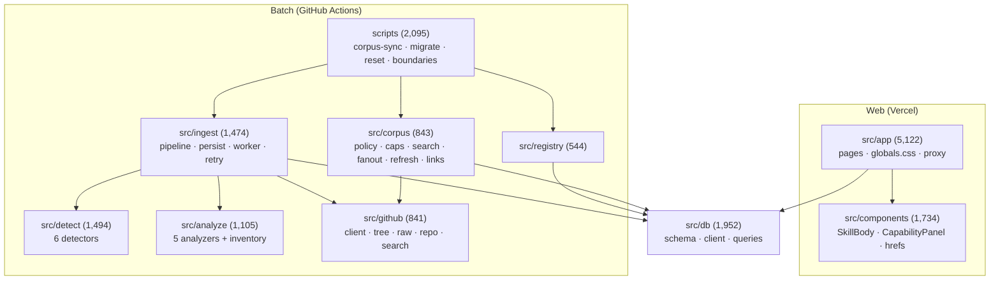
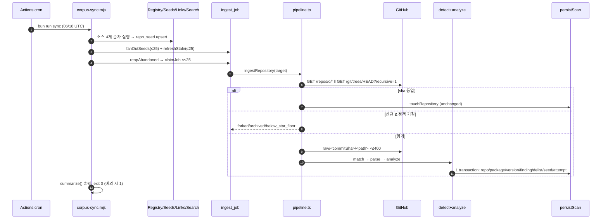
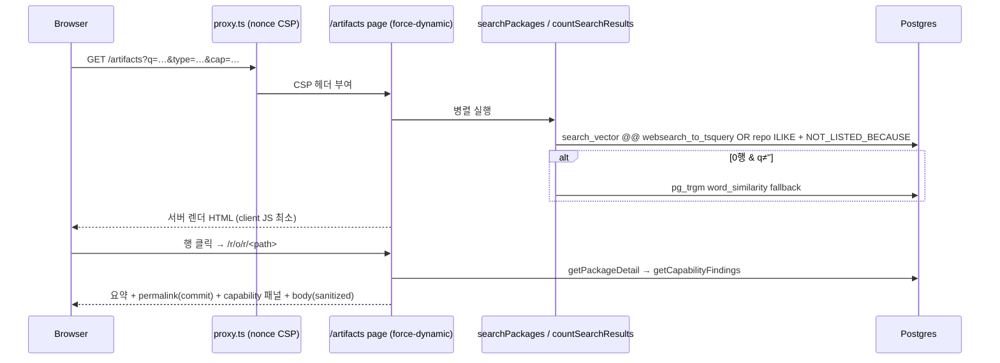

# AgentDock 아키텍처 분석

> 기준: `develop` @ `28639ec` (2026-10-20, 커밋 31개) · 읽기 전용 분석
> 관련 문서: [수집 파이프라인](agentdock-ingestion-analysis.md) · [검색·데이터](agentdock-search-and-data-analysis.md) · [품질·운영](agentdock-quality-and-operations.md) · [Implementation Map](agentdock-implementation-map.md) · [로드맵](agentdock-enhancement-roadmap.md)

## 목차

1. [한 줄 요약](#1-한-줄-요약)
2. [설계 원칙의 실제 구현 여부](#2-설계-원칙의-실제-구현-여부)
3. [기술 스택](#3-기술-스택)
4. [모듈 구조](#4-모듈-구조)
5. [E2E 흐름](#5-e2e-흐름)
6. [실행 단위와 배포 토폴로지](#6-실행-단위와-배포-토폴로지)
7. [강점](#7-강점)
8. [구조적 약점](#8-구조적-약점)
9. [분석 범위와 미확인 사항](#9-분석-범위와-미확인-사항)

---

## 1. 한 줄 요약

AgentDock 은 공개 GitHub 저장소의 AI agent artifact(Skill, Plugin, MCP server, Slash command, Hook)를 **읽기만 해서** 탐지하고, 원본 commit 에 고정된 출처와 정적 관찰 결과를 제공하는 검색 서비스다. 웹 계층(Next.js, Vercel)과 수집 계층(`bun run sync`, GitHub Actions)이 프로세스 수준에서 분리되어 있고, 둘은 PostgreSQL(Neon)의 `agentdock` 스키마 하나만 공유한다.

---

## 2. 설계 원칙의 실제 구현 여부

요청서에 정리된 설계 원칙을 소스에서 다시 검증했다.

| 원칙 | 강제 수단 | 검증 |
|---|---|---|
| 정적 관찰만, 실행하지 않음 | `scripts/check-boundaries.mjs` 가 `child_process`, `node:vm`, `writeFileSync`, `createWriteStream` 사용을 금지 | **[확인]** scanner 규칙 + 테스트 |
| 원본 파일·commit 추적 | raw 읽기를 commit sha 로 고정(`src/github/raw.ts`), permalink 는 `blob/<commitSha>/<path>`(`src/components/hrefs.ts`) | **[확인]** |
| 검색과 수집 분리 | `register()` 는 아무 수집도 시작하지 않음. `src/instrumentation.test.ts` 가 worker 이름조차 없음을 검사 | **[확인]** |
| 안전성 판정 없음 | UI 어휘를 scanner 가 검사(`safe/verified/trusted…`), sanctioned 예외 목록 | **[확인]** |
| 공개 제출 없음 | `src/app/no-public-ingest.test.ts` 가 server function 부재를 구조적으로 검사 | **[확인]** |
| 인기도는 일정에만 영향, 순위에 쓰지 않음 | `MIN_REPOSITORY_STARS` 단일 정의, `policy.test.ts` 가 import 허용 모듈 목록 검사 | **[확인]** |
| DB 공유 안전 | 모든 테이블 `pgSchema()`, migration 스키마 한정 검사, `CREATE EXTENSION` 금지, `assertSchemaIsolation` | **[확인]** |
| "모든 cap 은 버린 것을 말한다" | sync 요약의 `INCOMPLETE` 라인 | **[부분]** depth>10 제거, inventory 200, 행 2,000자 truncation, 링크 cap 등은 무보고(ingestion I7) |
| Null ≠ empty | `analyzed_at`, "not declared/not detected/unknown" 문구 | **[부분]** absence 필터·JSON artifact 패널이 위반(ingestion I3, 품질 U6) |

---

## 3. 기술 스택

| 계층 | 구성 | 버전 |
|---|---|---|
| Web | Next.js App Router(Turbopack), React | next 16.3.0, react 19.2.8 |
| 렌더링 | react-markdown + remark-gfm + rehype-sanitize | 10.1 / 4.0 / 6.0 |
| DB | PostgreSQL(Neon) + postgres.js + drizzle-orm | postgres 3.4.9, drizzle-orm 0.45.2 |
| 검증 | zod | 4.4.3 |
| 파싱 | js-yaml | 4.3.1 |
| 런타임/툴 | Bun 1.3.14, Biome 2.5.7, TypeScript 5.9.3, Vitest 4.1.10 | |
| CI/배포 | GitHub Actions(ci.yml, sync.yml), Vercel, Docker(standalone) | |

UI kit, CSS framework, 상태관리, 아이콘 패키지, 애니메이션 라이브러리, CLI 라이브러리는 없다(ponytail 원칙, CLAUDE.md). **[확인]**

---

## 4. 모듈 구조

비-테스트 코드 줄 수(2026-10-20 기준).

| 디렉터리 | 책임 | 핵심 진입점 |
|---|---|---|
| `src/app` | 페이지, 레이아웃, 에러, CSS | `page.tsx`, `artifacts/page.tsx`, `r/[owner]/[repo]/…` |
| `src/components` | 서버 컴포넌트 + client 3개 | `SkillBody`, `CapabilityPanel`, `PackageRows`, `hrefs.ts` |
| `src/db` | 스키마, 연결, 질의 | `schema.ts`, `client.ts`, `queries/{search,packages,jobs,seeds,capabilities,syncState}.ts` |
| `src/corpus` | discovery 정책과 소스 | `policy.ts`(별 floor), `caps.ts`(모든 상한), `search.ts`, `fanout.ts`, `refresh.ts` |
| `src/registry` | MCP Registry 동기화 | `sync.ts` |
| `src/github` | GitHub 호스트 allowlist 와 호출 | `client.ts`(`githubFetch`, rate-limit), `scan.ts`(caps), `tree.ts`, `raw.ts` |
| `src/ingest` | 저장소 1개 처리와 job 처리 | `pipeline.ts`, `persist.ts`, `worker.ts`, `retry.ts`, `errors.ts` |
| `src/detect` | artifact 인식과 파싱 | `index.ts`(`DETECTORS`), `run.ts` |
| `src/analyze` | capability 관찰 | `index.ts`(`ANALYZERS`), `run.ts`, `files.ts` |
| `scripts` | 운영 CLI | `corpus-sync.mjs`, `migrate.mjs`, `check-boundaries.mjs` |
| `fixtures` | frozen corpus 4개 + adversarial/xss | 테스트 전용 |
| `.planning` | GSD 계획 문서(Phase 0–8) | Phase 7–8 미착수 |

---

## 5. E2E 흐름

### 5.1 수집: GitHub → DB

### 5.2 조회: DB → UI

---

## 6. 실행 단위와 배포 토폴로지

| 실행 단위 | 트리거 | 환경 | DB 연결 | GitHub |
|---|---|---|---|---|
| Web | HTTP 요청 | Vercel 함수(iad1 확인) | `DATABASE_URL`(pooled 여부 미확인), `max:10` | 없음 |
| Sync | cron 06/18 UTC, 수동 dispatch | GitHub Actions ubuntu, timeout 60m, concurrency `sync` | direct URL | 토큰(시간당 5,000) |
| CI | push/PR | Actions | 없음(DB suite skip) | 없음 |
| Docker(대안) | host cron | `Dockerfile` standalone + compose | 자체 | 자체 |
| Migration | 수동 `bun run db:migrate` | 운영자 | direct | 없음 |

Vercel 과 Docker 를 동시에 운영하면 scheduler 가 두 개가 되므로 하나만 쓰라는 경고가 README, `sync.yml`, `VERCEL_DEPLOY.md` 에 있다. **[확인]**

---

## 7. 강점

1. **경계가 테스트와 scanner 로 강제된다.** 원칙이 문서로만 남지 않고, 위반하면 `bun run ci` 가 실패한다.
2. **실패 격리가 정교하다.** detector 와 analyzer 를 각각 try/catch 로 감싸고, 저장소 하나를 하나의 transaction 으로 처리하며, truncated scan 은 delist 하지 않는다.
3. **측정 기반 주석.** 거의 모든 상수에 측정값, 기각한 대안, 재검토 시점(`ponytail:` marker)이 기록되어 있어 다음 변경의 근거로 바로 쓸 수 있다.
4. **보안 기본기.** nonce CSP, sanitize, host allowlist, 수동 redirect 검증, scopeless token 권고를 갖췄다.
5. **작은 의존성 표면.** client component 3개, 런타임 의존성 10개.

## 8. 구조적 약점

| # | 약점 | 영향 | 상세 |
|---|---|---|---|
| W1 | **수집 처리량이 비인증 예산 기준 캡에 묶여 있다** | corpus 성장이 하루 최대 50 저장소 | ingestion §2, §4 |
| W2 | **Discovery 가 넓게 퍼지지 못한다**: topic 1개만 sweep, 전역 FIFO, terminal 결과 영구 제외 | 고밀도 소스 미도달 | ingestion §4 |
| W3 | **이미 저장된 데이터의 정합성 회복 경로가 약하다**: 비어 있거나 삭제된 저장소, 고착된 truncation, detector 예외로 인한 delist, revert 시 최신 version 오류 | 오래된/잘못된 정보 노출, refresh 정지 | ingestion §9 I1–I6 |
| W4 | **"null≠empty" 위반**: 필터와 패널 | 사용자가 관찰 범위를 오해 | ingestion I3, 품질 U6 |
| W5 | **관측성 부족**: 마지막 sync 기록 없음, green-but-empty 를 구분할 수 없음 | 데이터 정체를 늦게 발견 | 품질 §4 |
| W6 | **CI 가 DB 경로를 검증하지 않는다** | 핵심 회귀가 로컬에만 의존 | 품질 T1 |
| W7 | **검색 recall 의 기계적 한계**: prefix, path, 다단어, description/topics | 원하는 artifact 를 못 찾음 | 검색 §4 |
| W8 | **Artifact 형식 범위**: subagent, Codex/Cursor/Gemini 형식 미지원 | 생태계 일부 누락 | ingestion §7.2 |

---

## 9. 분석 범위와 미확인 사항

**수행한 것**: 비-테스트 소스 약 17.5k 줄 전체를 영역별로 읽었다(Agent 5개 병렬 분석). 결론에 큰 영향을 주는 주장(I1, I2, I3, I4, D2, D3, D9, S1, U1, U3, PollUntilDone)은 소스에서 직접 다시 확인했다. 정적 검증(check:boundaries, lint, typecheck, DB 제외 test)을 실행했고, 배포 사이트에 GET 13회를 보냈다.

**확인하지 못한 것 (UNVERIFIED)**:

| 항목 | 이유 |
|---|---|
| 운영 DB 의 실제 corpus 규모, queue 깊이, outcome 분포 | 운영 DB 에 접속하지 않음 |
| GitHub Actions sync 실행 로그(실제 drain 수, sweep 이 어디서 멈추는지) | Actions 를 조회·실행하지 않음 |
| 운영에 pg_trgm(0007)이 적용되었는지, 웹이 pooled 와 direct 중 무엇을 쓰는지 | DB/Vercel 설정 미조회 |
| Neon 리전과 Vercel 함수 리전(iad1) 사이의 거리 | 설정 미조회 |
| DB 기반 테스트 272개 | 운영 DB 와 격리할 수 없어 NOT RUN |
| `bun run build` | 추적 대상 파일을 다시 쓰므로 NOT RUN |
| 외부 스펙(Claude Code subagent/hooks 필드, Codex/Cursor/Gemini 형식, GitHub rate-limit 헤더 세부) | 일반 지식. 구현 전에 공식 문서로 재확인 필요 |
