# AgentDock 고도화 로드맵

> 기준: `develop` @ `28639ec` (2026-10-20) · 이 문서는 **제안**이다. 구현·commit·배포는 하지 않았다.
> 근거 ID(I·D·S·U·O·T·H)는 다음 문서의 항목을 가리킨다: [ingestion](agentdock-ingestion-analysis.md) · [search/data](agentdock-search-and-data-analysis.md) · [quality/ops](agentdock-quality-and-operations.md). 수정 진입점의 세부는 [Implementation Map](agentdock-implementation-map.md) 에 있다.

## 0. 과제 상태 (2026-10-20 갱신)

> 2026-10-21: R1 잔여, R26, R27과 sync 재시도 보강은 [Phase 3 기록](agentdock-phase3-operations-and-test-safety.md)에 있다(미커밋).
> 1차 R1 수정은 `77e7184`에 있다. 2차 작업은 작업 트리에만 있고 commit되지 않았다. 상세 내용은 [Phase 2 개선 기록](agentdock-phase2-improvements.md)에 있다.
> 상태 정의: DONE(구현과 회귀 테스트 완료) · PARTIALLY DONE · PENDING(미착수) · BLOCKED(결정 필요) · NOT VERIFIED(운영 환경에서 확인하지 않음)

| ID | 상태 | 비고 |
|---|---|---|
| R1 | DONE · NOT VERIFIED | 이미 저장된 저장소가 비면 delist하고 `scanned_at`을 갱신한다(`77e7184`). 404·`too_large`·409·재시도 소진은 Phase 3에서 `checked_at`·`check_failures` additive migration(0008)과 backoff 정렬로 처리했다(미커밋, [Phase 3](agentdock-phase3-operations-and-test-safety.md)). 운영 DB에는 0008이 아직 적용되지 않았다 |
| R2 | DONE | 타입별 inventory 범위: plugin은 `containerRoot`(루트 plugin이면 전체 tree), skill은 디렉터리, 나머지 타입은 파일 자체. 200개 cap에 도달하면 화면에 표시 |
| R3 | DONE | absence 필터는 최신 version의 `analyzed_at IS NOT NULL`이고 타입이 skill 또는 command일 때만 적용. analyzer 예외가 나면 `analyzed_at`을 null로 둔다 |
| R4 | DONE | queued는 60초, running은 2초 간격. 탭이 숨겨지면 멈추고, 돌아올 때 1회 즉시 갱신. "Check now" 링크 추가 |
| R5 | DONE | `match()` 예외가 난 타입은 delist에서 제외(`RepoScan.undetectedTypes`) |
| R6 | DONE | 같은 sha라도 저장 상태가 부분 읽기이고 tree에 결정적 절단 원인이 없으면 다시 읽는다. 512KB 초과 파일은 `ponytail:` 한계로 남김 |
| R7 | DONE · NOT VERIFIED | 토큰이 있으면 enqueue 100, refresh 100, drain 200, search 150요청/2.5초 간격. drain은 시작 35분 뒤 중단. 운영 처리 시간은 측정하지 않았다 |
| R8 | DONE | topic별 몫은 남은 예산 ÷ 남은 topic. topic 단위로 오류를 격리하고, shard stack을 `schema_meta`(`corpus_sweep:topic-search`)에 저장해 다음 실행에서 이어감 |
| R9 | DONE | `fanOutBySource`: seeds → search → links → backlog 순으로 몫을 나누고, 쓰지 않은 몫은 다음 소스로 넘긴다 |
| R10 | DONE | `x-ratelimit-resource`가 core이거나 없을 때만 core 슬롯을 갱신. secondary limit은 `retry-after` 기준으로 대기 |
| R11 | DONE | discovery 단계별로 try/catch. 실패한 단계가 있어도 나머지는 실행하고, 종료 코드는 1 |
| R12 | DONE | 소스별 discovery·enqueue, `/rate_limit` 기반 실사용 core 수, queue 잔량, `::notice/::warning/::error::`, `schema_meta.sync:last_success` 기록과 홈 화면 표시. Step Summary 파일은 디스크 쓰기 금지 원칙 때문에 쓰지 않음 |
| R13 | PENDING | |
| R14 | PENDING | |
| R15 | DONE | U1 frontmatter를 yaml 블록으로, U2 본문 heading을 두 단계 강등, U3 필터가 있을 때만 Clear filters 표시, U4 queued 문구 수정 |
| R16 | DONE | fuzzy fallback은 `offset === 0`일 때만 |
| R17 | PARTIALLY DONE | SC(짧은 질의는 repo ILIKE 제외), SD(prefix), SE(경로), SF(모든 단어 매칭이 0건이면 any 모드로 완화하고 화면에 표시) 완료. SG(trigram 임계값 측정) PENDING |
| R18 | PENDING | migration(보조 tsvector)이 필요해 이번 범위에서 제외 |
| R19–R23 | PENDING | |
| R24 | DONE | revert(A→B→A)가 되면 기존 version의 `ingested_at`을 now()로 옮긴다. migration 없음 |
| R25–R30 | PENDING | |
| R31 | PARTIALLY DONE | 이번 변경과 어긋나는 README(en/ko)와 DEPLOY 서술만 수정 |

## 목차

1. [기존 계획과의 관계](#1-기존-계획과의-관계)
2. [우선순위 기준](#2-우선순위-기준)
3. [전체 개선 과제 표](#3-전체-개선-과제-표)
4. [필수 결과 ① 빠르게 적용할 개선 TOP 5](#4-빠르게-적용할-개선-top-5)
5. [필수 결과 ② 사용자에게 유용한 신규 기능 TOP 5](#5-사용자에게-유용한-신규-기능-top-5)
6. [필수 결과 ③ 데이터 수집 품질 개선 TOP 5](#6-데이터-수집-품질-개선-top-5)
7. [필수 결과 ④ 장기 확장 과제](#7-장기-확장-과제)
8. [필수 결과 ⑤ 지금은 도입하지 않을 기술·기능](#8-지금은-도입하지-않을-기술기능)
9. [종합 우선순위 TOP 10](#9-종합-우선순위-top-10)
10. [가장 먼저 개발할 과제](#10-가장-먼저-개발할-과제)
11. [단계별 실행 순서](#11-단계별-실행-순서)

---

## 1. 기존 계획과의 관계

`.planning/ROADMAP.md` 와 `REQUIREMENTS.md` 에는 이미 다음이 정해져 있다. 이 로드맵은 그것을 대체하지 않고 **보강**한다.

| 기존 계획 | 상태 | 이 로드맵과의 관계 |
|---|---|---|
| Phase 7: Derived Compatibility(CMP-01~05) | 미착수 | 그대로 둔다. §7 장기 과제 |
| Phase 8: Freshness(조건부 요청, 배치 refresh, staleness 표시, archived/removed 처리, crawl 시 denylist) | 미착수 | R1, R7, R12, R13 이 이 Phase 의 **선행 수정**이거나 일부다. 새 기능으로 따로 세지 않는다 |
| v2: capability diff, public API, CLI, collections, watch, semantic search | 보류 | §7·§8 |
| Out of Scope: 위험 점수, 실행/sandbox, 설치 자동화, 평점, 다운로드 수, catalog 크기 경쟁, LLM 요약, 별도 manifest, mirror, 제출 큐, 인증, vector DB, K8s/Redis/ES | 결정됨 | §8 에서 재확인. 이 로드맵에서 뒤집지 않는다 |

> **주의:** Out of Scope 의 "Chasing catalog size" 는 이 로드맵의 수집 확대 제안과 충돌하지 않는다. 제안의 목표는 건수를 늘리는 것이 아니라, **이미 정한 정책(50★ floor, 고밀도 소스 우선)이 실제로 작동하게 만드는 것**이다. 지금은 캡 산정 오류와 sweep 결함 때문에 그 정책이 의도대로 돌지 않는다.

---

## 2. 우선순위 기준

| 등급 | 기준 |
|---|---|
| P0 | 서비스 정상 동작 또는 데이터 정합성에 영향을 주며, **코드로 검증된** 문제 |
| P1 | 사용자 가치가 높고, 비교적 명확하게 개선할 수 있음 |
| P2 | 중기적인 기능 확장 |
| P3 | 장기 연구·실험 |

---

## 3. 전체 개선 과제 표

| ID | 개선 과제 | 현재 상태(확인됨) | 문제 / 기회 | 개선 방안 | 수정 진입점 | 난이도 | 규모 | Migration | 위험 | 검증 | 우선 |
|---|---|---|---|---|---|---|---|---|---|---|---|
| R1 | 이미 저장된 저장소의 empty/unreadable 처리 | `no_artifacts`·`unreadable`·`too_large` 가 repository 행을 쓰지 않음 | refresh 최상단 고착 → corpus refresh 정지, 삭제된 artifact 영구 노출 (I1) | known 저장소 + 완전한 scan 의 `no_artifacts` → 빈 `persistScan`(delist + sha + scanned_at). unreadable/too_large 는 delist 하지 않고 refresh 순서만 뒤로 보냄(결정 필요) | `src/ingest/pipeline.ts:397-408, 454-460`, `persist.ts`, `corpus/refresh.ts:74` | M | S | A안 없음 / B안 additive | delist 의미 변경 → 결정 기록 | DB 회귀 테스트 2개(§10) | **P0** |
| R2 | 비-skill file inventory 범위 | `directoryOf(sourcePath)` 공통 사용 | plugin 은 `.claude-plugin/` 만, command/hook 은 형제 파일까지 → Files 표와 `no_scripts` 필터 오류 (I2) | 후보별 inventory root: plugin=`containerRoot`, shape-only=`sourcePath`, command/hook=파일 자체 | `src/analyze/files.ts:52-63`, `pipeline.ts:321` | L | S | 없음 | 기존 행은 다음 sha 변경 때 갱신 | 타입별 `files.test.ts` | **P0** |
| R3 | absence 필터의 null≠empty | `analyzed_at` 을 보지 않음, JSON artifact 는 body `''` | "No network observed" 가 미분석·미검사 행을 포함 (I3) | `analyzed_at IS NOT NULL` 요구 + body 없는 타입 제외(또는 라벨 정정) + hook/mcp command 를 `no_shell` 에 반영 | `src/db/queries/search.ts:145-179` | L | S | 없음 | 검색 의미 변경 → 결정 기록 | DB search 테스트 | **P0** |
| R4 | `PollUntilDone` 폴링 조건 | queued 동안 1.5초 간격 무기한 | 탭 1개가 월 invocation 한도 초과, Neon suspend 방해 | `running` 일 때만 폴링, hidden 이면 중지 | `PollUntilDone.tsx`, `jobs/[id]/page.tsx:31` | L | S | 없음 | 낮음 | 컴포넌트 테스트 + 수동 | **P0** |
| R5 | detector 예외 시 delist 방지 | `match()` 예외에도 truncated 아님 | 해당 타입 전체 delist (I4) | `detectorErrors` 가 있으면 그 타입은 delist 제외(또는 scan 을 incomplete 로) | `detect/run.ts`, `pipeline.ts:302-304, 416`, `persist.ts:244-256` | M | S | 없음 | 낮음 | pipeline 테스트(throw detector) | P1 |
| R6 | truncation 고착 해소 | sha 동일 시 short-circuit, `tree_truncated` 유지 | 일시적 실패가 상류 커밋 전까지 고착 (I5) | 저장된 `tree_truncated=true` 면 short-circuit 생략 | `persist.ts:350`(lastIngestedSha 확장), `scan.ts:79-88` | L | S | 없음 | raw 읽기 증가(quota 0) | 동일 sha 재수집 테스트 |  P1 |
| R7 | 수집 처리량을 예산 기반으로 | drain 고정 25, 캡이 비인증 기준 | 인증 예산의 약 1%만 사용 (D1) | core `remaining ≥ reserve` 이고 경과 시간 < 약 40분이면 계속 drain. enqueue/refresh 를 비례해서 늘림 | `scripts/corpus-sync.mjs:81, 87, 436-451`, `caps.ts` | M | S | 없음 | raw host throttle, Actions timeout | `shouldContinue` 순수 함수 테스트 + 운영 요약 비교 | P1 |
| R8 | topic sweep 이 모든 topic 에 도달 | sweep 전체 seed cap 2,000 이 첫 topic 에서 소진 | 4개 topic 미탐색 (D2) | topic 별 seed/request 예산 + `schema_meta` 에 topic cursor(`readSweepState/writeSweepState`) | `src/corpus/search.ts:96-188` | M | S | 없음(schema_meta 키) | 낮음 | 다중 topic 테스트 | P1 |
| R9 | scheduled fan-out 의 소스별 할당 | `--source=all` 이면 전역 FIFO | registry 가 queue 를 점유 (D3) | 소스별 quota: seed list → catalog/search → links → registry | `corpus-sync.mjs:200-211, 375, 385`, `fanout.ts` | M | S | 없음 | 낮음 | fanout 테스트 | P1 |
| R10 | 검색 rate-limit bucket 분리 | 단일 `lastRateLimit` | drain 오중단, 요약 수치 왜곡 (D9) | `x-ratelimit-resource` 가 core 이거나 없을 때만 기록 | `src/github/client.ts:145-156` | L | S | 없음 | 헤더 존재 여부 확인 필요 | client 단위 테스트 | P1 |
| R11 | 소스 단계 실패 격리 | 단일 try/catch | 소스 하나의 장애가 수집 전체를 정지 (I9) | 단계별 try/catch, registry `too_large` 처리 | `corpus-sync.mjs:364-373`, `registry/sync.ts:196-202` | L | S | 없음 | 낮음 | 오케스트레이터 테스트(신규) | P1 |
| R12 | sync 관측성 | exit 1 은 예외일 때만, 마지막 sync 기록 없음 | green-but-empty 를 구분할 수 없음, 정체 발견이 늦음 | `$GITHUB_STEP_SUMMARY`, 조건부 `::warning::`, `schema_meta.last_sync` + UI 표시 | `corpus-sync.mjs:143-191, 484`, `sync.yml`, `page.tsx` | L | S | 없음 | 낮음 | 수동 workflow 확인 | P1 |
| R13 | metadata 먼저, tree 는 필요할 때만 | 두 요청 병렬, etag 미사용 | 거절·unchanged 저장소마다 core 1회 낭비 | 게이트 거절이면 tree 생략, `pushed_at` 동일이면 tree 생략, 토큰이 있으면 `If-None-Match` | `src/github/scan.ts:51-62`(`fetchRepoScanInputs`), `src/github/repo.ts` | M | M | 없음 | "정확히 2요청" 테스트 의도적 변경 | 요청 수 테스트 | P1 |
| R14 | terminal seed 재제안 | anti-join 이 모든 job 제외 | 성장한 저장소 영구 누락 (D4) | `below_star_floor`/`no_artifacts`/실패 후 N일 지난 seed 를 낮은 우선순위로 재제안 | `src/db/queries/seeds.ts:103-113` | M | M | additive index(`ingest_job(target)`) | 예산 사용 증가 | seeds 테스트 | P2 |
| R15 | UX 결함 묶음 | U1–U4 | frontmatter 가 heading 으로 렌더, h1 중복, 무의미한 Clear filters, queued 문구 | §6.3 각 진입점 | `SkillBody.tsx`, `artifacts/page.tsx:270`, `JobPanel.tsx:55`, repo page `:116` | L | S | 없음 | 낮음 | 컴포넌트 테스트 | P1 |
| R16 | fuzzy fallback 페이지 조건 | offset 무관 | 마지막 페이지를 넘기면 잘못된 결과 (S1) | `offset === 0` 일 때만 | `search.ts:460` | L | S | 없음 | 매우 낮음 | search 테스트 | P1 |
| R17 | 검색 recall 패키지 | prefix 없음, 경로 질의 실패, ILIKE flooding, AND only | 원하는 artifact 를 찾기 어려움 (S5, S6) | SC(ILIKE 조건), SD(prefix), SE(질의 경로 정규화), SF(OR 완화), SG(trigram 측정) | `searchWhere`, `rankExpr`, `searchPackages` | M | M | 선택 | 검색 의미 변경 → 결정 기록 | 질의 표 기반 테스트 + 로그 | P1 |
| R18 | 저장소 description/topics 검색 | 미색인 | "pdf" 같은 주제어 recall 낮음 | persist 가 관리하는 보조 tsvector | `schema.ts`, `persist.ts` | M | M | additive + GIN | ingest 경로 변경 | 검색 테스트 | P2 |
| R19 | Subagent artifact 지원 | 미탐지(fixture 에 230+개) | 생태계 주요 형식 누락 (D8) | `agents/*.md`, `.claude/agents/**` detector(command.ts 와 유사), `tools` → declared | `src/detect/agent.ts`(신규) 외 §7.3 체크리스트 | M | M | INSERT 전용 migration | `maxFiles=400` 재산정 필요 | detector/fixture 테스트 | P2 |
| R20 | 관련 artifact / plugin 구성요소 탐색 | `parent_path` 는 저장되지만 UI 미활용 | plugin 안의 skill/command/hook 을 함께 보기 어려움 | 상세 페이지에 "같은 plugin 의 구성요소", "같은 저장소의 다른 artifact" | `[...path]/page.tsx`, `packages.ts` | L | S | 없음 | 낮음 | 렌더 테스트 | P2 |
| R21 | 타입별 설치/사용 안내 텍스트 | skill 경로 안내만 | plugin/MCP/command/hook 사용법을 알기 어려움 | 관찰한 사실(manifest 경로, marketplace 이름, `.mcp.json` 서버 이름)만으로 명령 예시 표시. 자동 설치는 하지 않음 | `[...path]/page.tsx:275-293` | L | S | 없음 | 외부 CLI 문법 변화 **[외부]** | 렌더 테스트 | P2 |
| R22 | Version 이력 표시 | DB 에 다중 version 있음, UI 없음 | 변경 시점·commit 을 추적할 수 없음 | 상세 페이지에 version 목록(commit, ingested_at) | `packages.ts`, 상세 페이지 | L | S | 없음 | revert 문제(R24)와 함께 고려 | 렌더 테스트 | P2 |
| R23 | denylist 를 노출에 반영 | ingest 시점에만 검사 | denylist 에 올린 저장소가 계속 노출 (S3) | `NOT_LISTED_BECAUSE` 에 branch 추가 | `packages.ts:128-150` | L | S | 없음 | 노출 의미 변경 → 결정 | packages 테스트 | P2 (Phase 8 연계) |
| R24 | revert 시 최신 version | `ingested_at DESC` | 잘못된 body/permalink (I10) | `last_seen_at`(또는 sha) 컬럼으로 최신 판정 | `persist.ts:161-177`, `packages.ts`, `search.ts` | M | M | additive | 정렬 기준 변경 | A→B→A 테스트 | P2 |
| R25 | 성능: 인덱스·캐시 | content_hash 인덱스 없음, 전 페이지 force-dynamic | 규모가 커지면 목록·count 지연, Neon compute 소모 | SH 인덱스, SI 캐싱 | `schema.ts`, `jobs.ts:239`, pages | M | S–M | additive | Next 16 캐시 API 확인 | EXPLAIN/timing | P2 |
| R26 (Phase 3 DONE) | CI DB 테스트 | DB suite 0개 실행 | 핵심 회귀가 CI 밖에 있음 (T1) | Postgres service + bootstrap SQL + pg_trgm, 순수 URL 테스트 분리 | `ci.yml`, `packages.test.ts` | M | M | 없음 | CI 시간 증가(약 50초) | CI 실행 | P1 |
| R27 (Phase 3 DONE) | 로컬 테스트 DB 격리 | `.env` 자동 로드 | 로컬 테스트가 운영 Neon 에 쓸 수 있음 (T2) | 테스트 전용 env 파일 또는 `TEST_DATABASE_URL` 만 읽기 | `vitest.config.ts:13` | L | S | 없음 | 낮음 | 수동 | P1 |
| R28 | analyzer 정확도 | substring 동사, shell/install 미탐, hidden codepoint 미탐, 2,000자 무보고 | 관찰 품질 | 패턴 보강 + precision 행 갱신 + cap finding | `src/analyze/*` | M | M | 없음 | precision 절차 준수 | precision/redos 테스트 | P2 |
| R29 | 비밀값 저장 최소화 | MCP args/url, server.json, catalog hint 원문 저장 | 저자가 실수로 넣은 토큰 보존 (I11) | env 키만 저장하는 규칙을 args/url/hint 에도 적용 | `mcp.ts:59-60, 143`, `catalog.ts:44, 60` | L | S | 없음 | 표시 정보 감소 | detector 테스트 | P1 |
| R30 | SEO 기본 | robots/sitemap/icon/OG 없음 | 검색 유입·공유 품질 | Next 파일 규칙 사용, 검색 결과와 jobs 는 noindex | `src/app/robots.ts` 등 | L | S | 없음 | 낮음 | 사이트 확인 | P2 |
| R31 | 문서 정정 | 불일치 다수 | 오해 유발 | 각 문서의 불일치 표 | README, DEPLOY, VERCEL_DEPLOY, 주석 | L | S | 없음 | 없음 | 리뷰 | P2 |

---

## 4. 빠르게 적용할 개선 TOP 5

변경이 1~2개 파일이고, migration 이 없으며, 회귀 위험이 낮은 순서다.

| 순위 | 과제 | 이유 | 진입점 |
|---|---|---|---|
| 1 | **R4** PollUntilDone 조건 | 한 줄 수준의 변경으로 무료 플랜 비용 위험 제거 | `PollUntilDone.tsx`, `jobs/[id]/page.tsx:31` |
| 2 | **R16** fuzzy `offset === 0` | 조건 하나 | `search.ts:460` |
| 3 | **R10** rate-limit core bucket 만 기록 | 조건 하나로 drain 오중단 제거 | `client.ts:145-156` |
| 4 | **R15** UX 결함(U1–U4) | 사용자에게 보이는 오류, 컴포넌트 국소 변경 | `SkillBody.tsx`, `artifacts/page.tsx:270`, `JobPanel.tsx:55` |
| 5 | **R12** sync Step Summary + `last_sync` | 운영자가 정체를 즉시 알아볼 수 있음 | `corpus-sync.mjs`, `sync.yml` |

## 5. 사용자에게 유용한 신규 기능 TOP 5

모두 **현재 존재하지 않음을 확인**했다.

| 순위 | 기능 | 사용자 가치 | 비고 |
|---|---|---|---|
| 1 | **R17 + R18 검색 recall 개선** (prefix, 경로, 다단어 완화, description/topics) | 핵심 사용 흐름인 "찾기"의 성공률 | 엄밀히는 신규 기능이 아니라 품질 개선이지만, 체감 가치가 가장 크다 |
| 2 | **R19 Subagent artifact** | Claude Code 생태계의 주요 형식. fixture 저장소에만 230개 이상 | `maxFiles` 재산정과 함께 |
| 3 | **R20 Plugin 구성요소·관련 artifact 탐색** | plugin 하나의 skill/command/hook/MCP 를 한 화면에서 파악 | `parent_path` 이미 저장됨 |
| 4 | **R21 타입별 사용 안내** | "찾았는데 어떻게 쓰지?" 해소. 관찰한 사실만 사용 | 설치 자동화(Out of Scope)와 구분 |
| 5 | **R22 Version 이력 + 사이트 신선도 표시(R12)** | 언제 바뀌었고 언제 확인했는지 보여 줌(provenance 강화) | Phase 8 staleness 표시와 합쳐서 설계 |

## 6. 데이터 수집 품질 개선 TOP 5

| 순위 | 과제 | 기대 효과 |
|---|---|---|
| 1 | **R1** empty/unreadable 처리 | refresh 정지 방지, 사라진 artifact 정리. **다른 처리량 개선의 전제** |
| 2 | **R7** 예산 기반 drain | 하루 처리량 50에서 인증 예산 범위 안의 수백 단위로(실측 필요) |
| 3 | **R8 + R9** topic 전체 sweep + 소스별 fan-out 할당 | 고밀도 소스(skills/plugin topic, operator seed) 도달 |
| 4 | **R13** metadata 먼저 / 조건부 요청 | 거절·unchanged 저장소 비용 절반 이하 |
| 5 | **R5 + R6** delist 정확성(detector 예외, truncation 고착) | 잘못된 대량 delist·부분 목록 고착 방지 |

후속: R14(terminal seed 재제안), R19(subagent), link cap 완화, topic 추가(실측 후).

## 7. 장기 확장 과제

| 과제 | 내용 | 선행 조건 |
|---|---|---|
| Phase 7 Derived Compatibility | 기존 계획(CMP-01~05) | 검색·데이터 정합성 안정화 |
| Phase 8 Freshness 완성 | 배치 metadata refresh(GraphQL 일괄 oid 확인), staleness 표시 저하 | R1, R7, R12, R13 |
| Codex/Cursor/Gemini/OpenCode 형식 | `.codex-plugin`, `.cursor-plugin`, `gemini-extension.json` 등 detector | R19 로 확장 절차 검증, 공식 스펙 확인 **[외부]** |
| Capability diff (V2-FRS-02) | version 간 finding 변화 표시 | R22, R24 |
| 읽기 전용 public API / CLI (V2) | 검색 결과 JSON | 캐시, 남용 대비(rate limit) |
| 한국어 검색 | `simple` 설정 tsvector 병행, ctype 확인 | 질의 로그로 수요 확인 |
| Detector 스펙 변화 대응 | 형식별 버전 필드·알 수 없는 키 통계를 sync 요약에 집계 | R12 |

## 8. 지금은 도입하지 않을 기술·기능

| 항목 | 이유 |
|---|---|
| Vector DB / Embedding / 의미 검색 | recall 실패 원인이 기계적이고 PostgreSQL 기능으로 해결 가능. pgvector 는 superuser 설치가 필요하고, 외부 provider 비용과 설명 불가능한 ranking 이 생김. V2-SEM-01 조건(질의 로그 증거) 미충족 |
| 안전 점수·검증 배지 | AGENTS.md "No page renders a verdict". regex 신호로 판정할 수 없음 |
| LLM 요약·자동 설명 | 공격자가 통제하는 텍스트 → prompt injection·허위 생성 위험(Out of Scope) |
| 별(stars) 기반 정렬·랭킹 | AGENTS.md invariant, `policy.test.ts` 가 강제 |
| Vercel Cron / 수집 route | "웹 서버는 수집하지 않는다" invariant, Hobby 300초 제한 |
| Redis·별도 큐·Elasticsearch | 규모상 필요 없음. `FOR UPDATE SKIP LOCKED` 와 GIN 으로 충분 |
| 계정·즐겨찾기(서버 저장) | 인증이 필요(Out of Scope). 필요하면 URL 공유나 브라우저 localStorage 로 대체 가능 |
| 검색 자동완성(클라이언트 JS) | 4번째 client component 와 추가 요청 비용. 우선 R17 로 recall 을 높이고, 필요하면 네이티브 `<datalist>` 를 검토 |
| 실행·sandbox 동적 분석 | 핵심 원칙 위반 |
| Star floor 하향 | 수집이 적은 원인이 floor 가 아님(§6). 처리량·sweep 결함을 먼저 고친다 |

---

## 9. 종합 우선순위 TOP 10

| 순위 | ID | 과제 | 우선 | 난이도 | 기대 효과 | 수정 진입점 |
|---|---|---|---|---|---|---|
| 1 | R1 | empty/unreadable 저장소 처리 | P0 | M | refresh 정지·잘못된 노출 제거 | `pipeline.ts:397-408` |
| 2 | R4 | PollUntilDone 조건 | P0 | L | 무료 플랜 자원 보호 | `PollUntilDone.tsx` |
| 3 | R3 | absence 필터 null≠empty | P0 | L | 필터 의미 정확성(invariant) | `search.ts:145-179` |
| 4 | R2 | 비-skill inventory 범위 | P0 | L | Files 표·`no_scripts` 정확성 | `files.ts:52-63` |
| 5 | R7 | 예산 기반 drain | P1 | M | 수집 처리량 수배 | `corpus-sync.mjs:436-451` |
| 6 | R8+R9 | topic sweep·fan-out 할당 | P1 | M | 고밀도 소스 도달 | `corpus/search.ts`, `corpus-sync.mjs:375` |
| 7 | R10+R11+R12 | rate bucket·단계 격리·관측성 | P1 | L | 수집 안정성·가시성 | `client.ts`, `corpus-sync.mjs` |
| 8 | R5+R6 | delist 정확성 | P1 | M | 데이터 손실·고착 방지 | `pipeline.ts`, `persist.ts` |
| 9 | R17 | 검색 recall 패키지 | P1 | M | 찾기 성공률 | `search.ts` |
| 10 | R15+R16 | UX·fuzzy 결함 | P1 | L | 눈에 보이는 오류 제거 | `SkillBody.tsx`, `search.ts:460` |

다음 순위: R26/R27(테스트 격리·CI DB), R13, R19, R29.

---

## 10. 가장 먼저 개발할 과제

### R1 — 이미 저장된 저장소가 비거나 읽을 수 없게 되었을 때의 처리

**선정 이유**

1. **검증된 데이터 정합성 결함이다.** artifact 를 모두 지운 저장소의 package 가 계속 검색되고, 삭제/비공개 저장소도 마찬가지다.
2. **refresh 전체를 멈출 수 있다.** 이런 저장소는 `scanned_at` 이 갱신되지 않아 `refreshStaleRepositories` 정렬(`scanned_at asc nulls first`)의 맨 앞에 영구히 남는다. 25개가 쌓이면 나머지 corpus 는 다시 확인되지 않는다.
3. **처리량 개선(R7)의 전제다.** 처리량부터 늘리면 이런 행이 더 빨리 쌓이고, 쌓일 때마다 매 run core 2회 이상을 낭비한다.
4. 변경이 작고(A안은 migration 없음), 기존 transaction·delist 구조를 그대로 재사용한다.

**범위 결정이 필요한 지점 (구현 전 사용자 결정)**

| 경우 | A안 (권장) | 대안 |
|---|---|---|
| known 저장소 + 완전한 scan + `no_artifacts` | 빈 `packages` 로 `persistScan` 호출 → 기존 delist 경로 재사용, `last_ingested_sha`·`scanned_at` 갱신 | — |
| known 저장소 + `unreadable`(404: 삭제 또는 비공개) | **delist 하지 않는다.** refresh 순서만 뒤로 보낸다 | ① N회 연속 404 이후 delist(Phase 8 "removed handling") ② 즉시 delist |
| `too_large`, terminal `unavailable` | refresh 순서만 뒤로 | — |
| "순서만 뒤로" 구현 | `scanned_at` 은 "AgentDock 이 읽은 시점"이라는 의미(UI "Last read")를 지키고, 별도의 `checked_at` 컬럼을 추가(additive migration)해 refresh 정렬에 사용 | migration 없이 `scanned_at` 을 갱신(UI 의미가 "확인 시도"로 바뀜 — 비권장) |

**영향 범위**

- 코드: `src/ingest/pipeline.ts`(분기), `src/ingest/persist.ts`(빈 scan 허용 확인), `src/corpus/refresh.ts`(정렬 키), 선택적으로 `src/db/schema.ts` + `drizzle/0008_*.sql`.
- 데이터: 해당 저장소의 package 에 `delisted_at` 설정(soft delete, 다시 나타나면 자동 복귀).
- UI: 목록에서 빠짐. 저장소 페이지는 "AgentDock currently lists nothing…" 분기를 탄다(기존 분기).
- 문서: README refresh rotation 설명.

**개발 절차**

```text
0. 사전 준비 → verify: 운영과 분리된 로컬 PostgreSQL(agentdock_test)에서 DB suite 가 돌아감 (R27)
1. 회귀 테스트 작성(먼저 실패 확인)
   a. pipeline.test.ts: 기존 2개 artifact 를 가진 저장소 → 새 tree 에 artifact 없음
      → 기대: 두 package delisted_at NOT NULL, repository.last_ingested_sha = 새 sha, scanned_at 갱신
   b. refresh.test.ts: unreadable 로 끝난 known 저장소가 다음 refresh 에서 맨 앞에 오지 않음
   → verify: 현재 코드에서 a, b 모두 FAIL
2. pipeline.ts:397 분기: known !== null && !inputs.tree.truncated && !artifactsTruncated 이면 persistScan(빈 scan)
   → verify: a PASS, 기존 no_artifacts(신규 저장소) 테스트 PASS
3. (B 결정 후) checked_at 추가 + worker 종료 경로에서 갱신 + refresh 정렬 변경
   → verify: b PASS
4. 문서 정정(README refresh 설명)
5. 전체 검증: check:boundaries → lint → typecheck → test(DB 포함, 격리 DB) → build
```

**Baseline (변경 전에 측정)**

| 지표 | 측정 방법 |
|---|---|
| refresh 정체 행 수 | `SELECT count(*) FROM agentdock.repository r WHERE scanned_at < now()-interval '7 days' AND NOT is_fork AND NOT is_archived` (읽기 전용, 운영자 실행) |
| 최근 outcome 분포 | `SELECT outcome, count(*) FROM agentdock.ingest_attempt WHERE finished_at > now()-interval '7 days' GROUP BY 1` |
| 반복 실패 known 저장소 | `ingest_attempt` 에서 같은 target 의 `no_artifacts`/`unreadable` 반복 수 |
| sync 요약 | Actions 최근 run 의 `refresh … still stale` INCOMPLETE 라인 |

**변경 후 검증**

- 위 쿼리에서 정체 행 수가 감소 추세인지 확인(2~3 run).
- sync 요약에서 refresh 대상이 매번 같은 저장소로 채워지지 않는지 확인.
- 배포 영향: 수집 경로만 변경되고 웹 변경은 없다. 다음 예약 sync 부터 적용된다.
- Rollback: 코드 revert 만으로 동작이 복원된다. 이미 delist 된 package 는 저장소에 artifact 가 다시 생기면 자동 복귀한다. `checked_at` 컬럼은 남아도 무해하다(additive).

---

## 11. 단계별 실행 순서

```mermaid
gantt
  dateFormat  X
  axisFormat  %s
  section 0 준비
  R27 로컬 테스트 DB 격리           :a0, 0, 1
  R26 CI Postgres service          :a1, 1, 3
  section 1 정합성 (P0)
  R1 empty/unreadable              :b1, 1, 3
  R2 inventory 범위                 :b2, 3, 4
  R3 absence 필터                   :b3, 4, 5
  R4 PollUntilDone                 :b4, 1, 2
  section 2 수집 엔진 (P1)
  R10 R11 R12 관측성·격리           :c1, 5, 7
  R5 R6 delist 정확성               :c2, 7, 9
  R7 예산 기반 drain                :c3, 9, 11
  R8 R9 sweep·fan-out              :c4, 11, 13
  R13 요청 절감                     :c5, 13, 15
  section 3 사용자 경험 (P1-P2)
  R15 R16 UX·fuzzy                 :d1, 5, 6
  R17 검색 recall                   :d2, 15, 18
  R20 R21 R22 상세 화면              :d3, 18, 21
  section 4 확장 (P2)
  R19 subagent                     :e1, 21, 24
  Phase 8 Freshness                :e2, 24, 28
```



(가로축은 상대적인 순서를 나타낸다. 일정 추정이 아니다.)
