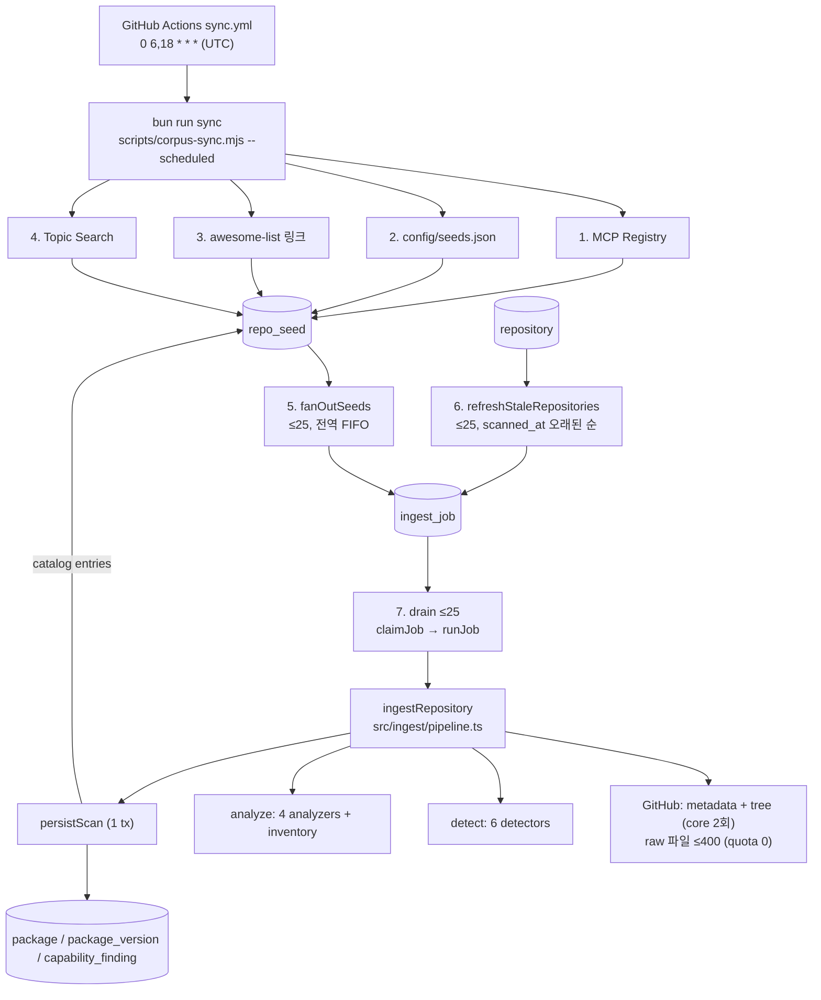
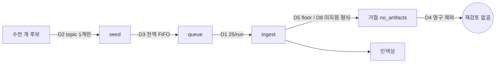

# AgentDock 수집 파이프라인 심층 분석 (Discovery · Sync · Detection · Capability)

> 기준: `develop` @ `28639ec` (2026-10-20) · 읽기 전용 분석 · sync/GitHub API/DB 미실행
> 표기: **[확인]** 소스 직접 확인 · **[추정]** 코드에서 추론(운영 데이터로 미검증) · **[외부]** 외부 스펙에 대한 일반 지식(미검증)

> **2026-10-20 갱신**: I2(R2), I3(R3), I4(R5), I5(R6), I9(R11), I10(R24), D1(R7), D2(R8), D3(R9), D9(R10)은 작업 트리에서 수정됐다(미커밋). 바뀐 동작은 [Phase 2 개선 기록](agentdock-phase2-improvements.md)에 있다. 아래 본문은 `28639ec` 기준 분석이다.

## 목차

1. [전체 흐름](#1-전체-흐름)
2. [Sync 단계와 예산](#2-sync-단계와-예산)
3. [Discovery 소스](#3-discovery-소스)
4. [수집량이 적은 구조적 원인](#4-수집량이-적은-구조적-원인)
5. [Job 수명주기와 Ingest 파이프라인](#5-job-수명주기와-ingest-파이프라인)
6. [Refresh 와 GitHub API 비용](#6-refresh-와-github-api-비용)
7. [Artifact Detection](#7-artifact-detection)
8. [Capability Observation](#8-capability-observation)
9. [결함 목록](#9-결함-목록)
10. [테스트 커버리지](#10-테스트-커버리지)
11. [문서-코드 불일치](#11-문서-코드-불일치)

---

## 1. 전체 흐름

웹 서버는 수집을 시작하지 않는다(`src/instrumentation.ts` 의 `register()` 는 schema 격리 확인 + `last_boot` 기록만). **[확인]**

---

## 2. Sync 단계와 예산

진입점: `package.json` `"sync": "bun scripts/corpus-sync.mjs --scheduled"` → `source=all`, `drain=25`, `refresh=25`, `staleHours=12` (`corpus-sync.mjs:72-94`). **[확인]**

| # | 단계 | 코드 | 상한 | cap 도달 시 출력 |
|---|---|---|---|---|
| 1 | Registry | `syncRegistry` `src/registry/sync.ts:162` | 40 pages × 100, page 2MB, seed 2,000 | `INCOMPLETE … watermark NOT advanced` (:234-248), parse_failure 는 exit 1 |
| 2 | Seed list | `runSeedList` :252 | 15 seeds | `INCOMPLETE — the seed file names N…` |
| 3 | Link lists | `expandLinkLists` `links.ts:125` | 4MB/list, **1,000 links/list** | `INCOMPLETE — N link(s) were past maxLinksPerList` |
| 4 | Topic search | `sweepTopics` `src/corpus/search.ts:67` | 60 req, 6.5s 간격, **sweep 전체 2,000 seed** | shard/stop/below-floor `INCOMPLETE` 라인 |
| 5 | Fan-out | `fanOutSeeds` `fanout.ts:38` | 25, `MAX_QUEUED=500` | 한 줄 요약(flood 시 별도 INCOMPLETE 없음) |
| 6 | Refresh | `refresh.ts:54` | 25 | `INCOMPLETE — N stored repositories are past the 12h cutoff` |
| 7 | Drain | :418-461 | 25, `remaining<2` 시 중단 | `INCOMPLETE — stopped … fewer than two core requests` |

### 처리량 산술 **[확인 + 추정]**

- 1 run 당 enqueue 최대 50(fan-out 25 + refresh 25), drain 25.
- 하루 2 run → **최대 50 저장소/일** (신규 + refresh + 정책 거절 포함), core 요청 ≈100/일.
- 운영 sync 는 `GITHUB_TOKEN`(시간당 5,000) 을 쓰지만(`sync.yml:67`), 캡은 비인증 60/h 기준으로 산정됨(`caps.ts:13-22, 93-97`). **인증 예산의 약 1% 사용.**
- enqueue(≤50) > drain(25) 이라 queue 가 run 당 최대 25 씩 증가 → 약 20 run(10일) 후 `MAX_QUEUED=500` 포화 → 이후 매 run flood, job 대기 ≈10일. **[추정, 운영 미확인]**

---

## 3. Discovery 소스

| 소스 | 구현 | 특징 / 한계 |
|---|---|---|
| MCP Registry | `src/registry/{client,sync}.ts` | `updated_since` watermark, 페이지 cursor 저장(`schema_meta`). 약 41% 행은 GitHub URL 없음(`registry/types.ts:13`). `www.github.com` 은 불인정(`client.ts:122`). star 정보 없음 → 거절 판정에 core 2회 소요 |
| Seed list | `config/seeds.json`, `seedList.ts` | 15개, artifact 밀도 순 |
| Link lists | `links.ts` | `hesreallyhim/awesome-claude-code`, `punkpeye/awesome-mcp-servers`. punkpeye 는 1,000 cap 에서 2,390 occurrence 누락(2026-08-11 측정, `caps.ts:46-52`) — **매 run 같은 꼬리가 누락** |
| Topic search | `src/corpus/search.ts`, `src/github/search.ts` | topics: `claude-code`, `mcp-server`, `agent-skills`, `claude-skills`, `claude-plugin`. 별 사다리 `[800,∞) [400,799] [200,399] [100,199] [50,99]` + 1,000 초과 shard 이분할. **resume cursor 없음** |
| Catalog seeds | `detect/catalog.ts` | `marketplace.json` 의 github/url/git-subdir source → seed |

정책 게이트: `discoveryRejection`(`src/corpus/policy.ts:56-65`) — fork → archived → stars<50. **처음 보는 저장소(`known === null`)에만** 적용(`pipeline.ts:213-215`), 이미 저장된 저장소는 별이 떨어져도 유지. **[확인]**

---

## 4. 수집량이 적은 구조적 원인

> "star 기준을 낮추자"는 원인이 아니다. 아래 순서가 영향이 큰 순이다(추정 포함).

| # | 원인 | 근거 | 영향 |
|---|---|---|---|
| D1 | **고정 drain 25/run** — 토큰이 있어도 예산 체크는 묶이지 않고 하드코딩 25 가 천장 | `corpus-sync.mjs:81`, `caps.ts:22` | 처리량 상한 50/일 |
| D2 | **Topic sweep 이 첫 topic 에서 끝난다** — `found.size >= 2000`(sweep 전체 기준)에서 `seed_cap` 으로 멈추고 외부 루프가 나머지 topic 을 모두 skip. `topic:claude-code` 는 100+ star 만 2,128 개(코드 주석 측정값) | `search.ts:97, 133-136`, `github/search.ts:56-59` | `agent-skills`, `claude-skills`, `claude-plugin`, `mcp-server` 미탐색 **[추정 — 운영 로그로 확인 필요]** |
| D3 | **Scheduled 모드는 전역 FIFO** — `--source=all` 이 fan-out scope 를 null 로 둠. 매 run registry seed(≤2,000)가 먼저 쓰여 operator seed/topic seed 가 그 뒤에 줄을 섬 | `corpus-sync.mjs:200-211, 375`, `seeds.ts:80-88` | 고밀도 소스 도달 지연(수십 일) |
| D4 | **Terminal 결과는 영구** — fan-out anti-join 이 모든 job 행(terminal 포함)을 제외. `below_star_floor`, `no_artifacts`, 3회 `unavailable` 실패는 다시 제안되지 않음 | `seeds.ts:66-68, 103-113` | 나중에 skill 을 추가하거나 50★ 을 넘긴 저장소는 영구 누락 |
| D5 | **큐레이션 소스에도 star floor 적용** — marketplace 가 직접 지목한 plugin 도 50★ 미만이면 거절 | `pipeline.ts:213-215` | 강한 신호 소스의 손실(변경 시 AGENTS.md invariant 결정 필요) |
| D6 | **Topic 없는 저장소는 발견 불가** + topic 목록 협소(`claude-code-plugin`, `mcp`, `model-context-protocol` 등 없음). code search(`filename:SKILL.md`) 미사용 | `github/search.ts:47-53` | 탐색 표면 제한 |
| D7 | **Link cap 이 매번 같은 꼬리를 버림** — 추출은 core 비용 0 이고 지출은 fan-out/MAX_QUEUED 가 이미 제한 | `links.ts:82`, `caps.ts:57` | 비용 없는 손실 |
| D8 | **지원하지 않는 artifact 형식** — subagent(`agents/*.md`) 만 있는 저장소는 `no_artifacts` → D4 로 영구 제외 | `detect/index.ts:13` | §7.7 참조 |
| D9 | **검색 rate-limit 헤더가 drain 을 막을 수 있음** — 검색 응답이 단일 `lastRateLimit` slot 을 덮어쓰고, drain 게이트가 이를 읽음. sweep 이 `rate_limited` 로 끝나면 drain 0 | `client.ts:145-156`, `corpus-sync.mjs:442`, `retry.ts:95-98` | 토큰 사용 시 search bucket 30/min 이라 발생 빈도 낮음 **[추정]** |

---

## 5. Job 수명주기와 Ingest 파이프라인

### 5.1 Job **[확인]**

| 단계 | 구현 |
|---|---|
| 생성 | `enqueueJob`(`src/db/queries/jobs.ts:46-76`): 소문자화 → denylist → `count(queued) ≥ 500` 이면 flooded → `ON CONFLICT (target) WHERE status IN (queued,running)` no-op 으로 기존 id 반환 |
| Claim | `claimJob`(:82-120): `UPDATE … WHERE id = (SELECT … FOR UPDATE SKIP LOCKED LIMIT 1)` |
| 회수 | `reapAbandoned`(:127-141): `started_at` 15분 초과 running → queued. sync 시작 시에만 실행 |
| 재시도 | `src/ingest/retry.ts:38-54` disposition 표 |

| Outcome | Disposition |
|---|---|
| ok / unchanged / denylisted / no_artifacts / forked / archived / below_star_floor | succeeded |
| invalid_input / unreadable / too_large | failed (terminal) |
| unavailable / storage_failed | 60s → 120s backoff, 3회 후 failed |
| rate_limited | reset 시각(≤1h)으로 재예약, attempt 환불 |

### 5.2 저장소 1개 처리 (`ingestRepository`, `pipeline.ts:98-461`) **[확인]**

1. `normalizeRepo` → denylist(**try 블록 밖** — DB 오류 시 sync 전체 중단).
2. `lastIngestedSha` 조회.
3. `fetchRepoScanInputs`: metadata + `git/trees/HEAD?recursive=1` **병렬**(core 2회). tree 는 commit sha 반환.
4. tree bounds: 100,000 entry, **depth > 10 은 조용히 제거**(truncated 표시 안 함, `scan.ts:64-69`).
5. sha 동일 → `unchanged` (파일 읽기 없음).
6. `known === null` 이면 정책 게이트.
7. detector 별 candidate → round-robin 으로 최대 400 파일(`scan.ts:24`), raw host 를 commit sha 로 고정해 읽기(512KB, 동시 2, 120s).
8. 실패한 raw 읽기는 skipped → `artifactsTruncated = true`.
9. parse → analyze(메모리) → `persistScan`(1 transaction).

### 5.3 Version 처리 **[확인]**

- 새 version 은 content hash 가 바뀔 때만 생성. 이전 version 은 영구 보존.
- "최신" = `ingested_at DESC` → revert(A→B→A) 시 B 가 최신으로 남음.
- 사라진 artifact 는 **완전한 scan 일 때만** delist.

---

## 6. Refresh 와 GitHub API 비용

- `refreshStaleRepositories`: non-fork, non-archived, `scanned_at` null 또는 12h 초과, `scanned_at asc nulls first` 25개. **[확인]**
- 변경 없어도 tree 를 받아야 sha 를 알기 때문에 **항상 core 2회**. `repository.etag` 는 저장되지만 `If-None-Match` 로 전송되지 않는다(`grep If-None-Match` 0건). **[확인]**
- sha 가 바뀌면 blob sha 가 같은 파일까지 모두 재요청(per-blob skip 없음).
- detector/analyzer 변경은 refresh 로 재적용되지 않는다(sha 동일 시 detection 생략). `reanalyze` 는 `analyzed_at IS NULL` 만 처리. **[확인]**

### 비용 절감 기회

| 방법 | 절감 | 조건 |
|---|---|---|
| metadata 먼저 → 게이트 거절이면 tree 생략 | 거절 저장소당 1회 | 순차 호출로 RTT 1회 증가 |
| `pushed_at` 동일 시 tree 생략 | unchanged 당 1회 | `pushed_at` 은 모든 branch push 에 갱신되므로 안전 방향 오탐 **[외부]** |
| `If-None-Match` (etag) | 인증 요청의 304 는 primary quota 미차감 **[외부]** | 토큰 필요 |
| GraphQL 일괄 oid 확인 | 대규모 시 최대 | 새 코드 경로 |

---

## 7. Artifact Detection

레지스트리: `src/detect/index.ts:13` `DETECTORS = [skill, catalog, plugin, mcp, command, hook]`. `collectCandidates`(`run.ts:23`) 가 detector 별 `match()` 를 try/catch, `safeParse`(`run.ts:60`) 가 parse 예외를 failed 로 변환. **[확인]**

### 7.1 타입별 인식 규칙 **[확인]**

| 타입 | 인식 | 파싱 / 검증 | 추출 메타 | 비고 |
|---|---|---|---|---|
| **Skill** (`skill.ts`) | `SKILL.md` 또는 `*/SKILL.md` (대소문자 구분, 위치 무관) | YAML frontmatter(CORE_SCHEMA, 중복키 오류, 64KB 입력/256KB 출력 cap). name/description 없으면 failed, 그 외 스펙 위반은 partial | name, slug, summary, license, version, allowedTools, frontmatterKeys | body = 원본 32KB(frontmatter 포함) |
| **Plugin** (`plugin.ts`) | ① `.claude-plugin/plugin.json` ② manifest 없이 `skills/commands/agents/workflows/output-styles`, `.mcp.json`, `.lsp.json`, `hooks/hooks.json` 중 2개 이상(루트·dot 경로 제외) | JSON cap(256KB, 배열 1000, 깊이 32). inline `mcpServers` 는 키 이름만 | declaredComponents(경로 override, **따라가지 않음**) | body `''` |
| **Catalog** (`catalog.ts`) | `.claude-plugin/marketplace.json` | `plugins` 배열 | — | package 행 없음, seed 생성. 상대경로 source 미연결 |
| **MCP server** (`mcp.ts`) | 모든 `.mcp.json`, 모든 `server.json` | `.mcp.json`: env 는 키만. `server.json`: **파일 전체를 frontmatter 에 저장** | servers, transport, command, args, url | `server.json` 에 `name` 만 있으면 ok(오탐) |
| **Command** (`command.ts`) | `commands` 세그먼트 아래 `.md`(README 제외) | frontmatter, 이름=파일명 | — | `argument-hint` 등 실제 키가 "스펙 외" 경고로 거의 모두 partial **[외부]** |
| **Hook** (`hook.ts`) | `*/hooks/hooks.json`, `*/.claude/settings.json` | 64KB, handlers ≤500 | events, handlers(event, matcher, type, command) | doc 주석(`<name>.json`)과 코드(`hooks.json` 만) 불일치 |

### 7.2 미지원 형식 (frozen fixture 기준 개수) **[확인 / 외부]**

| 형식 | 상태 | fixture 내 개수 |
|---|---|---|
| Claude Code subagent `agents/*.md`, `.claude/agents/**` | **미탐지**(plugin shape 신호로만 사용) | 230+ (wshobson 204) |
| Output styles | 미탐지 | 8 |
| Codex plugin `.codex-plugin/plugin.json` | 미탐지 | 93 |
| Cursor plugin/rules | 미탐지 | 94 |
| Gemini extension | 미탐지 | 2 |
| plugin.json inline hooks / mcpServers 객체 → 개별 행 | 미생성 | — |
| `.vscode/mcp.json`, `claude_desktop_config.json` | 미탐지 | — |

### 7.3 새 artifact 타입 추가 시 수정 지점 **[확인]**

1. `src/detect/<type>.ts` + `src/detect/index.ts:13` 등록
2. `src/detect/skill.test.ts:353-360` registry canary 갱신
3. 새 `drizzle/000N_*.sql` 에 `INSERT INTO agentdock.artifact_type … ON CONFLICT DO NOTHING`(패턴: `0003_flaky_selene.sql:16-22`) + `scripts/migrate.mjs:111-121` 목록 — **DDL 불필요**
4. `ARTIFACT_TYPE_IDS`(`src/db/queries/search.ts:76`)
5. `src/components/typeFilters.ts:29-35`, `ArtifactBadge.tsx:28-35, 50-57`, `Icon.tsx`, `globals.css` `.badge-<type>`
6. 상세 페이지 Install 블록/Frontmatter 행(`src/app/r/[owner]/[repo]/[...path]/page.tsx`)
7. **`CAPS.maxFiles=400`(`scan.ts:24`) 재산정** — wshobson 은 이미 384 파일 요청. subagent 추가 시 400 초과로 모든 타입이 round-robin truncation
8. fixtures(`fixtures/adversarial/`, capture) + README 표

---

## 8. Capability Observation

### 8.1 Analyzer **[확인]**

| Analyzer | Category | 입력 | 규칙 요약 |
|---|---|---|---|
| `install` v1 | package_install | body 행 | npm install/i, npx, pip(3) install, uvx, brew install, uv add/pip install, bunx |
| `declaredCapabilities` v2 | declared | `allowed-tools`, MCP/hook `command` | 토큰 그대로(축약 금지) |
| `observedNetwork` v1 | network_request / external_reference | body 행 | URL + 같은 행의 fetch 동사(**substring**) |
| `observedRemoteExecution` v1 | remote_execution | body 행 | `curl … \| sh`, `wget … && sh`, `iwr … \| iex` |
| `observedHiddenContent` v1 | hidden_content | body | zero-width, bidi, tag block, soft hyphen, 코드 밖 HTML 주석 |
| `fileInventory` | (package.files) | tree 경로 | `directoryOf(sourcePath)` 아래 blob, 200 cap |

공통: body 32KB, 행 2,000자 truncation, detector 당 50 finding + cap finding. "분석 안 됨"은 `package_version.analyzed_at IS NULL` 로 구분(`CapabilityPanel.tsx:54-55`). **[확인]**

### 8.2 정밀도 / ReDoS **[확인]**

- `fixtures/capability-precision.md` + `precision.test.ts` 가 20% kill line 강제. hidden analyzer 는 live 재계산 없음.
- 측정은 raw JSON fixture 에 body analyzer 를 돌리지만, 운영에서 JSON artifact 는 `body: ''` → **측정 조건과 운영 조건 불일치**.
- `redos.test.ts` 의 `SHIPPED` 목록에 hidden analyzer 누락(HTML 주석 정규식은 body 전체 대상, 32KB cap 으로 현재는 안전).

### 8.3 오탐/미탐 예 (probe 실행 결과)

| 유형 | 예 |
|---|---|
| 오탐(network) | `OUTPUT`, `OpenAI`, `TARGET` 이 fetch 동사로 매칭 |
| 미탐(shell) | `curl … \| sudo -E bash`, `bash -c "$(curl …)"`, `wget -qO- … \| sh`, `irm … \| iex`, `curl … \| python3` |
| 미탐(install) | `pnpm add`, `yarn add`, `npm ci`, `bun add`, `cargo install`, `go install`, `pipx install` |
| 미탐(hidden) | U+2060, U+200E/F, U+061C, variation selector |
| 오탐(hidden comment) | fence 문자/길이 불일치, 4-space 들여쓰기 코드 |
| 무알림 | 2,000자 이후 텍스트는 검사되지 않고 알림도 없음 |
| 미검사 | hook `command: "curl … \| sh"` 는 `declared` 만, `remote_execution` 아님 |

---

## 9. 결함 목록

| ID | 심각도 | 내용 | 근거 | 확인 |
|---|---|---|---|---|
| I1 | **High** | 이미 저장된 저장소가 `no_artifacts`/`unreadable`/`too_large`/terminal 실패면 `scanned_at` 미갱신·미delist → refresh 정렬 최상단에 영구 고정. 25개 이상이면 **나머지 corpus refresh 정지**, 삭제/비공개 저장소의 artifact 영구 노출 | `pipeline.ts:397-408, 454-460`, `refresh.ts:74` | 확인 |
| I2 | **High** | 비-skill 타입 file inventory 오류 — plugin 은 `.claude-plugin/` 만, shape-only plugin 은 부모(형제 plugin 포함), command 는 형제 command 전체, `.claude/settings.json` hook 은 `.claude/` 전체(83 파일). `no_scripts` 필터와 상세 Files 표 오류 | `src/analyze/files.ts:52-63`, `pipeline.ts:321` | 확인 |
| I3 | **High** | absence 필터가 미분석·JSON artifact 를 "관찰 안 됨"으로 통과 (null≠empty 위반) | `search.ts:145-179` | 확인 |
| I4 | Med-High | detector `match()` 예외 시 해당 타입 candidate 가 비고 truncated 표시 없음 → **그 타입의 기존 artifact 전부 delist** | `detect/run.ts:25-29`, `persist.ts:244-256` | 확인 |
| I5 | Med-High | 일시적 raw 실패로 truncated → 다음 refresh 는 sha 동일로 short-circuit, `touchRepository` 는 `tree_truncated` 유지 → 상류 커밋까지 부분 목록 고착 | `scan.ts:79-88`, `persist.ts:378-382` | 확인 |
| I6 | Medium | 결정적 skip(512KB 초과 파일, 400 초과, GitHub truncated tree)이 있는 저장소는 영원히 delist 불가 | `persist.ts:244` | 확인 |
| I7 | Medium | depth>10 entry 무보고 제거 — "Every cap says what it dropped" 위반. inventory 200 cap, 행 2000자 cap 도 무보고 | `scan.ts:67`, `files.ts:56`, `lines.ts:29-39` | 확인 |
| I8 | Medium | 검색 rate-limit 헤더가 core slot 오염 → drain 중단/요약 수치 왜곡 | §4 D9 | 확인(발생 빈도는 추정) |
| I9 | Medium | 소스 하나의 예외(registry unavailable/too_large, search 422/503)가 fan-out·refresh·drain 전체를 건너뜀. registry 거대 page 가 지속되면 **모든 수집 정지** | `corpus-sync.mjs:364, 477`, `search.ts:119, 151` | 확인 |
| I10 | Medium | revert 시 잘못된 최신 version | `persist.ts:174-176` | 확인 |
| I11 | Medium | 비밀값 저장 가능성: MCP `args`/`url` 원문, `server.json` 전체, catalog `hint` 전체 | `mcp.ts:59-60, 143`, `catalog.ts:44, 60` | 확인(실제 포함 여부는 미확인) |
| I12 | Medium | reap 된 job 의 attempts 상한 미적용 → OOM 유발 저장소 무한 재실행 | `jobs.ts:122-141`, `worker.ts:83` | 확인 |
| I13 | Low | rate-limit 환불 시 `(job_id, attempt_no)` 중복 행 | `jobs.ts:203` | 확인 |
| I14 | Low | body 스트림 abort / JSON parse 오류가 `storage_failed`("저장 실패") 메시지로 분류 | `client.ts:236-257`, `tree.ts:37` | 확인 |
| I15 | Low | 빈 저장소(trees 409)가 unavailable 3회 재시도 **[외부]** | `tree.ts:32-35` | 추정 |
| I16 | Low | `markup.ts` fence 추적 부정확, network 동사 substring, `server.json` 오탐, command 의 `docs/commands` 오탐 | §7, §8 | 확인 |
| I17 | Low | Actions 최악 실행 시간 ≈69분 > `timeout-minutes: 60` | `sync.yml:42` | 추정 |

---

## 10. 테스트 커버리지

| 영역 | 커버됨 | 미커버 |
|---|---|---|
| Discovery | 사다리/분할/paging, **단일 topic** sweep, registry cursor·watermark, link 추출, seed list, fan-out, refresh 정렬 | **`scripts/corpus-sync.mjs` 무테스트**, 다중 topic sweep, rate-limit bucket 분리, 단계 실패 격리, queue 포화 |
| Job/Ingest | disposition 표, backoff, claim 동시성, dedupe, flood, reaper, persist 멱등/rename/delist/rollback, pipeline 게이트 | I1, I4, I5, I6, I10, I12, I13 회귀 테스트 없음 |
| Detection | adversarial frontmatter 33종, 4 corpus match 수, malformed 경로, nesting, 7번째 detector(DET-09) | 비-skill inventory, `server.json` 오탐 |
| Analysis | 순수성, 격리, cap, CRLF/BOM, precision kill line, ReDoS(4/5) | hidden ReDoS, 2000자 truncation 알림, 동사 substring, shell 변형 |

DB 기반 suite(persist, pipeline, worker, reanalyze, jobs, fanout, refresh, registry/sync 등)는 `describe.skipIf(!DB_URL)` 이며 **CI 에서 실행되지 않는다**. 이번 분석에서도 실행하지 않았다(NOT RUN, `CI=1` 로 격리). **[확인]**

---

## 11. 문서-코드 불일치

| 문서 | 주장 | 실제 |
|---|---|---|
| `corpus-sync.mjs:28-31` | "sweep 은 멈춘 위치를 저장" | registry 만. topic sweep 은 상태 없음 |
| `caps.ts:13-16` | in-process worker 와 사용자 제출 여유분 | 둘 다 존재하지 않음 |
| `jobs.ts:5-10` | "Submit is unauthenticated" | 제출 경로 없음 |
| `README*.md` | "60 requests an hour 예산" | 운영은 토큰(5,000/h) 권장·사용 |
| `DEPLOY.md:276-281` | "n/25 runs, or n/30 hours" | 하루 2 run 이면 n/12.5 일 |
| `README` refresh | "rotation 이 꼬리를 굶기지 않음" | I1 로 깨짐 |
| `README.md:56-63` | commands 는 `.claude/commands/`, hook 은 `.claude/settings.json`, MCP 는 registry entry 포함 | 모든 `commands/` 세그먼트, `hooks/hooks.json`, `server.json`. registry 행은 artifact 가 아닌 seed |
| `github/search.ts:8-21` | 검색 bucket 위험은 홈 페이지만 | 같은 프로세스 drain 게이트도 영향 |
| `hook.ts:18` | `<name>.json` | `hooks.json` 만 |
| `markup.ts:14-30` | 오류는 과소보고 방향 | fence 조기 종료 시 과대보고 |
