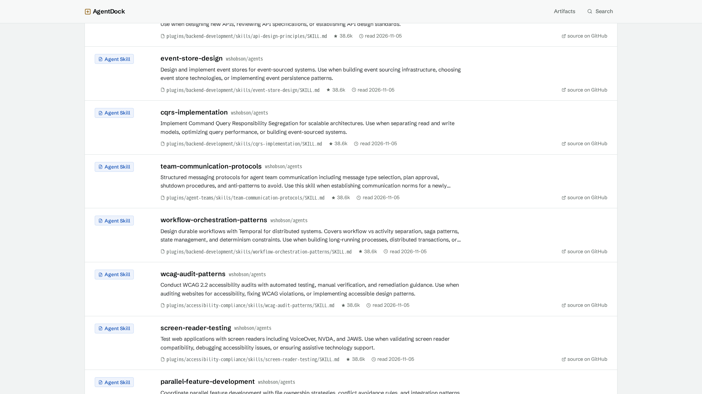
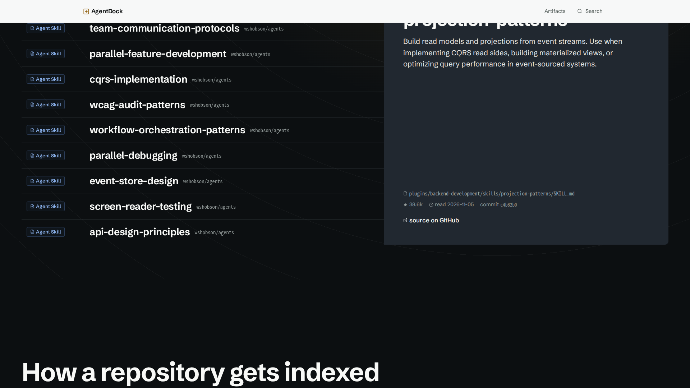
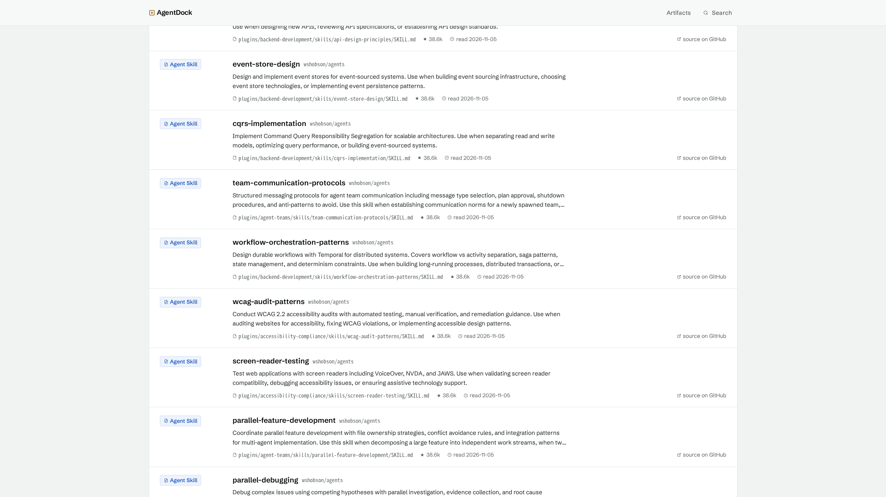
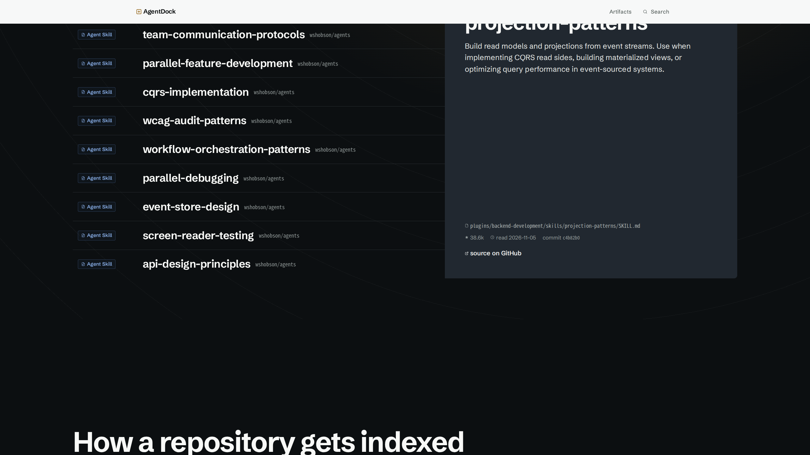
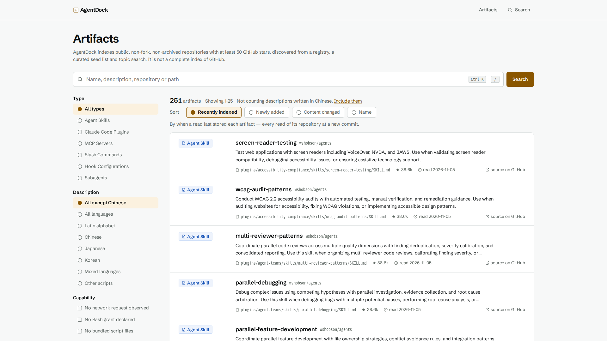
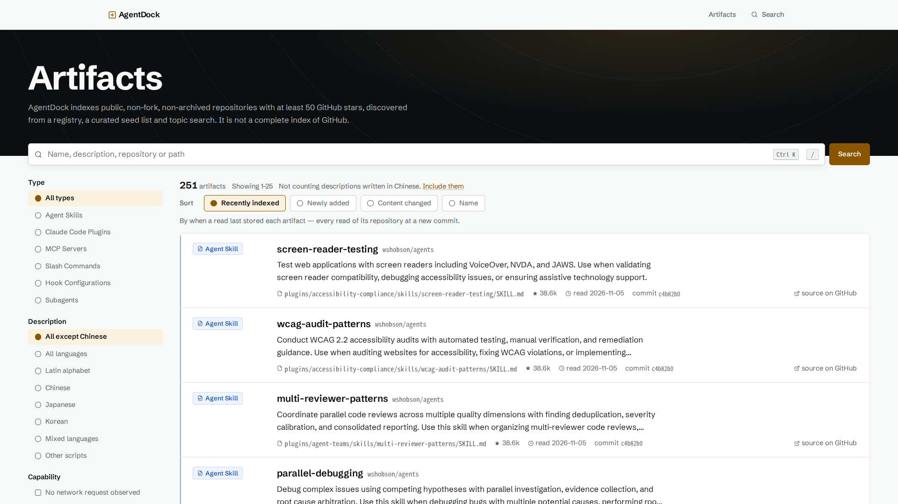
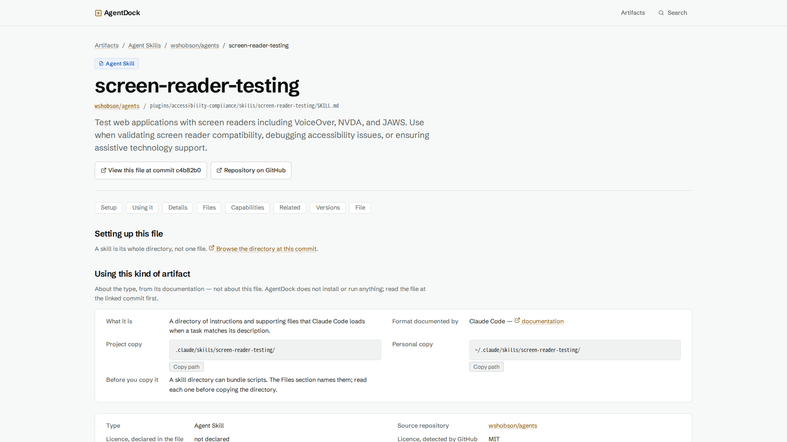
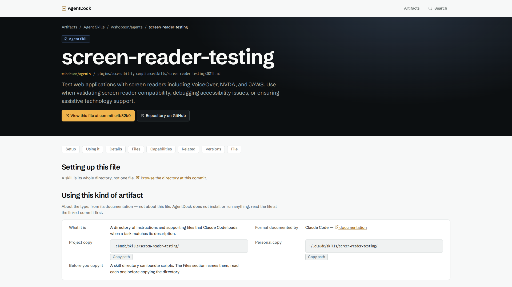
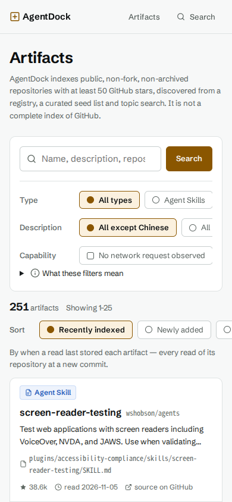
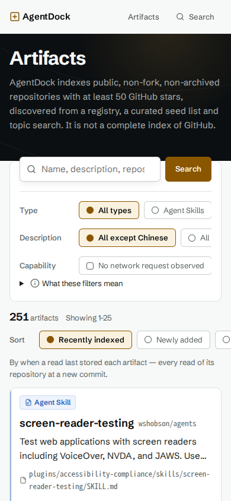

# AgentDock Phase 83–85 — Immersive Discovery Experience

- 작성: 2026-11-05. 기준선: `dc01ebe`(Phase 80–82, 커밋 완료). 시작 시 작업 트리는 깨끗했다. 요청서의 "미커밋일 수 있음"과 달라 Git 자체를 비교 기준으로 삼았다.
- 표기: PASS / FAIL / WARNING / PENDING. commit, push, 배포, 운영 DB 접근은 하지 않았다. 로컬 테스트 DB(`agentdock_test`, 시드 251건 표시 + 중국어 1건)만 썼다.
- 측정 환경: 로컬 Production 빌드, Playwright Chromium, ANGLE/Vulkan(Intel RPL-S 내장 GPU). 변경 전 빌드는 별도 복사본을 3971 포트에서 띄워 같은 조건으로 교차 측정했다.

## 1. 기존 하단 UI 문제

변경 전 `before-*` 스크린샷과 CSS에서 확인한 내용이다.

| 문제 | 근거 |
|---|---|
| 좁은 콘텐츠 | 2560px에서 `main` 1764px(69%), 내부 콘텐츠 1701px. 1920px에서 1512px. `--wrap`의 한계 |
| 약한 위계 | h1 105px 아래 h2 23.6px(2560). 1440px에서 h2 18px |
| 작은 글씨 | 1440px 이하에서 행 메타·파이프라인 설명 12px, 설명 13px |
| 반복 사각형 | 같은 모양의 행 10개, 같은 카드 4단계, 같은 카드 6개(`.type-card`, `auto-fill`) |
| 단조로운 스크롤 | 모든 섹션이 같은 폭과 같은 머리글. 움직임은 진입 페이드뿐 |
| Hero와 단절 | 어두운 stage가 Hero 끝에서 끊기고 바로 밝은 띠와 사각형으로 전환 |
| 푸터 | 12px 문장 한 줄. 닫는 느낌 없음 |
| 목록·상세 | 내용은 충실하나 첫 화면이 Hero와 다른 제품처럼 보임 |

`before-*-full`류 전체 페이지 캡처에서 파이프라인과 타입 카드가 비어 보인 것은 캡처 때 스크롤 연동 애니메이션이 시작 전이었기 때문이다. 실제 결함이 아니므로 문제에서 제외했다.

## 2. 선택한 디자인 방향

**핵심 문장:** 이 페이지에서 "커밋까지 추적되는 읽기"가 하나의 선으로, Hero의 "도크 판 더미"가 데이터 벽의 조각이 된다.

| 영역 | 선택 | 이유 |
|---|---|---|
| Recently indexed | 왼쪽 이름 색인 + 오른쪽 큰 미리보기 | 10개 이름을 빠르게 훑으면서 설명·경로·커밋을 크게 볼 수 있다. 순서는 그대로 |
| Pipeline | 한 줄 선 위의 번호 있는 4개 정거장, 스크롤 고정 | 순서가 실제이므로 번호가 정보다. 파일마다 선언하는 종류를 표시 |
| 조건 | `50+`를 stage 패널에 크게, 나머지 셋은 낱말로 | star 기준만 AgentDock의 예산 결정이고 셋은 GitHub 사실이다(`policy.ts`). 크기는 순위가 아니며 옆 문장이 그렇게 말한다 |
| Browse by type | 데이터 기반 Bento | 아래 비교 참고 |
| 전환 | stage를 Feed·Pipeline까지 잇고 조건에서 한 번 뒤집음 | 어두운 페이지가 섹션으로 읽히게 하는 지면 변화 |
| 푸터 | 페이지 폭의 `AgentDock` 워드마크 | 닫는 표지. CSS 생성 콘텐츠라 접근성 트리에 중복 없음 |

**Browse by Type 3안 비교(시드 194·29·16·8·3·1):**

| 후보 | 판단 |
|---|---|
| A. Asymmetric Bento | **선택.** 다만 위치별 고정 크기는 먼저 온 종류를 크게 그리므로, 등재 수로 정렬해 가장 많은 종류가 큰 칸을 갖게 했다 |
| B. Interactive Category Wall | 기각. 같은 타일이면 이번에 교체한 6개 사각형과 같다 |
| C. Spatial Category Explorer | 기각. 3D면 Hero의 복제이고 비용도 같다 |

**기술 선택:** JS를 추가하지 않고 CSS `:has()`, scroll-driven animation, sticky로 구현했다. 클라이언트 컴포넌트 수와 의존성은 그대로이고, GSAP·Framer Motion 추가는 측정 전에 필요 없어졌다.

## 3. 스킬 활용 결과

네 스킬 모두 이번 작업에서 실제로 호출했고, 실행 가능한 스크립트도 돌렸다.

| 스킬 | 실제 실행 | 제안 | 채택 / 기각 |
|---|---|---|---|
| frontend-design | 스킬 호출, 지침 적용 | 주제에서 나온 구조, 대담함은 한 곳에, 템플릿 장식 금지 | 채택: 실제 순서가 있는 곳에만 번호, 강조 단어·대문자 라벨 없음. 대담함은 `50+`와 `194`에 집중 |
| taste-skill | `draw.mjs`(seed 459245453, `product-performs`, `--keep palette,type`), `inspect.mjs` | Small index + large picture, Drag through the stages, 제품 조각이 곧 이미지 | 채택: Feed의 색인·미리보기, 단계 진행, 실제 데이터 조각. 기각: 드래그(스크롤로 대체), 실사 사진 4장 이상, 영상(정직한 소재가 없음) |
| ui-ux-pro-max | `search.py --design-system`, `ux`, `style`, `chart` 검색 | Brutalism + JetBrains Mono + 초록 CTA, Bento 체크리스트, Sankey의 접근성 대안 | 기각: 스타일·서체·팔레트(추천 패턴이 FAQ 랜딩으로 제품과 맞지 않고, 브랜드 고정). 채택: reduced-motion에서 스크롤 효과 제거, Bento 응답형, "표 없는 흐름은 문장으로 제공" |
| design-system | 스킬 호출, 3계층 토큰·상태 사양 참고 | Primitive → Semantic → Component 토큰, 상태 우선순위 | 채택: `--t-display`, `--t-feed`, `--t-numeral`, `--wide`, `.stage`, 포커스 > 호버 우선순위(패널 z-index). 토큰 생성 스크립트는 기존 CSS 변수와 겹쳐 쓰지 않음 |

상충: taste 하우스 규칙(라벨·모노·헤어라인·사진)은 이 제품의 앱 관례와 충돌한다. 처분은 §10.3에 항목별로 적었다.

## 4. 컴포넌트별 변경 사항

| 파일 | 변경 |
|---|---|
| `src/app/page.tsx` | 섹션 재구성, 조건을 독립 섹션으로 분리, 타입을 등재 수로 정렬, 조건 머리글 추가 |
| `src/components/PackageRows.tsx` | 설명·메타를 `.row-detail`로 감쌈, 짧은 커밋 표시 추가 |
| `src/components/IndexFlow.tsx` | 파일 → 종류 매핑 표시, `hooks.json` 추가(`src/detect/hook.ts`가 감지하지만 목록에 빠져 있었음) |
| `src/components/DockBoardStatic.tsx` | `DockStack` 추가: Hero와 같은 투영·판 수의 SVG |
| `src/app/globals.css` | 토큰, `.stage`, 하단 섹션, 목록·상세 머리, 스크롤 모션 |
| `src/app/layout.tsx`, `artifacts/page.tsx`, `r/**/page.tsx` | stage 클래스와 래퍼 |
| `e2e/journeys.spec.ts`, `IndexFlow.test.tsx` | 신규 5개 여정. 파일 수 단언 8 → 9(`hooks.json` 추가에 따른 변경). 기존 단언 약화 없음 |
| `README.md`, `README.en.md`, `CLAUDE.md`, `docs/images/agentdock-{home,artifacts}.png` | 현재 구조에 맞게 동기화 |

데이터 의미·URL·쿼리·API·스키마는 바꾸지 않았다. 조건 머리글 "What decides which repositories it reads"와 커밋 표시는 새로 보이는 문구지만, 기존 사실을 말한다. Hero의 `DockBoard`·`DockScene`은 수정하지 않았다.

## 5. 인터랙션 목록

| 섹션 | 인터랙션 | 구현 |
|---|---|---|
| Feed | 호버·키보드 포커스 미리보기, 행과 패널이 이어지는 탭 형태 | `:has()`, `opacity` |
| Feed | 포인터 없음·터치: 각 행에 설명 인라인 | `@media (hover: hover)` |
| Feed → 상세 | 이름·배지 공유 요소 전환(기존 유지) | View Transition |
| Pipeline | 약 1.4화면 고정, 진행선, 단계 밝아짐, 파일 9개 순차, 개수 카운트업 | `view-timeline` |
| Pipeline | 파일 타일 호버 | `transform`, 색 |
| 조건 | `50+` 스크롤 확대, 조건 3개 순차 진입, 호버 시 아이콘 강조 | `view()` |
| 타입 | 판이 도크에 내려앉음, 호버 시 판이 벌어지고 색이 스택에서 번짐 | `view-timeline`, `transform` |
| 전체 | 페이지 전환(기존 유지), reduced-motion에서 움직임 없음 | CSS |

섹션마다 움직임을 다르게 했다. Feed 행에는 진입 애니메이션이 없다. 첫 화면에 있고, 읽으러 온 내용이기 때문이다.

## 6. 변경 전후 스크린샷

같은 해상도, 같은 스크롤 위치(뷰포트 높이의 배수)로 찍었다. `docs/images/phase83-85/`에 있고, 파일명은 `{before|after}-{폭}-{y01|y02|y03|list|detail}.png`이다. 고정 구간 때문에 같은 위치라도 보이는 섹션은 다를 수 있다.

| 화면 | 변경 전 | 변경 후 |
|---|---|---|
| 1920 하단 1 |  |  |
| 2560 하단 1 |  |  |
| 1920 목록 |  |  |
| 1920 상세 |  |  |
| 390 목록 |  |  |

여정 캡처: `journey-*.png`(호버, 파이프라인 2·35·98%, reduced-motion, 다크 모드). 영상: [journey.webm](../images/phase83-85/journey.webm).

## 7. 성능 비교

1920×1080, 같은 측정 스크립트, 3회 중앙값. 전체 페이지를 5초 동안 휠로 스크롤하며 프레임을 쟀다.

| 지표 | 변경 전 | 변경 후 | 4배 CPU 제한 전 | 4배 CPU 제한 후 |
|---|---|---|---|---|
| LCP | 76ms | 72ms | 124ms | 124ms |
| CLS | 0 | 0 | 0 | 0 |
| 상호작용 지연(Event Timing 최대) | 32ms | 24ms | 32ms | 24ms |
| Long Task 개수 / 최대 | 2 / 75ms | 2 / 74ms | 4 / 186ms | 4 / 193ms |
| Hero FPS / 최악 프레임 | 60 / 19ms | 60 / 19ms | 60 / 19ms | 60 / 19ms |
| 하단 후 Hero 복귀 FPS | 60 | 60 | 60 | 60 |
| Scroll FPS / 최악 프레임 | 60 / 21ms | 60 / 21ms | 60 / 21ms | 60 / 22ms |
| CPU(TaskDuration/초) | 0.122 | 0.124 | 0.239 | 0.221 |
| JS 힙 | 16.7MB | 12.8MB | 13.3MB | 15.7MB |
| DOM 노드 | 988 | 1,212 | 988 | 1,212 |

| 번들 | 변경 전 | 변경 후 |
|---|---|---|
| 홈 전송 JS(전송 크기, 9개) | 389,744B | 389,744B(0B 증가) |
| 전체 JS | 1,538,943B | 1,538,943B |
| CSS(gzip 전송) | 9,865B | 12,120B(+2,255B) |

- 힙은 실행마다 ±3MB 움직여 차이로 해석하지 않는다.
- LCP 표본 범위는 변경 전 52~76ms, 변경 후 56~76ms다. 서버 재시작 직후 첫 요청에서 변경 후 208ms를 1회 봤고, 콜드 스타트로 보이나 원인은 확인하지 않았다.
- 무거운 라이브러리를 추가하지 않았으므로 사전 번들 측정은 해당 없음이다. R3F 장면도 복제하지 않았다.

**한계:** 내장 GPU 1대와 로컬 서버다. 60FPS는 주사율 상한이고, 실기기·네트워크 지연·운영 데이터(약 1.9만 행)는 반영되지 않는다.

## 8. 테스트 결과

최종 코드 기준이다.

| 항목 | 결과 |
|---|---|
| `bun run check:boundaries` | PASS |
| `bun run lint` | PASS(경고 0) |
| `bun run typecheck` | PASS |
| `bun run test`(테스트 DB 사용) | PASS: 81개 파일, 1,562 통과, 2 skip(`search.test.ts`의 trigram 저하 경로, `client.test.ts`의 잘못된 비밀번호 거부) |
| Production Build | PASS |
| 전체 E2E | PASS: 64/64(기존 59 + 신규 5) |
| 브라우저 콘솔·4xx/5xx(실제 GPU 여정) | 오류 0건 |
| Hero GPU 재검사(1440·1920·2560) | PASS: 60FPS, 선택·닫기·Esc·검색·일시정지, 캔버스 1개, 오버플로 0 |

**실제 브라우저 여정(실제 GPU):**

| # | 동작 | 결과 | 값 |
|---|---|---|---|
| 1 | Hero에서 하단 스크롤 | PASS | 휠 스크롤 |
| 2 | Recently indexed 호버 | PASS | 패널 1개만 표시, 패널까지 호버 유지, 키보드 Tab 도달 |
| 3 | 상세 진입 | PASS | h1 일치, 40자 SHA 링크 |
| 4 | 뒤로 가기 | PASS | 스크롤 980 → 980 복원 |
| 5 | Pipeline 스크롤 | PASS | 고정 위치 일정, 단계 0.22 → 1, 개수 0 → 252 |
| 6 | Browse by Type 호버 | PASS | 판 이동 확인 |
| 7 | 카테고리 선택 | PASS | 타일 29 = 목록 29 |
| 8 | 필터 적용 | PASS | `?type=command&sort=name`, 뒤로 가기 |
| 9 | 검색 실행 | PASS | `/artifacts?q=review` |
| 10 | reduced-motion | PASS | 애니메이션 0, 고정 없음, 흐린 요소 0, 3D 미로드 |

**검증 중 발견해 고친 회귀:** 패널까지 가는 틈에서 호버가 끊김(여정 2b), 폰에서 keyframe이 페이지를 12px 넓힘, 폰 첫 결과 y=631(>625), 1024px 고정·세로 배치 경계 충돌, 1024×800 첫 행 y=808.

## 9. 접근성 결과

- **axe:** 1280 라이트, 390 다크, 5개 경로에서 위반 0(E2E 포함, WCAG 2.2 A/AA + best-practice). 패널 열림 상태도 포함.
- **키보드:** Feed 패널의 링크까지 행 순서대로 Tab 도달. 타입 타일 focus-visible 동작.
- **스크린리더:** 패널은 `opacity`로 숨겨 트리에 남고, 패널 제목과 워드마크는 빈 대체 텍스트(`content: … / ""`)를 쓴다. **코드 기준이며 실제 스크린리더로 듣지는 않았다.**
- **색만으로 구분하지 않음:** 종류는 항상 글자와 함께 표시한다. 조건에 tick·초록·빨강이 없다.
- **판정 어휘:** `check:boundaries` 통과.

## 10. 코드 리뷰

### 10.1 PR Review Toolkit

`pr-review-toolkit:code-reviewer`와 `comment-analyzer`를 실제로 돌렸다.

| 등급 | 내용 | 처분 |
|---|---|---|
| IMPORTANT | 마우스 클릭 후 남은 포커스의 패널이 호버 행을 덮어 다른 행의 소스가 열림 | 수정, E2E 추가 |
| IMPORTANT | 1024~1150px에서 고정 영역이 창보다 큼 | 고정 하한을 74rem으로 |
| IMPORTANT | 클래식 스크롤바에서 목록·상세에 가로 스크롤바 생김 | `html { overflow-x: clip }`. 실제 스크롤바로 재측정: 가로 막대 0, 고정 동작 유지 |
| IMPORTANT | 40~64rem 목록에서 검색 라벨이 어두운 띠에 묻힘 | 라벨이 숨는 폭에만 겹침 적용 |
| MINOR | `:has` 미지원 시 패널 숨김, 높이 경계, 긴 이름, `hooks.json` 누락 | 모두 수정 |
| CRITICAL(주석) | 낡은 모션 설명, count-up 설명, 끊긴 문서 참조, 미사용 `--t-metric`, README 구성 | 모두 수정 |
| IMPORTANT(주석) | 띠 설명, `.stage` 누락, 순환 참조 등 | 수정 |

코드 CRITICAL은 0건이었다. 리뷰어의 일부 측정은 임시 fixture에서 나온 값이므로, 위 수정은 실제 서버에서 다시 쟀다.

### 10.2 재검증

수정 뒤 빌드, CI, 전체 E2E, 실제 GPU 여정을 다시 돌렸고 §8의 결과가 그 값이다.

### 10.3 taste `inspect.mjs`

최종 결과는 **8 FAIL, 6 WARN**이다(`--allow gradient`). 이 도구의 "완료" 기준은 충족하지 않았고, 아래 사유로 항목별로 처분했다. 고칠 수 있는 항목(13px 미만 22건 → 2건, 본문 16px, 측정 폭, 고정 길이)은 고쳤다.

| 항목 | 처분 |
|---|---|
| headline-lines, text-shadow | 유지 대상인 Hero의 것 |
| headline-lines(`Public`) | `<dd>`와 작은 글씨를 한 덩어리로 잰 오탐 |
| eyebrow | `dl`의 `dt`이며 실제 조건 이름 |
| mono | 저장소·경로·파일명이라 실제 코드 값 |
| hairline | 목록 행 구분선과 헤더. 앱 화면 관례 |
| few-pictures, no-footage | 정직한 소재가 없어 기각. 제품 조각과 3D 장면이 이미지 역할 |
| covered-text | sticky 헤더 아래를 지날 때의 오탐 |
| size-count, body-size | Hero·기존 토큰 영향이 남음. **미해결 WARNING** |
| measure, long-pin, small-text(2건) | 일부 남음. **미해결 WARNING** |

## 11. 남은 문제

| 등급 | 내용 |
|---|---|
| WARNING | 왼쪽 정렬선 불일치: 1440px 이상에서 Hero는 기존 폭, 하단은 넓은 폭이라 시작선이 다르다. Hero 유지 지시로 남겼다(2560 x=430 vs 230) |
| WARNING | 폰 페이지 높이 5,164 → 8,271px. 크기를 키운 대가이며 첫 결과 위치 기준은 유지했다 |
| WARNING | 대각선으로 패널에 가면 지나는 행으로 미리보기가 바뀐다. 수평 이동은 정상. 해결하려면 JS 지연이 필요해 넣지 않았다 |
| WARNING | 미리보기 설명은 8줄에서 잘린다. 전체는 상세 페이지에 있다 |
| WARNING | 클래식 스크롤바 환경에서 `scrollTo`로만 8px 움직일 수 있다(막대 없음, 사용자 조작 없음). 홈에는 변경 전에도 같은 8px 초과가 있었다 |
| PENDING | Firefox·Safari 미확인. CSS상 고정·애니메이션 없이 완성 상태로 보이는 설계지만 실행 확인은 Chromium뿐이다 |
| PENDING | 운영 데이터(약 1.9만 행)·실기기·실제 스크린리더 미확인 |
| PENDING | 시드에서 최근 10건이 모두 Agent Skill이라 Feed의 유형 혼합 화면은 실데이터로 보지 못했다 |

## 12. 변경 파일 목록

```text
README.md
README.en.md
CLAUDE.md
docs/analysis/agentdock-phase83-85-discovery-experience.md   (신규)
docs/images/agentdock-home.png
docs/images/agentdock-artifacts.png
docs/images/phase83-85/                                      (신규, 66개, 14MB)
e2e/journeys.spec.ts
src/app/artifacts/page.tsx
src/app/globals.css
src/app/layout.tsx
src/app/page.tsx
src/app/r/[owner]/[repo]/[...path]/page.tsx
src/app/r/[owner]/[repo]/page.tsx
src/components/DockBoardStatic.tsx
src/components/IndexFlow.test.tsx
src/components/IndexFlow.tsx
src/components/PackageRows.tsx
```
