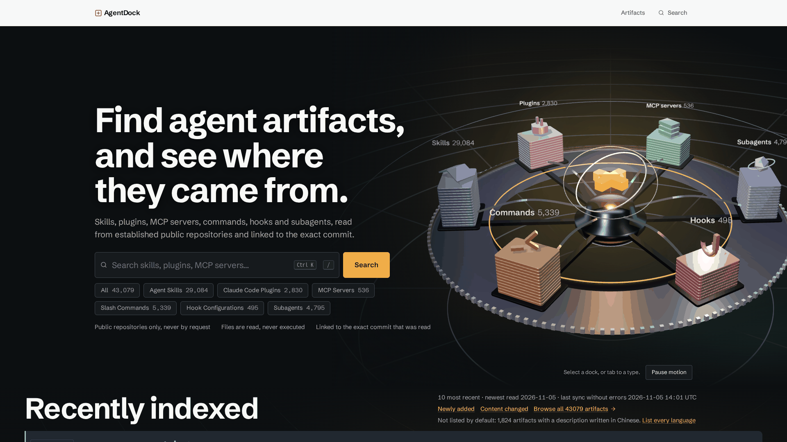
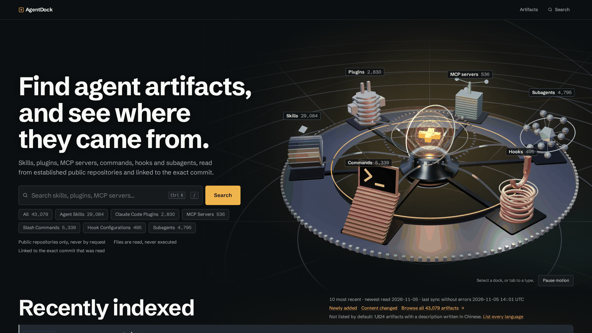
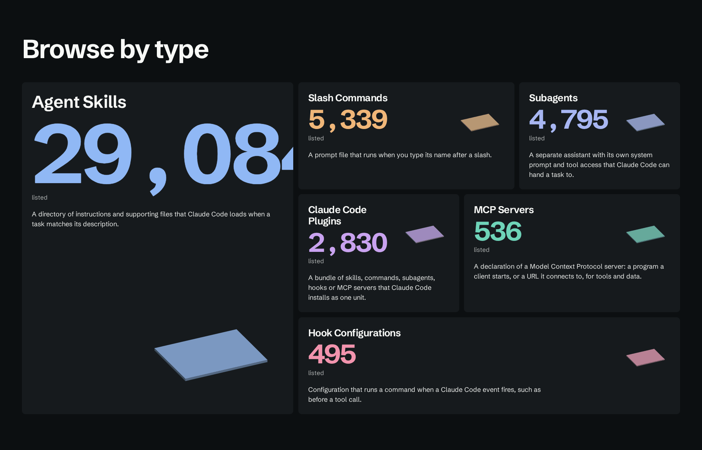
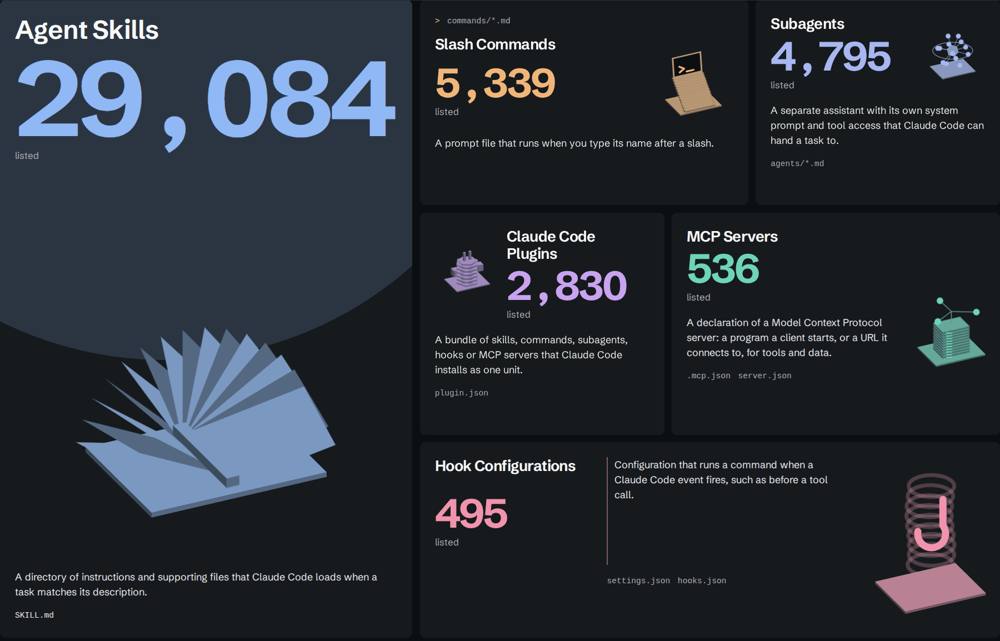
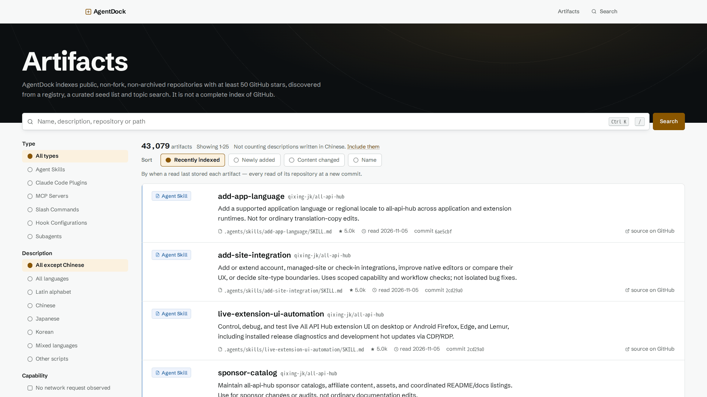
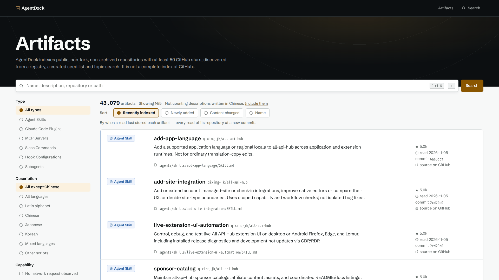
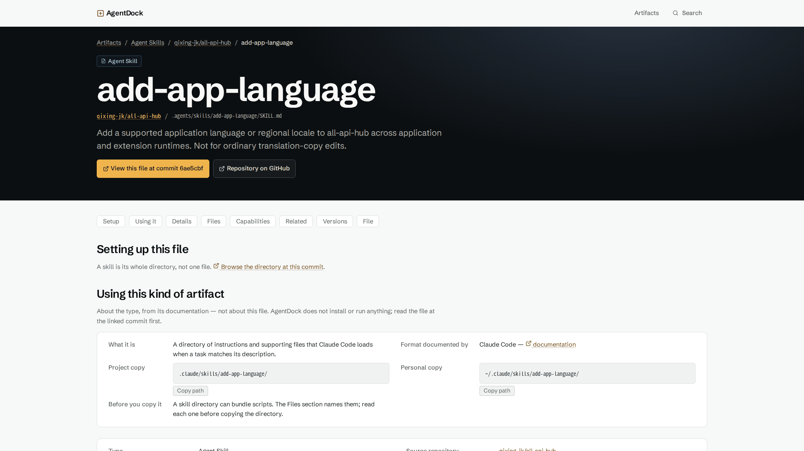
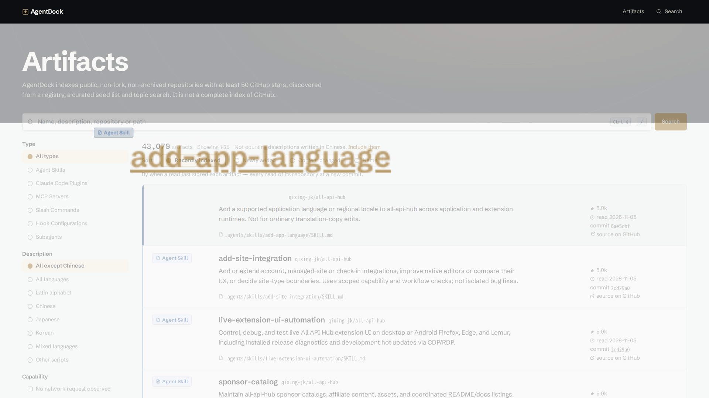
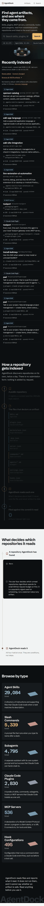
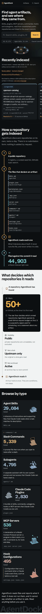

# AgentDock Phase 86–90: Premium Cinematic UI/UX와 Production Release

| 항목 | 값 |
|---|---|
| 작성일 | 2026-11-06 (KST) |
| 브랜치 | `develop` |
| 이전 HEAD | `03e01c77f58af114026f57a9852bc4062f327600` |
| 구현 커밋 | `3427f79` (기능), `65d01d8` (GPU 없는 환경의 성능 회귀 수정) |
| 운영 사이트 | https://agentdock-delta.vercel.app/ |
| 변경 범위 | 프론트엔드만. DB·Migration·인덱싱·Sync·검색 의미·URL·환경변수 변경 없음. 의존성·client component 추가 없음 |

측정 환경은 별도 표기가 없으면 Intel Graphics (RPL-S) + Vulkan의 실제 GPU, Chromium, 1920×1080, 로컬 production build + 테스트 DB다. "운영"은 실제 사이트를 읽기 전용으로 측정한 값이다.

## 1. 변경 전 문제

브라우저로 7개 해상도(2560, 1920, 1440, 1024, 768, 390, 360)를 DOM 측정했다. 운영 수치는 배포된 `03e01c7`에서 읽었다.

| 문제 | 측정 |
|---|---|
| 숫자가 카드 밖으로 잘림 | `29,084`가 카드 경계를 2560에서 138px, 1920에서 100px, 1440에서 87px 넘음 |
| 시작선 불일치 | 1920에서 Hero·헤더 x=231, 하단 섹션·목록 x=60 |
| 3D 오브젝트 잘림 | 1920에서 `Subagents 4,79`가 창에 잘림 |
| 레이블 겹침 | `Hooks 495`가 자기 Hook 뒤로 가려짐 (depth test를 받는 sprite) |
| 모바일 길이 | Recently Indexed가 390에서 2,672px, 360에서 2,799px. 홈 전체 7,997px |
| 작은 글씨 | 경로와 코드 11.7px |
| 터치 영역 | 행 제목 링크 22px (WCAG 2.5.8 기준 24px 미달) |
| 상세 페이지 | 단일 열. 섹션 링크가 첫 화면과 함께 스크롤되어 사라짐 |
| 인덱스 수 표기 | CSS counter라 콤마 없이 `44903` (자기 `ponytail:` 주석의 "1만 건 초과 시 삭제" 조건을 이미 넘김) |
| 긴 설명 | 잘린 설명 전체를 볼 경로가 미리보기에 없음 |

## 2. 디자인 목표

- 그래파이트와 Amber의 정체성을 유지한다.
- **판 개수 = 실제 수량(log2)** 규칙을 유지한 채, 판의 형태만 종류별로 바꾼다.
- 사용자의 행동에 반응할 때만 움직인다.
- 화려함보다 읽기와 탐색을 우선한다. 상세 페이지에 3D를 넣지 않는다.
- 새 데이터를 만들지 않는다. 화면의 값은 전부 기존 쿼리 결과다.

## 3. 실제 구현

### 공통

- `--gutter` 토큰 하나로 헤더, Hero, 섹션, 목록, 상세, 푸터의 시작선을 맞췄다. 기존 `--wide` 보정은 삭제했다.
- 헤더를 모든 페이지에서 stage(어두운 바탕)로 통일했다.
- 경로와 코드의 최소 크기를 13px로 올렸다.

### Browse by Type

- 숫자 크기를 `min(상한, 남은 폭 / (자릿수 × 0.6))`으로 계산한다. 값이 아니라 길이만 읽으므로 7자리 이상도 규칙 추가 없이 맞는다.
- 타일이 자기 폭에 따라 배치를 바꾸고(`@container`), 종류별로 그림의 위치와 강조가 다르다.
- 타일에 감지 파일명(`SKILL.md` 등)을 추가했다. `IndexFlow`의 목록을 그대로 재사용한다.
- Hover, Focus, Press에 종류별로 반응한다. 부채가 펴지고, 모듈이 벌어지고, 코일이 늘어나고, 노드가 커진다.

### Recently Indexed

- 대각선 이동 중 지나친 행이 미리보기를 빼앗던 문제를 CSS 지연(140ms)으로 고쳤다. 잠금이 아니라 지연이라, 다른 행에 머무르면 바뀐다.
- 미리보기에 전체 내용으로 가는 "Read all of it" 링크를 추가했다. 행 이름과 주소가 같아 `tabIndex={-1}`로 Tab 정지점은 늘리지 않았다.
- hover가 없거나 좁은 화면에서는 가로 카드 열이다. 모든 사실을 카드에 유지한다.

### Pipeline과 조건

- 조건 문구는 `src/corpus/policy.ts`의 `discoveryRejection`과 대조했고 실제 구현과 일치해 바꾸지 않았다.
- Pin 구간을 240svh에서 190svh로 줄였다. 선 위를 이동하는 Tracer와 채워지는 정거장을 추가했다.
- 인덱스 수를 콤마가 있는 실제 텍스트로 바꾸고 카운트업은 삭제했다.

### 목록

- 96rem 이상에서 행을 "이름·설명·경로 / 출처 사실" 2열로 나눴다. 마크업은 그대로라 접근성 트리 순서가 바뀌지 않는다.
- URL 계약, 정렬, 필터, 페이지네이션은 변경하지 않았다.

### 상세

- 상단에 사실 4개를 요약했다(읽은 커밋, 마지막 읽음, Upstream 변경, GitHub stars). Details의 값과 같다.
- 왼쪽에 고정 레일을 두고, CSS scroll timeline으로 현재 섹션을 표시한다. Client JS는 0B다.
- 이름 길이에 따라 제목 크기를 줄인다. 87자 이름으로 확인했다.
- 복사할 값은 어두운 코드 블록으로, Versions는 세로 선으로, Files는 디렉터리를 흐리게 표시한다.

## 4. 변경 파일

| 파일 | 내용 |
|---|---|
| `src/components/DockScene.tsx` | 6종 형상, 허브, DOM 레이블, 적응형 품질, 자원 해제 |
| `src/components/dockShaders.ts` | Core, Beam, Trail 셰이더 |
| `src/components/DockBoardStatic.tsx` | 같은 6종의 SVG 형상 |
| `src/components/dockBoard.ts` | 데이터와 장식의 경계 설명 갱신 |
| `src/components/IndexFlow.tsx`, `PackageRows.tsx` | 숫자 텍스트화, 감지 파일 export, 미리보기 링크 |
| `src/app/page.tsx`, `layout.tsx`, `r/[owner]/[repo]/[...path]/page.tsx` | 타일, 헤더, 상세 구조 |
| `src/app/globals.css` | 토큰, 레이아웃, 반응형, 모션 |
| `e2e/journeys.spec.ts`, `src/app/motion.test.ts`, `src/components/IndexFlow.test.tsx` | 테스트 |
| `CLAUDE.md` | 자원 해제 규칙 |

## 5. 화면 비교

| 영역 | 변경 전 | 변경 후 (운영) |
|---|---|---|
| Hero |  |  |
| Browse by Type |  |  |
| 목록 |  |  |
| 상세 |  |  |
| 모바일 전체 |  |  |

그 밖의 화면은 `docs/images/phase86-90/`에 있다. 2560·1920·1440 전체 페이지, 3D Hover와 선택, 검색 focus와 결과, Recently Indexed, Pipeline, 조건, Versions, 390·768, reduced motion이다.

전체 페이지 이미지는 reduced motion 상태로 찍었다. Pin이 없어 긴 페이지를 한 장에 담을 수 있기 때문이다.

화면 녹화는 저장소에 넣지 않았다. 7.5MB이고 이 환경에 압축 도구가 없어서다.

## 6. 3D 변경 사항

| 종류 | 판 하나가 무엇인가 | 고정 부품 |
|---|---|---|
| Skills | 부채꼴로 펼친 책장 | 책등, 위에 도는 결정 |
| Plugins | 번갈아 좁아지는 육각 모듈 | 핀 2개, 양쪽 소켓 |
| MCP servers | 랙 유닛 | 빛나는 레일, 3개 노드를 도는 암 |
| Commands | 터미널로 오르는 계단 | 프롬프트가 있는 화면 |
| Hooks | 코일 한 바퀴 | 갈고리, 코일을 오르는 이벤트 링 |
| Subagents | 노드 (golden-angle 나선) | 코어, spoke, 궤도 |

- **허브:** 브랜드 기호를 빛나는 코어, 유리 셸, 격자, 짐벌 3개가 감싼다. 빛기둥을 더했다. 선택한 종류의 색으로 변하고 검색 입력에 반응한다.
- **깊이:** 지수 안개, 궤도 3개와 혜성 빛. 림 라이트는 조명이 아니라 반사 환경의 패널로 넣었다(§9).
- **레이블:** Sprite를 DOM으로 바꿨다. 항상 장면 앞에 있고 무대 안으로 제한된다. 텍스처 6장도 줄었다.
- **프레이밍:** 시작선을 맞춰 생긴 폭과 반경 조정으로 링 전체가 화면에 들어온다.
- **Fallback:** SVG도 같은 6개 실루엣을 그린다. WebGL 없음, Reduced Motion, 좁은 화면, 컨텍스트 손실 경로는 기존 그대로다.

### 이전부터 있던 WebGL 컨텍스트 누수

three.js는 Sprite geometry와 DFG 조회 테이블을 렌더러별이 아니라 페이지당 하나만 둔다. 렌더러마다 그 객체에 `dispose` 리스너를 달고 리스너가 GL 컨텍스트를 쥐어서, 페이지를 다시 방문할 때마다 렌더러가 남았다. 언마운트 시 두 객체를 dispose한다.

처음 측정한 "컨텍스트 1→31"에는 측정 스크립트의 ElementHandle이 캔버스를 잡아 둔 영향이 섞여 있었다. 이를 배제하고 힙 스냅샷으로 유지 경로를 추적해 원인을 확정했다.

| 페이지 복귀 30회 | 수정 전 | 수정 후 |
|---|---|---|
| 힙 (10회 간격) | 18.3 → 21.1 → 24.0 → 26.7MB | 18.3 → 18.4 → 18.2 → 18.5MB |
| 살아 있는 WebGL2 컨텍스트 (10회 간격) | 1 → 11 → 21 → 31 | 1 → 2 → 3 → 4 |

수정 후 값이 측정마다 1씩 늘어나는 것은 측정 쿼리 자체가 결과를 붙들기 때문으로 보인다(추정). 측정을 한 번만 하는 E2E는 복귀 4회 후 2개 이하를 단언하며, 수정 전에는 5개로 실패했다.

## 7. 인터랙션 개선

| 동작 | 내용 |
|---|---|
| 3D Hover | 그 Dock만 밝아지고 나머지는 어두워지며, 형상이 열리고 빛기둥이 선다 |
| 3D 선택 | 카메라 Focus, 패널, 코어 색 변경, 바닥 파동 |
| 칩 Hover·Focus | 해당 Dock으로 이동. 키보드 경로 유지 |
| 검색 Focus·입력 | 입자가 허브로 흐르고 빛기둥과 코어가 밝아짐 |
| Pause | 기존대로 저장되고 유지됨 |

**구현하지 않은 것:** 검색 "실행" 시점의 에너지 흐름은 보이지 않는다. 검색은 네이티브 GET form이라 즉시 이동하는데, 연출 때문에 이동을 지연하지 않았다. 입력 단계의 반응으로 대신한다.

## 8. 반응형 검증

운영 데이터, 7개 해상도. 오버플로 0건, 숫자 잘림·겹침 0건.

| 폭 | 홈 전체 변경 전 | 홈 전체 변경 후 | Skills 숫자 크기 |
|---|---|---|---|
| 2560 | 9,219px | 8,760px | 223px |
| 1920 | 7,146px | 6,845px | 191px |
| 1440 | 5,978px | 5,703px | 144px |
| 1024 | 4,769px | 4,695px | 49px |
| 768 | 6,685px | 5,281px | 42px |
| 390 | 7,997px | 5,595px | 40px |
| 360 | 8,258px | 5,682px | 40px |

- Recently Indexed는 390에서 2,672px(운영)에서 626px(테스트 DB)로 줄었다. 표본 설명 길이가 달라 정확히 같은 조건의 비교는 아니다.
- E2E가 4자리부터 8자리까지(`1,234`~`12,345,678`) 7개 폭에서 숫자의 경계 이탈과 그림 겹침을 검사한다.
- **줄이지 못한 곳:** 390의 Browse by Type은 1,800px(변경 전)에서 1,807px(변경 후)로 거의 같다. 정보를 빼지 않는 조건에서 타일 6개는 이 정도 길이가 남는다.

## 9. 성능 비교

### 3D, 실제 GPU

| 항목 | 변경 전 | 변경 후 (테스트 DB) | 변경 후 (운영 규모) |
|---|---|---|---|
| FPS | 60 | 60 | 60 (2560·1920·1440·1024) |
| 최악 프레임 | 17ms | 17~18ms | 18~19ms |
| Draw call / 프레임 | 87 | 97 | 97 |
| 삼각형 / 프레임 | 42,426 | 41,234 | 63,266 |
| 점 / 프레임 | 1,293 | 1,293 | 5,673 |
| 정지 시 draw (3초) | 0 | 0 | 0 |
| 셰이더 프로그램 | 18 | 24 | 24 |
| 텍스처 | 16 | 10 | 10 |
| 버퍼 | 199 | 297 | 297 |
| 첫 프레임까지 | 측정 안 함 | 약 1.0초 | 측정 안 함 |

Texture Memory, GPU 사용률, Shader Compile 시간은 직접 측정하지 않았다. 대신 텍스처 수와 첫 프레임까지의 시간을 쟀다.

### 3D, GPU 없는 2코어 (SwiftShader, `taskset -c 0,1`, 1280×800)

SwiftShader 수치는 실제 GPU와 비교할 값이 아니라 저사양 환경의 회귀 지표다.

| 구간 | `03e01c7` | `3427f79` | `65d01d8` |
|---|---|---|---|
| 진입 직후 FPS | 6.1~7.0 | 4.6 | 6.6 |
| 안정 구간 FPS | 4.1~6.3 | 3.6 | 6.4 |

`3427f79`는 이 조건에서 느려졌고 CI가 그것을 잡았다(§14). 원인과 수정은 다음과 같다.

- 레이블 크기를 프레임마다 읽어 스타일 재계산을 강제함 → 무대 크기가 바뀔 때 한 번만 측정
- 림 라이트가 조명을 하나 늘림 → 반사 환경의 패널로 대체
- 품질 조정이 45프레임마다라 4fps에서 한 단계에 11초 → 1.5초 단위로 판단
- 소프트웨어 렌더러는 그림자 없이 낮은 해상도로 시작

### 웹 지표 (로컬 3회 중앙값)

| 항목 | 변경 전 | 변경 후 |
|---|---|---|
| LCP | 64ms | 72ms |
| CLS | 0 | 0 |
| 상호작용 지연 (입력) | 24ms | 32ms |
| Long Task | 2회, 최대 83ms | 1회, 최대 61ms |
| 스크롤 FPS | 60 | 60 |
| 스크롤 중 CPU | 7.0% | 9.8% |
| JS 힙 | 14.6MB | 13.7MB |
| DOM 노드 | 1,212 | 1,447 |
| 3D chunk (gzip) | 249,580B | 252,013B |
| CSS (gzip) | 12,114B | 14,093B |

운영 3회 중앙값은 LCP 2,692ms, CLS 0, 상호작용 32ms, Long Task 1회(최대 77ms), Hero·스크롤 60fps다. 한국에서 측정했고 응답은 Vercel `iad1`을 거친다. **같은 조건의 변경 전 운영 LCP는 측정하지 않아 비교할 수 없다.** 첫 화면에 필요한 client JS는 변하지 않았고 3D는 별도 chunk이므로 원인이 이번 변경이라는 근거는 없지만, 확인된 것도 아니다.

모바일 렌더링 성능은 수치로 재지 않았다. 폰은 3D를 받지 않고 SVG만 받는다.

## 10. E2E 결과

Production build + 테스트 DB, **71 passed** (변경 전 64). 요구한 18개 시나리오의 대응은 다음과 같다.

| 시나리오 | 검증 |
|---|---|
| 홈, 3D 로딩, Dock 선택, 카테고리 | `the dock board` 묶음, 타일 Journey |
| 검색, 필터, 정렬, 페이지네이션, Query 유지, 뒤로 가기 | 기존 Journey 유지 |
| 상세 이동, 섹션 탐색, GitHub 링크 | 기존 Journey + 새 레일 Journey |
| 모바일 | `on a phone` 묶음 + 카드 열 Journey |
| WebGL Fallback, Reduced Motion | 기존 Journey 유지 |
| 리소스 정리 | 새 Journey: 복귀 4회 후 살아 있는 컨텍스트 2개 이하 |

새로 추가한 Journey 7개는 다음과 같다. 숫자 길이와 해상도, 대각선 이동, 폰 카드 열, 상세 레일, 상세 요약, 레이블이 무대 안에 있는지, 컨텍스트 누수.

바꾼 기존 테스트는 다음과 같다.

- "each listed once": 이름 링크만 세도록 변경. 미리보기 링크가 같은 주소를 가리키기 때문이다.
- 카운트업 테스트 2건: 카운트업 삭제에 맞춰 "스타일시트가 숫자를 그리지 않는다"와 "콤마 있는 텍스트"로 교체.
- 3D Journey: 테스트 예산 120초, 장면 상태 대기 20초. GPU 없는 CI에서 장면을 실제로 돌리기 때문이다.

표준 CI는 boundaries, lint, typecheck, unit을 모두 통과했다. Unit은 1,561 passed, 2 skipped다. skipped 2건은 이번 변경 이전부터 있던 것이다. `client.test.ts`의 잘못된 비밀번호 검사는 테스트 DB가 trust 인증이라 비밀번호 없는 URL에서 건너뛰고, `search.test.ts`의 trigram 저하 검사도 이 환경에서 건너뛴다.

**Visual Regression은 NOT RUN이다.** 이 프로젝트에 자동 도구가 없고, 스크린샷을 직접 비교했다.

## 11. 접근성

| 항목 | 결과 |
|---|---|
| axe (wcag2a/aa, 21, 22aa, best-practice) | 1280 light, 390 dark의 5개 경로 + 패널 열림에서 위반 0건 |
| 키보드 | Tab, Escape, focus 복귀 Journey 통과 |
| 터치 영역 | 행 이름 22→24px. 문장 안 링크는 WCAG 예외라 그대로 |
| Reduced Motion | 캔버스 없음, 실행 중 애니메이션 0 (운영 확인) |
| 숨김 처리 | 3D는 `aria-hidden`. 같은 동작을 칩과 패널로 제공 |
| 실제 스크린리더 | **PENDING** (자동 검사와 별개) |

Reduced Motion에서는 상세 레일의 현재 섹션 표시가 없다. 프로젝트 규칙상 애니메이션은 no-preference 블록에만 둘 수 있어서다. 링크 자체는 동작한다.

## 12. 코드 리뷰

`pr-review-toolkit:code-reviewer`로 독립 리뷰를 받았다. CRITICAL 0건, IMPORTANT 3건이고 모두 수정 후 재검증했다.

| 등급 | 내용 | 조치 |
|---|---|---|
| IMPORTANT | Subagent 코어와 spoke가 노드 중심에서 0.27 위로 어긋남 | 수정 |
| IMPORTANT | 약 640~680px에서 TOC가 두 줄이 되어 앵커 제목을 가림 | 수정 (64rem 미만 전체 한 줄) |
| IMPORTANT | 현재 섹션 표시의 `font-weight`가 레이아웃을 흔듦 | 제거, 주석 정정 |
| 기준 미만 | Hook 링 방향, 무효 `scale`, 미사용 ref, scrim에 가려지는 레이블, 정의되지 않은 `smoothstep`, frustum culling | 수정 |

PR Review Toolkit만 사용했다. CodeWatcher는 사용하지 않았다.

디자인 스킬은 이 세션에 로드된 frontend-design, taste-skill, ui-ux-pro-max, design-system의 지침을 설계에 반영했다. taste-skill의 `draw.mjs`와 `inspect.mjs`는 실행하지 않았다. 기존 정체성을 유지하는 작업이라 새 방향을 뽑을 이유가 없었고, 검증은 자체 DOM 측정과 스크린샷으로 했다.

## 13. 남은 문제

| 항목 | 상태 |
|---|---|
| 실기기, Safari, Firefox | PENDING. Chromium만 검증 |
| 실제 스크린리더 | PENDING |
| Vercel 서버 로그 | PENDING. 이 환경에 Vercel CLI가 없음. 브라우저에서 5xx·실패 요청 0건만 확인 |
| 운영 LCP 전후 비교 | PENDING (§9) |
| 긴 설명 | 카드와 미리보기는 줄임 유지. 전체는 상세 페이지로 이동해서 봄 |
| 대각선 지연 | `allow-discrete` 미지원 브라우저에서는 즉시 전환 (기존 동작) |
| 현재 섹션 표시 | scroll timeline 미지원 브라우저에서는 표시 없음, 링크는 동작 |
| 저사양 | GPU 없는 2코어는 약 6.5fps로 이전 수준이지 쾌적하지 않음 |
| `THREE.Clock` 경고 | R3F 내부에서 나오는 기존 경고. 콘솔 error 아님 |

## 14. Git 상태

| 커밋 | 내용 | 비고 |
|---|---|---|
| `3427f79` | `feat(ui): elevate AgentDock with premium cinematic interactions` | CI e2e 실패, 배포 안 됨 |
| `65d01d8` | `fix(ui): keep the dock scene light on a machine with no GPU` | 배포됨 |
| 이 보고서 | `docs(analysis): record the Phase 86–90 release` | 문서와 이미지만 |

첫 push의 CI 실패(run 42076948384)는 GPU 없는 환경의 실제 성능 회귀였다. 재시도로 넘기지 않고 원인을 고쳤다. amend, force push, 이력 재작성은 없다.

## 15. 배포 결과

| 항목 | 값 |
|---|---|
| CI | run 42082401349 success (check, database, e2e) |
| Deploy | run 42086135109 success, 워크플로 내장 smoke PASS |
| Vercel Deployment | https://agentdock-rf15vkpvk-huni5.vercel.app |
| GitHub Deployment | 7581963770, production, `65d01d8` |
| 운영 | https://agentdock-delta.vercel.app/ |

`65d01d8`의 첫 CI는 e2e Job이 `cancelled`였다. E2E는 71건 모두 통과했지만 `playwright install --with-deps`에 8분 39초가 걸려 Job 제한 15분에 닿았다. 워크플로를 바꾸지 않고 같은 커밋에서 해당 Job만 재실행했다. 수동 배포는 하지 않았다.

### 운영 검증 (읽기 전용)

27개 검사 중 26개 통과. 실패 1건은 검사 안에서 일부러 호출한 `/r/nobody/nothing`의 404가 콘솔에 찍힌 것이다. 404 요청을 뺀 8개 경로를 따로 돌렸을 때 콘솔 오류와 실패 요청은 0건이었다.

| 항목 | 결과 |
|---|---|
| 홈, 목록, 필터·정렬·페이지 URL, 상세, 저장소 | 200 |
| 존재하지 않는 페이지 | 404 |
| 검색 `code review` | 1,747건, 검색어 유지 |
| 필터, 정렬, 페이지네이션, 뒤로 가기 | Query 유지 |
| GitHub 링크 | 40자리 commit SHA 기준 |
| 3D Hero | live, 레이블 6개가 칩 수치와 일치, 선택 동작 |
| Browse by Type | 7개 해상도에서 `29,084` 포함 잘림 0건 |
| 수치 | 목록 43,079, 인덱스 44,903, 중국어 제외 1,824 |
| 콘솔 오류, WebGL 오류, 네트워크 실패, 5xx | 0건 |
| Reduced Motion | 캔버스 없음, 애니메이션 0 |

운영 DB에 쓰기를 하지 않았고 Sync도 건드리지 않았다.
