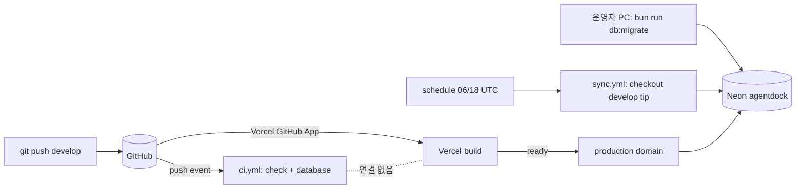

# AgentDock Phase 9 — CI/CD · Neon Migration · Vercel Production 배포 자동화

작성일 2026-10-22 · 기준 HEAD `0602d99`(develop) · 미커밋 · 운영 미활성화

## 1. Executive Summary

| 항목 | 상태 |
|---|---|
| 로컬 구현 | 완료. `deploy.yml`, migration gate, advisory lock, history 검증, 위험 migration 승인, 배포 판단(gate), smoke test, CI 중복 실행 방지, sync 보호 |
| 검증 | 단위 테스트 +58건, 로컬 PostgreSQL migration E2E 10개 시나리오, 빌드한 앱 smoke E2E 4개 시나리오, workflow Summary 판정 11개 조합, Vercel 단계 stub, actionlint |
| 운영 활성화 | **하지 않았다.** GitHub Environment, Vercel token, fingerprint 등록과 activation push는 사용자가 수행한다(§18) |
| 판정 | **READY FOR ACTIVATION.** 단, §18 B·E 단계는 실제 계정에서만 확인할 수 있다 |

**핵심 불변조건:** production은 migration이 적용되지 않은 빌드를 서빙하지 않는다. 이 조건은 두 장치로 지킨다.

- `vercel.json`이 develop과 main의 Vercel Git 배포를 끈다.
- `deploy.yml`은 같은 job 안에서 같은 sha의 migrate와 verify가 성공한 다음에만 `vercel deploy --prod`를 실행한다.

## 2. 현재 배포 구조 (Phase A, 변경 전)



근거(읽기 전용 조회, 2026-10-22):

- `gh api repos/…/commits/0602d99/statuses`에 `Vercel pending 03:18:13Z → success 03:18:31Z`가 있다. CI check run은 03:18:14Z에 시작했다. Vercel은 CI 결과를 기다리지 않았다.
- `repos/…/environments`에는 아무것도 없다. `repos/…/deployments`도 비어 있다. Vercel은 commit status만 남긴다.
- 기존 `ci.yml`은 `on: push / pull_request`이고 secret이 없다. `sync.yml`은 schedule과 workflow_dispatch로 실행된다.

| 질문 | 답(변경 전) |
|---|---|
| CI 결과와 Vercel 배포가 연동되는가 | 아니다. 같은 push 이벤트에서 따로 시작한다 |
| CI가 실패해도 production이 갱신되는가 | 그렇다 |
| migration 없이 앱이 먼저 배포될 수 있는가 | 그렇다. migration은 운영자 PC에서 수동으로 한다(decision `migrate-before-push-0008`). 순서는 사람이 지킨다 |
| 배포 중 Sync가 DB를 쓰면 | Sync는 schedule 시각의 develop tip을 checkout한다. migration보다 먼저 새 코드가 돌 수 있다 |
| 같은 commit을 중복 배포할 수 있는가 | Vercel은 push마다 배포한다. 중복 push 이벤트를 막는 장치가 없다 |
| Vercel 배포가 실패하고 migration만 적용된 상태 | 가능하다. migration이 추가형이면 이전 앱이 그대로 동작한다 |
| 이전 앱과 새 schema가 공존 가능한가 | 지금까지의 0000–0010은 추가형이다(0006 generated column, 0007 DO guard 포함). 강제 장치는 없었다 |
| Rollback 범위 | Vercel Instant Rollback은 앱만 되돌린다(Hobby는 직전 배포 1개까지). DB는 Neon restore로 수동 복구한다 |

## 3. 문제점

1. Push 하나가 CI와 production 배포를 동시에 시작한다. CI 실패와 migration 미적용 모두 배포를 막지 못한다.
2. Migration 순서를 사람이 기억해야 한다.
3. `migrate.mjs`에는 실행자 사이의 직렬화가 없었다. 또 history를 lock 없이 읽었다. 두 실행자가 같은 history를 읽으면 둘 다 적용을 시도한다.
4. drizzle 규칙("가장 최근 `created_at`보다 새로운 파일만 적용")은 세 경우를 조용히 넘긴다.
   - 적용 뒤 수정된 파일
   - DB에는 있는데 checkout에는 없는 migration(오래된 commit을 배포한 경우)
   - 사이에 빠진 파일
5. 위험 SQL을 막는 장치가 boundary scanner의 review marker 하나뿐이었다. DELETE·UPDATE·ALTER COLUMN은 걸리지 않았다.
6. 새 코드의 sync가 migration보다 먼저 돌 수 있었다.

## 4. CI 중복 실행 원인 (Phase B)

| run | number | event | branch | sha | check_suite | created |
|---|---|---|---|---|---|---|
| 39716087560 | 24 | push | develop | 0602d99 | 107635235272 | 03:18:12Z |
| 39716088515 | 25 | push | develop | 0602d99 | 107635237887 | 03:18:12Z |

- 두 run 모두 `run_attempt 1`이고 `workflow_dispatch`가 아니다. PR도 없다(`pulls?state=all`가 비어 있다).
- `GET repos/…/activity`에 **같은 ref 갱신 `28730e9→0602d99`가 push 2건으로 기록돼 있다.** id는 47339677051과 47339678237이고 둘 다 03:18:09Z다.
- 로컬 remote에는 URL이 하나뿐이고 push 설정도 없다. `origin/develop` reflog에는 push가 1건이다.

**결론(확인된 사실):** 두 CI run은 push 이벤트 2건에서 따로 시작됐다. `pull_request` trigger 때문이 아니다.

**추정(확인 불가):** 이벤트가 두 번 생긴 원인이 GitHub 쪽 중복 전달인지, 클라이언트(Orca 등)의 동시 push 2회인지는 로컬 기록만으로 가릴 수 없다.

**대응(`ci.yml`)**
- `concurrency: ci-${event}-${sha}`, `cancel-in-progress: true`
  - 같은 이벤트·같은 sha면 나중 run이 앞 run을 취소한다.
  - sha가 다르면 group이 달라 서로 취소하지 않는다.
  - CI는 아무것도 쓰지 않으므로 취소해도 안전하다. deploy는 `success`로 끝난 run에서만 시작한다.
- `push.branches: [develop, main]`: PR이 열린 브랜치를 push와 PR에서 두 번 검사하지 않는다. PR 검증은 그대로 유지한다.
- **`paths-ignore`는 쓰지 않았다.** 문서만 바꾼 push에서 CI가 돌지 않으면 그 commit의 deploy도 돌지 않는다. 그런데 직전 code commit의 deploy는 gate에서 `SUPERSEDED`(tip이 아님)로 끝난다. 결과적으로 어떤 commit도 배포되지 않는다.

## 5. 자동화 설계 비교 (Phase C)

| 기준 | A. Git Integration + Deployment Checks | **B. Actions → Vercel CLI (선택)** | C. 자동 도메인 할당 끄기 + `vercel promote` |
|---|---|---|---|
| Hobby 지원 | 문서에 플랜 제한 언급이 없다(미확인) | 공식 가이드의 기본 경로다 | promote의 Hobby 지원은 미확인 |
| `*.vercel.app` 보호 | 문서는 "custom production domains"라고만 쓴다. 기본 도메인도 막는지는 불명 | 배포 자체가 migration 뒤에 일어나므로 해당 없음 | 동일하게 불명 |
| 순서 보장 | Vercel 빌드와 migration이 병렬로 돈다. check 이름이 맞아야 한다 | 같은 job 안에서 step 순서로 보장 | 보장되지만 promote 전 smoke에 protection bypass가 필요 |
| 비용 | 빌드 1회 | 빌드 2회(CI build + Vercel build) | 빌드 2회 |
| Secret | 추가 없음 | `VERCEL_TOKEN` 1개 | `VERCEL_TOKEN` + bypass secret |
| Rollback | Instant Rollback | 같음 | 같음 |
| 실패 안전성 | check 미보고 시 동작이 문서에 없음 | 빌드가 실패하면 도메인을 옮기지 않는다(CLI exit 1) | 같음 |

**B를 고른 이유:** 확인되지 않은 플랫폼 기능에 기대지 않는다.

확인한 공식 문서(2026-10-22):
- Vercel의 Git configuration(`git.deploymentEnabled`)
- "How can I use GitHub Actions with Vercel"
- CLI global options: `VERCEL_TOKEN`, `VERCEL_ORG_ID`, `VERCEL_PROJECT_ID` 환경변수
- Instant Rollback: Hobby는 직전 배포만 되돌릴 수 있고, rollback 뒤에는 자동 도메인 할당이 꺼진다
- Neon plans: Free는 branch 10개, restore window 6시간·1 GB-month, 수동 snapshot 1개

**`--prebuilt`를 쓰지 않은 이유:** `vercel pull`이 production 환경변수, 즉 pooled `DATABASE_URL`을 runner로 내려받는다. 원격 빌드를 쓰면 runner에 DB URL이 하나만 존재한다(migration용 direct URL).

## 6. 최종 아키텍처

```mermaid
flowchart TD
  push[push develop] --> ci[CI: check + database]
  push -. vercel.json: deploymentEnabled.develop=false .-> x[Vercel Git 배포 없음]
  ci -->|workflow_run success, event=push, 같은 repo| gate
  subgraph deploy.yml — concurrency production, cancel-in-progress false
    gate{gate: 이 sha의 push CI 성공? tip? 이미 서빙?}
    gate -->|SUPERSEDED / ALREADY_DEPLOYED| skip[SKIPPED]
    gate -->|BLOCKED_CI| blocked[BLOCKED]
    gate -->|DEPLOY| plan[plan --production: pin, history, risk]
    plan -->|exit 1/2| blocked
    plan --> mig[migrate --production: advisory lock, lock_timeout 15s, 적용, 검증, commit]
    mig -->|실패| failed[FAILED: 배포 안 함]
    mig --> ver[plan --require-current]
    ver --> vd[vercel deploy --prod --build-env AGENTDOCK_COMMIT_SHA]
    vd -->|build 실패| failed2[FAILED: 이전 배포 유지]
    vd --> smoke[smoke: 페이지 + X-AgentDock-Commit]
    smoke -->|실패| degraded[DEGRADED]
    smoke --> ok[SUCCESS]
  end
  sync[sync.yml] --> sg[plan --require-current] -->|최신일 때만| run[bun run sync]
```

**production 활성화 시점의 증명**
1. Vercel에서 production 도메인을 옮기는 경로는 세 가지다: Git 배포, CLI `--prod` 배포, 대시보드 수동 조작. 첫 번째는 `vercel.json`이 develop·main에 대해 끈다. 대시보드 조작은 운영자 행위다(§17).
2. CLI 배포는 `deploy.yml`의 `vercel` step에만 있다. 이 step의 `if`는 `steps.verify.outcome == 'success'`를 요구한다. verify는 migrate가 성공해야 돌고, migrate는 plan이 성공해야 돈다. 모두 같은 job·같은 `SHA`다.
3. verify는 `--require-current`로 "pending 0"을 DB에서 다시 읽는다. 그래서 "migration 성공"은 exit code가 아니라 history로 확인한다.
4. `vercel deploy --prod`는 빌드가 준비된 뒤에 도메인을 옮긴다. 빌드가 실패하면 도메인은 이전 배포에 남는다.

## 7. GitHub Actions 설계

| 장치 | 위치 | 효과 |
|---|---|---|
| trigger | `workflow_run: [CI] completed, branches [develop]` + `workflow_dispatch` | CI 결과를 재사용한다. 테스트를 다시 돌리지 않는다 |
| job `if` | conclusion success, event push, head_repository가 이 repo | PR·fork·취소·실패 run은 배포를 시작하지 않는다 |
| gate | `scripts/release.mjs gate` | 이 sha의 push run이 develop에서 success인지 API로 확인한다(`head_sha`, `event=push`, `branch=develop`, `status=success`). 다른 sha나 다른 이벤트의 성공은 근거가 아니다 |
| 순서 역전 방지 | gate: `sha ≠ develop tip` → SUPERSEDED | 늦게 끝나거나 다시 실행된 이전 sha가 최신 배포를 덮어쓰지 않는다 |
| 중복 배포 방지 | gate: production `X-AgentDock-Commit == sha` → ALREADY_DEPLOYED | 중복 push 이벤트(CI #24/#25 같은 경우)나 re-run이면 Vercel 배포를 건너뛴다 |
| 직렬화 | `concurrency: production`, 취소 없음 | 대기 run은 하나만 남고 더 새로운 run으로 교체된다 |
| 권한 | `contents: read`, `actions: read` | 쓰기 권한이 없다 |
| 환경 | `environment: production`(develop만 허용) | Vercel token과 pin은 develop의 job에서만 읽힌다 |
| 재실행 | migrate는 멱등이다(pending이 없으면 no-op). gate는 tip과 서빙 중인 sha를 다시 확인한다 | 중단된 run은 그냥 다시 실행하면 된다 |
| Summary | 항상 실행 | `SUCCESS / SKIPPED / BLOCKED / FAILED / DEGRADED`, sha, 단계별 결과, rollback 안내. SUCCESS·SKIPPED만 exit 0 |

## 8. Neon Migration Gate

구현은 `scripts/migration-gate.mjs`(순수 함수)와 `scripts/migrate.mjs`다. 기존 drizzle의 파일 reader, history 형식, hash를 그대로 쓴다. 새 migration 엔진은 만들지 않았다.

- **Target 검증(`--production`, 접속 전):**
  - URL이 없거나 형식이 아니면 거부한다.
  - loopback과 `-pooler` host도 거부한다.
  - `AGENTDOCK_TARGET_FINGERPRINT`가 없거나 다르면 거부한다.
  - fingerprint는 `sha256("user@host:port/db")`의 16자다. password와 query는 제외한다.
  - host 문자열을 코드에 넣지 않는다. endpoint가 바뀌면 fingerprint가 달라져 막힌다(닫힌 쪽으로 실패). 운영자가 pin을 갱신하면 풀린다.
  - Neon branch id를 SQL로 읽는 공식 방법은 찾지 못했다(`neon.timeline_id`는 문서화되지 않았다). 그래서 쓰지 않는다.
  - history가 비어 있으면 production에서는 BLOCKED다(운영 중인 배포가 아니라는 뜻).
- **History 검증:** 세 경우 모두 BLOCKED다.
  - 기록된 migration의 hash가 다르다(적용 뒤 수정).
  - DB에는 있는데 checkout에는 없다(DB가 앞서 있다).
  - 최신 기록보다 오래된 파일이 적용되지 않았다(gap).
- **위험 규칙(allowlist):**
  - 자동 적용: 새 table·index·type·sequence, nullable 또는 literal default column, 같은 파일에서 만든 table의 FK, `artifact_type` seed.
  - 승인 필요: 그 밖의 모든 것. generated column, volatile default, NOT NULL without default, DROP, DELETE, UPDATE, ALTER COLUMN, RENAME, 기존 table의 constraint, DO block, 한 chunk 안의 여러 statement가 여기에 든다.
  - boundary scanner(`checkMigrationSql`)가 거부하는 것은 BLOCKED다.
  - 실제 파일에 적용하면 0000–0010 가운데 0006과 0007만 "승인 필요"다. 둘 다 이미 적용됐다.
- **승인:** `AGENTDOCK_APPROVED_MIGRATIONS=<정확한 tag>`. 대기 중이 아닌 tag를 지정하면 BLOCKED다. 지난 승인이 다음 migration으로 이어지지 않는다.
- **직렬화:** 한 transaction 안에서 다음 순서로 실행한다.
  1. `SET LOCAL lock_timeout = '15s'`
  2. `pg_advisory_xact_lock(hashtext('agentdock:migrate:agentdock'))`
  3. history 읽기(lock 아래에서)
  4. gate
  5. 적용
  6. 적용 뒤 history 재검증
  7. commit
  - lock은 commit, rollback, 연결 종료 때 풀린다.
  - GitHub concurrency와 달리 노트북, runner, Docker 등 모든 실행자에게 적용된다.
- **실패별 동작:**

| 실패 | 동작 | 확인 |
|---|---|---|
| DB 접속 실패 | `migrate failed: ECONNREFUSED`(주소는 출력하지 않음), exit 1 | E10 |
| Secret 누락 | `DATABASE_URL is not set` / `AGENTDOCK_TARGET_FINGERPRINT is not set`, exit 1 | E10, 단위 |
| 대상 불일치 | `fingerprint … does not match the pinned …`, exit 1 | E10, 단위 |
| SQL 오류 | `migrate failed: 42703 …`, 전체 rollback, history 그대로 | E7 |
| 권한 부족 | PostgreSQL `42501`이 같은 경로로 출력되고 rollback된다 | 미재현(구조상 E7과 같은 경로) |
| Lock timeout | `55P03 … lock timeout`, 15초, rollback | E8, E9 |
| History 불일치 | BLOCKED, exit 1 | E4, E5 |
| 위험 migration | NEEDS_APPROVAL, exit 2 | E6 |
| Backup 실패 | 자동 backup은 없다. 승인 절차에서 운영자가 branch를 만든다(§12) | — |
| 적용 뒤 검증 실패 | commit 전에 throw하므로 rollback된다 | 코드 경로 |

- **Sync 보호:** `sync.yml`은 `bun run sync` 전에 `migrate.mjs --plan --require-current`(읽기 전용)를 실행한다. schema가 checkout보다 뒤처져 있으면 sync를 실행하지 않고 run을 실패로 끝낸다.

## 9. Vercel Deployment Gate

- `vercel.json`: `git.deploymentEnabled: { develop: false, main: false }`
  - develop·main 외 브랜치의 Preview는 그대로 둔다.
  - Production Branch가 develop이든 main이든 둘 다 막힌다.
- `vercel@61.1.0`을 pin했다. npm 게시일은 2026-09-29로, 3주 이상 지났다.
- `vercel deploy --prod --yes --build-env AGENTDOCK_COMMIT_SHA=$SHA`
  - token은 `VERCEL_TOKEN` 환경변수로만 전달한다. stub으로 argv에 들어가지 않는 것을 확인했다.
  - 빌드는 Vercel 프로젝트의 Production 변수로 실행된다.
- `next.config.ts`는 `X-AgentDock-Commit` 헤더를 붙인다. 값은 `AGENTDOCK_COMMIT_SHA` 또는 Vercel Git 배포의 `VERCEL_GIT_COMMIT_SHA`다. Docker 빌드에는 둘 다 없어 헤더가 붙지 않는다. 공개 repository의 commit sha이므로 노출해도 되는 정보다.
- **rollback된 상태:** Vercel은 rollback 뒤 자동 도메인 할당을 끈다. 이 상태에서는 deploy가 성공해도 도메인이 옮겨지지 않는다. smoke의 identity 검사가 이를 `DEGRADED`로 잡고 "undo the rollback"을 안내한다.

## 10. Production Secret 구성

| 이름 | 종류 | 위치 | 사용처 | 신규 |
|---|---|---|---|---|
| `DATABASE_URL` | secret | repository | sync.yml, deploy.yml(migration). agentdock_app **direct** | 기존 |
| `AGENTDOCK_GITHUB_TOKEN` | secret | repository | sync.yml | 기존 |
| `VERCEL_TOKEN` | secret | environment `production` | vercel deploy | **신규** |
| `VERCEL_ORG_ID`, `VERCEL_PROJECT_ID` | variable | environment `production` | vercel CLI | **신규** |
| `PRODUCTION_URL` | variable | environment `production` | gate, smoke, environment url | **신규** |
| `AGENTDOCK_TARGET_FINGERPRINT` | variable | environment `production` | migrate `--production` | **신규** |
| Vercel `DATABASE_URL`(pooled), `DATABASE_SCHEMA` | Vercel env | Vercel Production | 웹 | 기존, 변경 없음 |

후보 중 쓰지 않는 것:
- `NEON_API_KEY`, `NEON_PROJECT_ID`, `NEON_PRODUCTION_BRANCH_ID`: Neon API를 호출하지 않는다. 자동 backup을 구현하지 않았기 때문이다(§12).
- `NEON_PRODUCTION_DATABASE_URL`: 기존 `DATABASE_URL`을 재사용한다. 둘 다 같은 agentdock_app role이므로 별도 role로 얻는 권한 축소가 없다.

Migration 전용 role은 만들지 않았다. agentdock_app은 schema owner로서 DDL을 실행하는 최소 role이다. 웹용 읽기 전용 role을 분리하는 일은 Phase 0의 role·schema 경계를 바꾸는 작업이라 이번 범위에서 뺐다.

## 11. GitHub Environment 설정

`production`을 만든다.

- Deployment branches: `develop` 하나만 둔다.
- 필수 reviewer는 두지 않는다. 두면 모든 push가 사람을 기다린다.
- 위험 migration은 별도 승인 절차를 거친다. repository 쓰기 권한자가 `workflow_dispatch`에 tag를 명시해야 한다.

이 repository는 public이다(`visibility: public`). public repository에서 environment와 branch 제한을 쓸 수 있는지는 이번 세션에서 문서로 확인하지 않았다. 활성화 단계 A에서 화면이 열리는지로 확인한다.

## 12. Backup / Recovery

**자동 backup은 구현하지 않았다.** 이유는 세 가지다.
- Neon API key는 project 전체 권한이다.
- 만든 branch로 실제 복구가 되는지는 이번 작업에서 검증할 수 없다.
- Free 플랜은 branch 10개, snapshot 1개로 제한된다.

대체 장치는 다음과 같다.
1. 위험 migration은 승인 없이는 적용되지 않는다. 승인 절차에 "Neon Console → Branches → Create branch `pre-<tag>`"가 들어 있다(VERCEL_DEPLOY.md).
2. 자동 적용되는 migration은 추가형뿐이다. 데이터를 지우거나 바꾸지 않는다.
3. Neon Free instant restore는 6시간, 1 GB-month까지 쓸 수 있다. production을 제자리에서 restore하면 그 뒤에 들어온 sync 데이터가 사라진다. 그래서 새 branch로 먼저 restore해 확인하도록 안내한다.

production DB를 자동으로 덮어쓰는 rollback은 없다.

## 13. Smoke Test

`bun scripts/release.mjs smoke <url> [sha]` 하나로 다음을 확인한다.

- **identity:** `HEAD /`의 `X-AgentDock-Commit`이 sha와 같은지 본다. CDN 전파를 기다리려고 10초 간격으로 최대 6회 시도한다.
- **페이지:** `/`, `/artifacts`, `/artifacts?q=mcp`가 모두 200이어야 하고 error boundary 문구가 없어야 한다. `/skills`는 308이어야 한다.
- **DB 호환성:** 페이지가 DB를 읽어 렌더링하므로, 200과 error boundary 부재가 곧 DB 확인이다.
  - `/artifacts`에 "No artifacts indexed yet"가 나오면 FAIL이다. 다른 DB나 schema를 가리킨다는 뜻이다.
  - migration 상태는 HTTP로 노출하지 않는다. workflow의 verify step이 DB에서 직접 확인한다.
- **유형:** `ARTIFACT_TYPE_IDS` 6개를 `/artifacts?type=…`로 조회한다.
  - 비어 있는 유형은 `note`로만 보고하고, 모든 유형이 비어 있을 때만 FAIL이다. 개수는 하드코딩하지 않는다.
  - 목록이 `search.ts`와 어긋나면 테스트가 실패한다.
- **실패 시:** step이 실패하면 Summary가 `DEGRADED`로 기록하고 rollback 절차를 안내한다. 자동 rollback은 하지 않는다. Hobby에서는 직전 배포 1개로만 되돌릴 수 있고, 되돌린 뒤에는 도메인 자동 할당이 꺼진다. 자동화하면 다음 배포까지 막힌다.

## 14. Rollback

| 대상 | 방법 | 범위 |
|---|---|---|
| 앱 | Vercel Instant Rollback(Hobby는 직전 배포만). 그 뒤 Undo Rollback 또는 `vercel promote`로 자동 할당을 복구한다 | 코드만 되돌린다. 환경변수는 그대로다 |
| 앱(코드) | `git revert` 후 push하면 deploy.yml이 배포한다 | **migration 파일을 지우는 revert는 BLOCKED다**(DB가 앞서 있음). 코드만 되돌린다 |
| DB, 추가형 | 그대로 둔다. 이전 앱이 새 schema에서 동작한다(§16 S1) | — |
| DB, 승인된 위험 migration | `pre-<tag>` branch나 restore window에서 수동 복구한다 | 운영자가 판단한다 |
| 배포 중단 | `gh workflow disable deploy.yml` | 지금 서빙 중인 버전은 그대로 유지된다 |

## 15. Sync와 배포 충돌 방지

- **concurrency group:** sync와 production은 그룹이 다르다. 서로 기다리지 않으며, 일부러 그렇게 했다. 배포 때마다 최대 40분인 sync를 기다리게 하지 않는다.
- **충돌이 생기는 곳은 PostgreSQL뿐이다.**
  - DDL이 sync의 쓰기 transaction과 부딪히면 15초 안에 실패하고 rollback된다(E9). sync는 영향을 받지 않는다.
  - 추가형 migration은 이미 돌고 있는 이전 코드의 sync와 호환된다.
- **새 코드의 sync:** schema가 최신이 아니면 첫 step에서 실행을 거부한다.
- **알려진 비용:** DDL은 ACCESS EXCLUSIVE lock을 기다린다. 그동안 같은 table을 읽는 웹 query도 최대 15초까지 그 뒤에서 기다릴 수 있다. 현재 규모에서 transaction은 짧다. Phase 8에서 저장소 하나를 쓰는 데 statement 14개였다.

## 16. 테스트 결과

### 16.1 기존 + 신규 전체

| 항목 | 명령 | 결과 |
|---|---|---|
| boundaries | `bun run check:boundaries` | PASS — 11 migration, 91 source, 27 UI |
| lint | `bun run lint` | PASS — 205 files, No fixes |
| typecheck | `bun run typecheck` | PASS |
| tests, PG17 DB 포함 | `CI=1 bun run test`(`TEST_DATABASE_URL`만) | **PASS 70 files / 1 skipped, 1327 passed / 3 skipped**. Phase 8은 1269였고 58건이 늘었다 |
| build | `bun run build`(placeholder URL) | PASS |
| Vercel 모드 build | `VERCEL=1 bun run build` | PASS |
| Docker | `docker build -t agentdock-phase9:local .` | PASS |
| workflow lint | `rhysd/actionlint:1.7.7`(shellcheck 포함) | PASS, 0건 |
| diff / secret scan | `git diff --check`, 패턴 grep | PASS. 걸린 1건은 테스트용 가짜 URL(`s3cret@ep-x-123…`)이다 |

skip 3건은 Phase 8과 같다.
- pg_trgm 부재 케이스: 로컬에 pg_trgm이 설치돼 있다.
- wrong-password: trust 인증이라 실행할 수 없다.
- permalink live: `CI=1`이라 실행하지 않는다.

### 16.2 요구 시나리오

| # | 시나리오 | 방법 | 결과 |
|---|---|---|---|
| 1 | 정상 migration + 배포 | E3(0011 추가형 적용·검증), S1 smoke, Summary | PASS(local) |
| 2 | migration 없는 배포 | E2 `UP_TO_DATE`, Summary | PASS(local) |
| 3 | migration 실패 | E7 `42703`, history 13 → 13 | PASS(local) |
| 4 | 위험 migration | E6: exit 2, 거부, 엉뚱한 tag는 BLOCKED, 정확한 tag면 적용 | PASS(local) |
| 5 | 잘못된 target | E10: loopback, pooler, pin 불일치 | PASS(local) |
| 6 | secret 누락 | E10 `DATABASE_URL`, gate 입력 누락(단위) | PASS(local). 실제 Vercel CLI의 token 누락은 NOT RUN |
| 7 | CI 실패 | gate `BLOCKED_CI`(fake API), job `if` | gate PASS(mock). GitHub의 `if` 평가는 NOT RUN |
| 8 | 중복 trigger | ci.yml concurrency와 ALREADY_DEPLOYED | 설정은 actionlint PASS. GitHub 동작은 NOT RUN |
| 9 | 같은 sha 중복 배포 | `ALREADY_DEPLOYED`(단위, fake API), Summary SKIPPED | PASS(mock) |
| 10 | 이전 sha 역전 | `SUPERSEDED`(이전 sha를 다시 실행하는 경우 포함) | PASS(mock) |
| 11 | 두 배포 동시 시작 | E1 migrator 2개 동시 실행 → 1개만 적용, 중복 hash 0. GitHub concurrency는 NOT RUN | PASS(local) |
| 12 | sync와 migration 경합 | E9 row lock을 잡은 writer → DDL 15초 뒤 실패, rollback, 재시도 성공. E3 `--require-current` exit 1 | PASS(local) |
| 13 | Vercel build 실패 | stub CLI exit 1 → step 실패, url 없음, Summary "previous deployment" | PASS(stub) |
| 14 | smoke 실패 | S2 sha 불일치, S3 빈 schema, S4 서버 없음, 단위(error boundary, 5xx) | PASS(local) |
| 15 | history 불일치 | E4 DB가 앞섬, E5 수정된 파일 | PASS(local) |
| 16 | DB lock 실패 | E8 advisory lock 점유 → 15초 뒤 `55P03` | PASS(local) |
| 17 | rollback 절차 | 문서로만 작성 | NOT RUN(Vercel 계정 필요) |
| 18 | secret 노출 검사 | diff/untracked scan, stub argv에 token 없음, 오류 출력에 주소·URL 없음(E10) | PASS |

### 16.3 호환성 조합

- **이전 앱 + 신규 schema:** 0011(`ADD COLUMN note text`)을 적용한 `agentdock`에 현재 빌드를 붙여 smoke를 돌렸다(S1). 결과는 PASS다. identity `0602d99`를 확인했고, 비어 있는 유형은 note로 보고됐다.
- **신규 앱 + 신규 schema:** Phase 9에는 schema 변경이 없다. 신규 앱은 현재 schema를 쓰고, 그 조합은 S1과 같은 빌드다. 앞으로 schema를 바꿀 때는 E3 → S1 순서로 같은 방식으로 확인한다.

로그(scratchpad `p9/`):
- `mig-e2e.log`
- `smoke-e2e.log`
- `summary-cases.log`
- `static.log`, `test.log`, `build*.log`, `docker.log`

로컬 `agentdock` schema는 검토된 11개 migration 상태로 되돌렸다(`UP_TO_DATE`).

## 17. 남은 제한 사항

1. **운영 미검증:** 실제 GitHub Actions, Vercel, Neon에서는 아무것도 실행하지 않았다(금지 조건).
   - `git.deploymentEnabled`가 이 프로젝트에서 Git 배포를 실제로 막는지는 문서로만 알고 있다. §18 E에서 처음 확인한다.
   - activation push 자체는 migration이 없어서, 막지 못하더라도 불변조건이 깨지지 않는다.
2. **대시보드 수동 조작은 막지 못한다:** Redeploy, Promote, 노트북에서의 `vercel --prod`. 운영자의 수동 행위로 남는다.
3. **Vercel Hobby token은 계정 전체 권한이다.** project 단위로 scope할 수 없다.
4. **fingerprint는 host 기준이다.** Neon이 endpoint host를 바꾸면 배포가 막힌다. 닫힌 쪽으로 실패하며, 운영자가 pin을 다시 등록해야 한다.
5. **위험 규칙은 allowlist다.** 안전한데도 목록에 없는 shape는 승인을 요구한다(오탐은 승인 쪽으로 난다). 반대로 allowlist의 `CREATE UNIQUE INDEX`는 데이터 때문에 실패할 수 있다. 이때는 rollback된다.
6. **비파괴적 `CREATE INDEX`도 build 동안 쓰기를 막는다.** `CONCURRENTLY`는 transaction 안에서 쓸 수 없다(0010 주석).
7. **빌드를 두 번 한다.** CI와 Vercel에서 한 번씩이다.
8. **schema가 최신이 아니면 sync가 실패한다.** 승인을 기다리는 migration이 있으면 그동안 12시간마다 sync가 실패한다. 의도한 동작이다(조용히 넘어가지 않게).
9. **ACCESS EXCLUSIVE 대기 중에는 웹 query가 최대 15초 지연될 수 있다(§15).**

## 18. 최초 활성화 절차

정본은 `VERCEL_DEPLOY.md` → "Automated deploys" → "Activation"이다. 요약:

| 단계 | 할 일 | 통과 조건 |
|---|---|---|
| A | GitHub → Settings → Environments → `production` 생성. branch를 develop으로 제한하고, secret `VERCEL_TOKEN`, variable 4개를 넣는다 | 화면에 등록된 상태 |
| B | 노트북에서 읽기 전용으로 `migrate.mjs --fingerprint`와 `--plan --production` 실행 | `11 applied, 0 pending — UP_TO_DATE` |
| C | Vercel → Settings → Environments → Production → Branch Tracking이 develop인지 확인. 아무것도 바꾸지 않는다 | develop |
| D | activation commit을 push(이 변경 전체, migration 없음) | CI 1회, Deploy `SUCCESS`, 헤더 = sha |
| E | migration 없는 두 번째 commit을 push | Vercel에 Git 배포가 없고 Deploy 배포 1건만 있음 |
| — | E를 통과해야 migration이 든 commit을 push할 수 있다 | |

**전환 순서의 증명**
- **D 이전:** 기존 Git 배포가 그대로 동작한다. B에서 production에 pending migration이 0개임을 확인한다. 즉 "새 코드가 migration보다 먼저"인 상황이 생길 migration이 없다.
- **D:** commit에 migration이 없다. Vercel이 Git 배포를 한 번 더 하더라도 그 코드에 필요한 migration이 없다.
- **E 이후:** Git 배포가 꺼진 것을 확인했고, production을 바꾸는 경로는 `deploy.yml`의 verify 뒤뿐이다(§6). E가 실패하면 repository를 disconnect하는 대안이 있다. CLI 배포에는 Git 연결이 필요 없다.
- **`workflow_run` 주의:** 이 trigger는 default branch에 있는 workflow 파일로 실행된다. D에서 deploy.yml이 처음 들어오므로, D의 CI 완료가 Deploy를 시작하지 않을 수 있다. 그 경우 `gh workflow run deploy.yml --ref develop`로 수동 실행한다. 이 경우에도 gate는 같은 CI 성공을 확인한다.

## 19. 일상적인 배포 절차

1. develop에 push한다.
2. CI가 성공하면 Deploy가 자동으로 돈다.
3. Summary를 확인한다.
   - `SUCCESS` / `SKIPPED`: 할 일 없음.
   - `BLOCKED (migration plan)`: plan step을 읽는다. `needs approval`이면 backup branch를 만들고 `gh workflow run deploy.yml --ref develop -f approve_migrations=<tag>`.
   - `FAILED (migration)`, lock timeout: 다시 실행한다.
   - `FAILED (Vercel)`: 빌드를 고쳐 push한다. production은 이전 배포다.
   - `DEGRADED`: §20.
4. 축소(contract) 변경, 예를 들어 column 삭제는 그 column을 읽는 빌드가 남아 있지 않을 때 별도 push로 하고 승인 절차를 거친다.

## 20. 긴급 복구 절차

1. `gh workflow disable deploy.yml`로 다음 배포를 막는다.
2. 앱: Vercel → Production Deployment → **Instant Rollback**(직전 배포).
   - rollback 뒤에는 도메인 자동 할당이 꺼진다.
   - 복구가 끝나면 **Undo Rollback**으로 되돌린다.
3. DB:
   - 자동 적용된 migration은 추가형이므로 그대로 둔다. migration 파일을 지우는 revert는 하지 않는다.
   - 승인된 위험 migration으로 데이터를 잃었다면 `pre-<tag>` branch나 restore window에서 **새 branch로** restore해 확인한 뒤 운영자가 결정한다.
4. 원인을 고쳐 push하고 `gh workflow enable deploy.yml`로 다시 켠다.

## 부록 — 변경 파일

| 파일 | 내용 |
|---|---|
| `.github/workflows/deploy.yml` | 신규. §7 |
| `.github/workflows/ci.yml` | push branch 필터, sha·event concurrency |
| `.github/workflows/sync.yml` | `--plan --require-current` step |
| `vercel.json` | 신규. develop·main의 Git 배포를 끈다 |
| `scripts/migration-gate.mjs` / `.test.ts` | 신규. 위험 규칙, history, plan, fingerprint, target. 테스트 44건 |
| `scripts/migrate.mjs` | `--plan`, `--production`, `--require-current`, `--fingerprint`, advisory lock, lock_timeout, lock 아래 history 읽기, 적용 뒤 검증, 오류 정제 |
| `scripts/release.mjs` / `.test.ts` | 신규. gate, smoke. 테스트 14건(fake GitHub API, fake site) |
| `next.config.ts` | `X-AgentDock-Commit` 헤더 |
| `.gitignore` | `.vercel` |
| `VERCEL_DEPLOY.md`, `DEPLOY.md`, `README.md`, `README.en.md` | 배포 경로, 승인, activation, 복구 |
