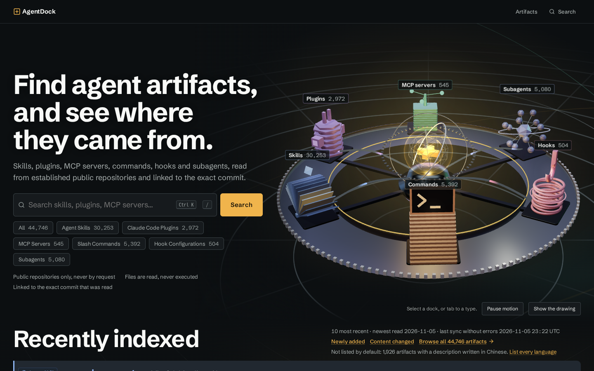
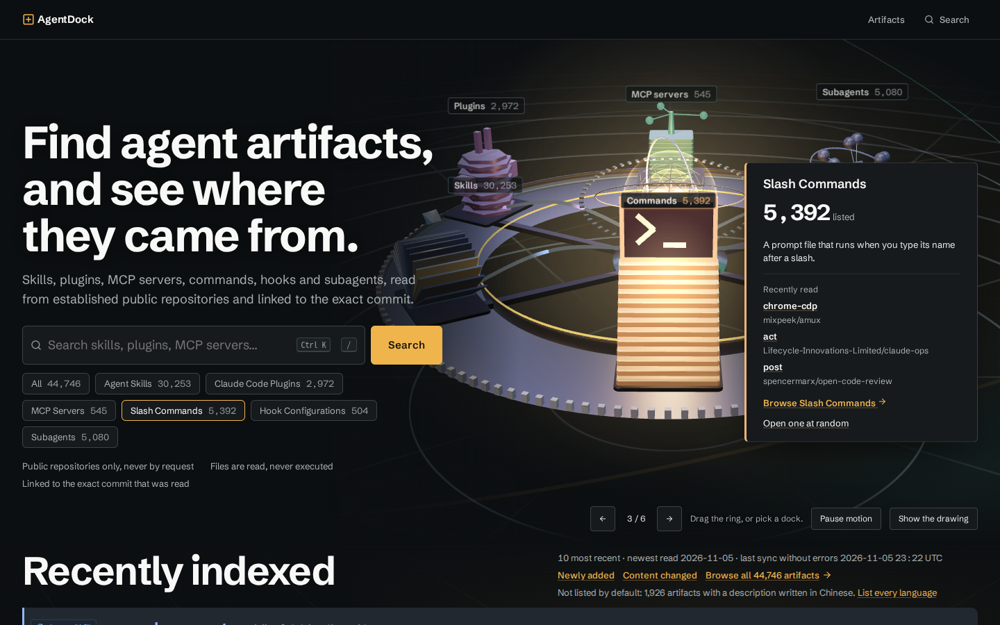
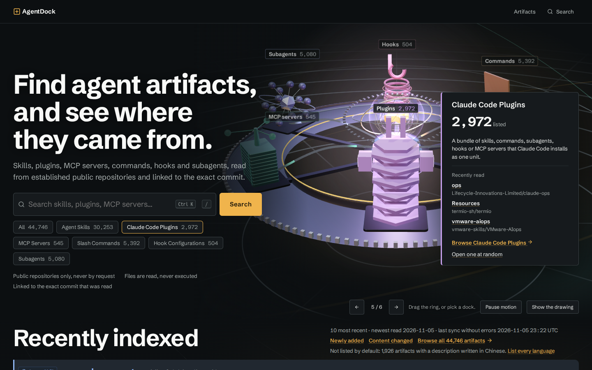
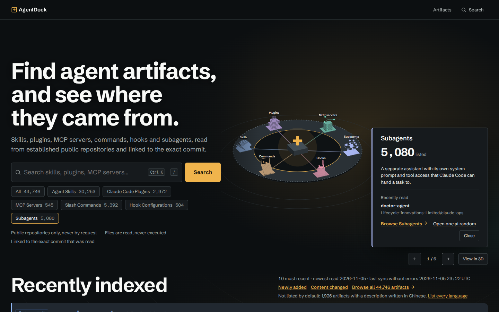
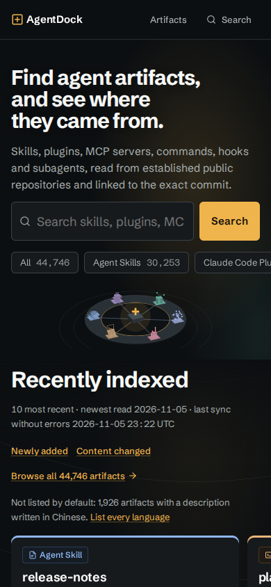
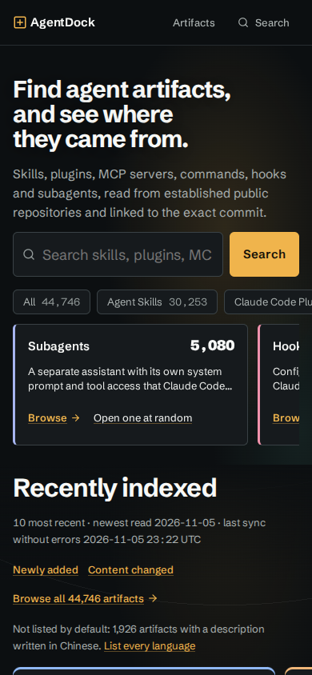
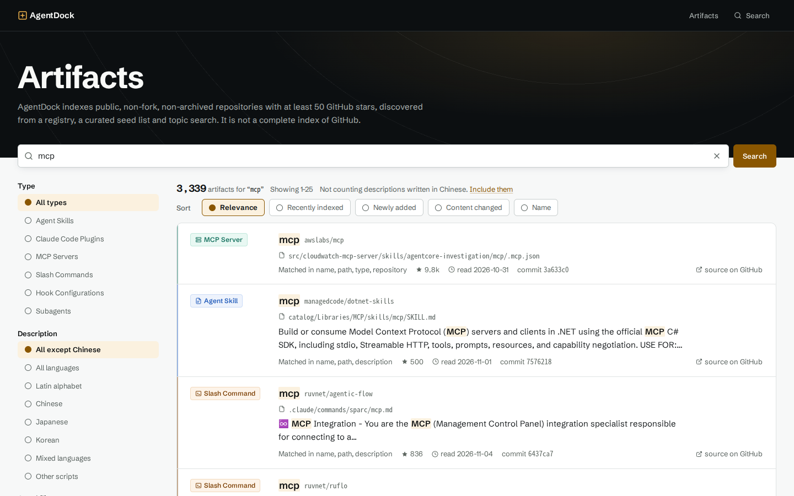
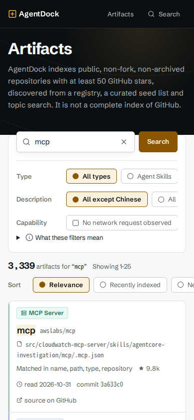
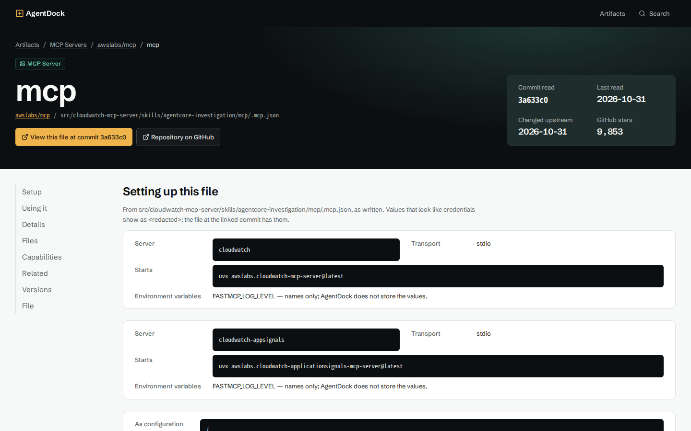
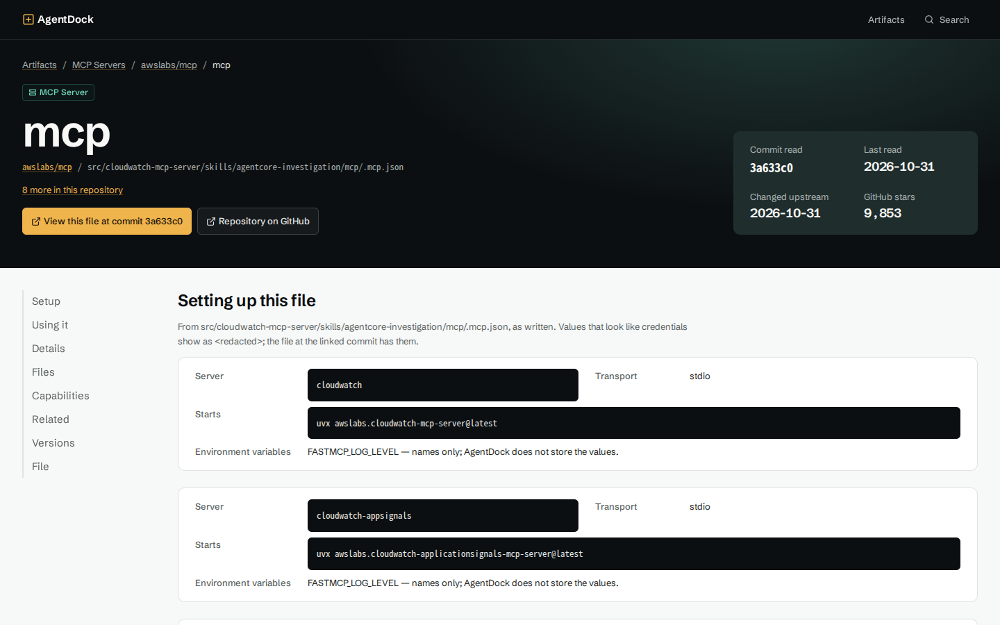

# AgentDock Phase 95: Interactive Experience 2.0

기준 `102160d`, 배포 `14c1c36`, 2026-11-06. 수치와 판정은 이 날짜의 실행 결과다.

## 1. 판정

**PASS (사용자 직접 확인 대기).** 자동 검증과 운영 경량 확인을 통과했다. 체감 품질과 실기기 터치는 자동으로 판정하지 않았다.

첫 푸시(`ef3fe88`)는 CI E2E에서 휴대폰 첫 화면 회귀가 잡혀 배포되지 않았다. Deploy는 건너뛰어졌고 운영은 그대로였다. `14c1c36`에서 고친 뒤 배포했다.

## 2. 출발점

브리프는 항목이 "순차적으로 포커싱"된다고 적었지만, 코드에 그런 동작은 없었다. 고리는 초당 0.05rad로 표류하기만 했고, 도크는 칩에 올리거나 눌렀을 때만 포커스됐다. 드래그, 스와이프, 방향키도 없었다. 사용자가 본 인상을 실제 동작으로 만드는 것을 P0로 잡았다.

## 3. 구현

### P0: 고리

| 항목 | 동작 |
|---|---|
| 투어 | 도크를 하나씩 앞으로 가져와 6초 머문다(이동 포함). 패널, 칩, 허브 색, 빔이 함께 바뀐다. |
| 회전 | 지수 감쇠에서 임계 감쇠 스프링으로 교체했다. 닫힌 해라 긴 프레임에도 발산하지 않고, 드래그 놓을 때의 속도를 이어받는다. |
| 강조 | 포커스 도크는 7% 커지고 나머지는 물러나 어두워진다. bloom과 glow는 추가하지 않았다. |
| 드래그 | 고리 가까운 쪽이 포인터를 따라오고, 놓으면 관성을 반영한 가장 가까운 도크에 멈춘다. 터치는 `touch-action: pan-y`로 세로 스크롤과 공존한다. |
| 키보드 | 스텝퍼 버튼(◀ n/6 ▶)과 그 위의 좌우 방향키, 칩 행의 좌우 방향키. 수정키 조합은 브라우저에 넘긴다. |
| 양보 | 도크 호버, 고르기, 드래그, 검색창, 패널 사용 중에는 투어가 멈추고, 조작이 끝나면 8초 뒤 돌아온다. |
| 정지 | Pause와 reduced motion에서는 투어가 없다. 입력 없이 45초 지나거나 화면 밖이면 렌더 루프가 멈춘다. |

### 모바일과 정적 화면

- **64rem 미만:** `.dock-cards`를 네이티브 CSS scroll snap으로 스와이프한다. 스크립트 없이 동작하고, 링크는 44px 이상이다.
- **40rem 이하:** 카드가 정적 그림을 대신한다. 둘 다 두면 첫 아티팩트가 첫 화면 밖으로 밀린다(y=936).
- **GPU 없음, reduced motion:** 3D 청크를 받지 않는다. 스텝퍼는 그대로 동작하고, 패널이 도크를 가리지 않도록 그림이 옆으로 비켜 줄어든다.

### 실제 데이터만 쓰는 발견 경로

- **`GET /api/docks/[kind]`:** 포커스된 종류의 실제 행을 서로 다른 저장소에서 최대 3개 보낸다. `s-maxage=21600`이다. 홈의 스냅샷 1회 읽기(Phase 93)를 유지하려고 페이지가 아닌 별도 경로로 뺐다. 패널의 "Recently read"에 쓴다.
- **`GET /artifacts/random?type=`:** 해당 종류의 등재 항목 하나로 307 리다이렉트한다. 스크립트 없는 일반 링크이고 `rel="nofollow"`다. 패널, 카드, 유형 목록, 상세 페이지에 있다.
- 두 경로 모두 읽기 전용이고, 입력은 고정 목록의 종류뿐이다. 등재 규칙과 언어 필터를 따르며 stars는 입력이 아니다.
- 네트워크 그래프는 만들지 않았다. 관계로 쓸 수 있는 저장된 사실은 "플러그인 디렉터리 포함"과 "같은 저장소"뿐이고, 이는 상세 페이지에 표시했다.

### P1: 목록·상세

기존 페이지가 이미 다듬어져 있어(Phase 86~90) 다시 만들지 않고 빠진 것만 더했다.

- **상세:** 코드 블록 복사 버튼. 클릭 시 페이지에서 읽으므로 저자의 글이 클라이언트 컴포넌트 prop으로 넘어가지 않는다.
- **상세:** 상단에 소속 플러그인, 포함 구성요소 수, 같은 저장소의 다른 항목 수 링크.
- **목록:** 유형 하나로 볼 때 "Open one at random".
- **홈:** 포커스 도크의 칩 강조, 패널 텍스트 순차 등장.

페이지 전환(View Transition), hover/active 피드백, 스크롤 스파이는 이미 있어 추가하지 않았다. 동명 항목의 경로 표시와 URL 기반 필터는 건드리지 않았다.

## 4. Before / After (운영, 1440×900 또는 390×844)

| 화면 | Before | After |
|---|---|---|
| 홈 |  |  |
| 홈, 다음 도크 | |  |
| 홈, GPU 없음 | |  |
| 홈, 휴대폰 |  |  |
| 검색 |  |  |
| 검색, 휴대폰 |  |  |
| 상세 |  |  |

## 5. 검증

**로컬:** 저장소 복사본과 일회용 Postgres 컨테이너를 썼다. `agentdock_test`는 건드리지 않았고, 컨테이너는 끝난 뒤 삭제했다.

| 항목 | 결과 |
|---|---|
| lint, typecheck, check:boundaries | 통과 (기존 CSS 경고 1건) |
| build (`VERCEL=1`, standalone) | 통과. `instrumentation.ts` Edge 경고는 이번 변경과 무관하다. |
| 단위 테스트 (변경 범위, DB 포함) | 572 통과, 1 skip |
| E2E 영향 범위 | 48 통과, 리뷰 수정 후 10 통과, 휴대폰 10 통과 |
| 레이아웃 (1024·1280·1920·2560) | 겹침 없음, 가로 넘침 0 |

**CI `42200283381`:** check, database, e2e 전체 성공. 단위 1,641 통과, 3 skip. E2E 120 통과(기존 112건에 Phase 95 8건 추가).

**운영:** 아래는 `14c1c36`에서 확인한 값이다.

| 항목 | 결과 |
|---|---|
| Deploy `42201855114` | 성공. 마이그레이션 12 applied, 0 pending, UP_TO_DATE (변경 없음). smoke PASS. |
| `x-agentdock-commit` | `14c1c36` |
| HTTP | `/` 200 6.7초, `/artifacts` 200 3.4초, `q=mcp` 200 1.7초, `type=skill` 200 2.1초, 상세 200 1.7초, `/skills` 308 |
| `/api/docks/mcp_server` | 200. MISS 3.7초, 이어서 HIT 0.3초. 없는 종류는 404. |
| `/artifacts/random` | 307, 실제 상세로 이동. 약 3초. |
| 실제 GPU (Intel) | 자동 시작. 투어 command > skill > plugin, 드래그, Next, Esc 동작. |
| GPU 없음 (SwiftShader) | `still`, three.js 청크 0개, View in 3D 표시. |
| 휴대폰 | 첫 행 y=834, 가로 넘침 0. |
| 브라우저 오류 | 0건 |

`/`의 6초대는 배포 직후 값이고 이번 변경 전과 같은 수준이다(Phase 94 직후 6.0초). 첫 스냅샷 발행 전이라는 점도 그대로다.

**실행하지 않음:** 부하·성능 측정(지시대로), 실기기 터치, Safari, 스크린리더, Vercel 서버 로그(접근 수단 없음), 운영 DB 직접 조회.

## 6. 리뷰

PR Review Toolkit `code-reviewer` 1회. CodeWatcher는 이 환경에 없다. 아래 3건은 소스와 대조해 실제 결함임을 확인하고 고쳤다. 수정본의 재리뷰는 하지 않았고 관련 테스트로 확인했다.

| 등급 | 결함 | 조치 |
|---|---|---|
| HIGH | 멀티터치나 `pointerup` 유실 시 드래그가 풀리지 않아 렌더 루프가 멈추지 않음 | `isPrimary`, pointerId 비교, 버튼 상태 확인, `lostpointercapture` |
| MAJOR | 투어 중 Close와 Esc를 눌러도 다음 프레임에 패널이 되살아남 | `letGo()`로 8초 대기를 함께 시작, E2E 추가 |
| MAJOR | 무작위 조회의 double 비교로 id 인덱스를 시작점으로 못 씀 | `::bigint`, 종류별 `max(id)`, 실행 계획 확인 |

그 밖에 고친 것: 수정키 방향키 양보, 무작위 경로의 DB 오류 처리.

## 7. 불안정 E2E 기록

보고서 커밋 `328949a`의 CI `42202575399`에서 코드가 같은데도 E2E가 실패했고, 그 커밋의 Deploy는 건너뛰어졌다. 운영은 `14c1c36` 그대로였다.

| 테스트 | 결과 | 판단 |
|---|---|---|
| `the tour stops off screen and after one lap alone`, 736행 | 재시도까지 2회 실패. 화면 복귀 3초 뒤 draw 수가 5초간 그대로 | **원인 미확정** |
| `leaving and coming back leaves no scene behind`, 699행 | 1회 실패 후 재시도 통과. WebGL 컨텍스트 3개(기준 2 이하) | GC 시점에 따른 흔들림으로 추정, 미확인 |

첫 번째 테스트의 근거: 트레이스에 오류와 경고가 없고, 화면 변화는 복귀 뒤 약 4.5초에서 끝난다. 스크롤 이징만 그리고 멈춘 패턴이라 `inView`가 false로 남은 경우와 맞는다. 같은 코드가 CI `42200283381`과 로컬 반복 6회에서는 통과했다.

코드에서 확인한 약점은 하나다. `IntersectionObserver` 콜백이 묶음의 첫(가장 오래된) 항목을 읽었다. 이를 마지막 항목을 읽도록 고쳤다. 다만 이 실패의 경로상 묶음이 생겼다는 증거는 없어, 이것으로 해결됐다고 판정하지 않는다. 재발하면 사용자에게는 스크롤로 돌아온 뒤 투어가 멈춘 것처럼 보일 수 있으나, 칩, 스텝퍼, 링크는 계속 동작한다. 그래서 MINOR로 분류했다.

## 8. 남은 MINOR

1. 휴대폰 첫 행 여유가 작다(운영 y=834, 기준 844). 숨김 언어 안내 줄이 길어지면 넘을 수 있고, 그때 E2E가 잡는다.
2. `/artifacts/random`이 운영에서 약 3초 걸린다. 드문 종류에서 등재 판정 행을 더 훑는 것으로 보이나 원인은 측정하지 않았다.
3. id 간격 때문에 무작위가 완전히 균등하지는 않다. 순위가 아니고 인기도도 들어가지 않는다.
4. 키보드로 패널에 들어간 뒤 칩 호버나 드래그로 종류가 바뀌면 패널이 다시 마운트되어 포커스를 잃을 수 있다.
5. 터치 대각선 스크롤이 6px을 넘기면 `pointercancel` 전에 고른 항목이 닫힐 수 있다.
6. `/api/docks` 실패 결과를 세션 동안 재시도하지 않는다. 패널은 예시 없이 동작한다.
7. CDN 캐시 때문에 패널 예시가 삭제 후 최대 약 30시간 남을 수 있다.
8. 정적 그림이 패널을 피해 줄어들면 1440px에서 라벨이 작아진다.

## 9. 커밋

`e1ef27f` 발견 경로, `a8a4c81` 투어와 조작, `31f7dbc` 상세, `ef3fe88` E2E, `14c1c36` 휴대폰 첫 화면 수정, `328949a` 이 문서, 다음 커밋 `inView` 수정과 §7.

## 10. 보호 대상

0012 Contract, `rollback-0012.sql`(미추적 유지), 0011, 운영 DB, Sync 파이프라인과 스케줄, 환경변수, Vercel 설정은 변경하지 않았다. 운영 Sync는 수동 실행하지 않았다.

`CLAUDE.md`는 "클라이언트 컴포넌트는 fetch하지 않는다"는 문장이 사실과 달라져 한 줄 고쳤다.
