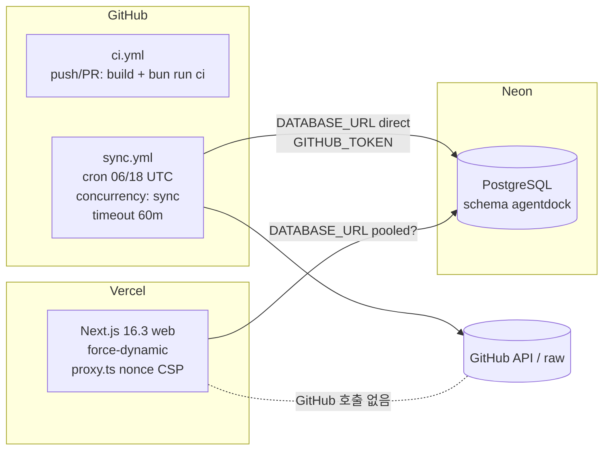

# AgentDock 품질 · 운영 · 보안 · UX 분석

> 기준: `develop` @ `28639ec` (2026-10-20) · 읽기 전용 분석
> 배포 사이트(https://agentdock-delta.vercel.app/)는 GET 13회로만 확인했다(부하 테스트 없음).
> 표기: **[확인]** 소스/사이트 직접 확인 · **[추정]** 추론 · **[미확인]** 근거 부족

## 목차

1. [검증 Baseline (이번 분석에서 실행)](#1-검증-baseline-이번-분석에서-실행)
2. [테스트 체계](#2-테스트-체계)
3. [운영 구성과 책임 경계](#3-운영-구성과-책임-경계)
4. [운영 안정성 질문에 대한 답](#4-운영-안정성-질문에-대한-답)
5. [보안 검토](#5-보안-검토)
6. [프론트엔드 / UX](#6-프론트엔드--ux)
7. [문서-코드 불일치](#7-문서-코드-불일치)
8. [개선 후보 요약](#8-개선-후보-요약)

---

## 1. 검증 Baseline (이번 분석에서 실행)

DB 와 격리하려고 CI 와 같은 조건으로 실행했다. `vitest.config.ts:13` 은 `CI` 가 없으면 `.env` 를 자동으로 읽기 때문이다.

```bash
# 실행 위치: 저장소 루트 (~/workspace_auto/agentdock)
env -u DATABASE_URL CI=1 bun run check:boundaries   # OK (8 migrations, 86 source, 26 UI files)
env -u DATABASE_URL CI=1 bun run lint               # Checked 189 files, No fixes applied
env -u DATABASE_URL CI=1 bun run typecheck          # 오류 없음
env -u DATABASE_URL CI=1 bun run test               # 52 files passed | 11 skipped; 822 passed | 272 skipped
```

| 항목 | 결과 |
|---|---|
| check:boundaries | PASS |
| lint | PASS |
| typecheck | PASS |
| test (DB 제외) | PASS — 822 passed |
| DB 기반 suite (11 files, 272 tests) | **NOT RUN** — 운영 Neon 과 격리할 수 없어 실행하지 않음 |
| `src/github/permalink.test.ts` (live GitHub) | **NOT RUN** — `CI=1` 로 skip |
| `bun run build` | **NOT RUN** — 추적 대상 `next-env.d.ts` 를 다시 쓸 수 있어 생략 |

실행 후 `git status` 의 변화는 `docs/analysis/` 신규 파일뿐이다.

---

## 2. 테스트 체계

### 2.1 구성 **[확인]**

| 영역 | 파일 수 | 성격 |
|---|---|---|
| analyze | 11 | 순수 함수, precision/ReDoS |
| detect | 10 | frozen fixture 기반 |
| components | 11 (.tsx) | 렌더 테스트(escaping, SkillBody, JobPanel 등) |
| app | 2 | motion CSS 규칙, no-public-ingest 구조 검사 |
| corpus | 6 | fanout/refresh 는 DB gated |
| db/queries | 5 | **전부 DB gated** (search 52, packages 28) |
| ingest | 6 | persist/pipeline/worker/reanalyze DB gated |
| github | 5 | fetch stub. permalink 는 live network |
| registry | 2 | sync DB gated |
| root | env, log, proxy, instrumentation | 순수 |
| scripts | check-boundaries | scanner 자체 테스트 |

- GitHub mock: `fixtures/` 232개 파일(SHA 로 고정한 실제 저장소 4개 + adversarial + xss) + `vi.stubGlobal('fetch')`.
- DB suite 는 파일 상단에서 `DATABASE_SCHEMA='agentdock_test'` 를 설정하고 DB 모듈을 동적으로 import 한다.

### 2.2 격차

| # | 격차 | 영향 |
|---|---|---|
| T1 | **CI 에서 DB 기반 테스트가 0개 실행된다** — 검색 술어·ranking, `NOT_LISTED_BECAUSE`, persist, queue, refresh 가 개발자 로컬에서만 검증됨 | 회귀 위험이 가장 큰 영역이 CI 밖에 있음 |
| T2 | `.env` 의 `DATABASE_URL` 이 운영 Neon 이면 로컬 `bun run test` 가 Neon 의 `agentdock_test` 에 쓰기/삭제를 수행 | 운영 인스턴스 부하·오염 위험 |
| T3 | `detailHref`/`sourcePathCandidates` 같은 순수 URL builder 테스트가 DB gated 블록 안에 있음(`packages.test.ts:429+`) | CI 에서 검증되지 않음 |
| T4 | `scripts/corpus-sync.mjs` 오케스트레이션 테스트 없음 | 단계 순서·종료 코드·요약 산술 무검증 |
| T5 | `artifacts/page.tsx` 라우트 수준 테스트 없음 | "Clear filters" 결함 같은 분기 오류 미검출 |
| T6 | `SkillBody.test.tsx` 에 frontmatter 케이스 없음 | §6.3 결함 |
| T7 | 수집 파이프라인 결함(I1, I4, I5, I10 등)에 대한 회귀 테스트 없음 | ingestion 문서 §9 참조 |

**권장**: CI 에 PostgreSQL service container 를 추가(bootstrap SQL + `CREATE EXTENSION pg_trgm`)하고, 로컬에서는 `.env.test` 를 따로 둬서 운영 URL 과 분리한다.

---

## 3. 운영 구성과 책임 경계



| 항목 | 상태 |
|---|---|
| Production 브랜치 | `develop` (Vercel 연결 브랜치는 대시보드 설정, **[미확인]**) |
| Standalone | `next.config.ts`: `output: process.env.VERCEL ? undefined : 'standalone'` (28639ec) |
| DB 연결 | `max:10`, `idle_timeout:20`, prepared statement on. 웹에서 pooled 와 direct 중 무엇을 쓰는지 **[미확인]** |
| Secret | sync step 에만 `DATABASE_URL`, `AGENTDOCK_GITHUB_TOKEN`. `persist-credentials: false`, `permissions: contents: read` |
| 함수 리전 | 응답 헤더 `x-vercel-id: icn1::iad1::…` → 함수가 iad1(기본값)에서 실행됨. Neon 리전과 같은지 **[미확인]** **[확인: 헤더]** |
| env 검증 | `src/env.ts` zod. 오류 메시지에 값 미포함 |

---

## 4. 운영 안정성 질문에 대한 답

| 질문 | 답 | 근거 |
|---|---|---|
| 1. 수집이 실패해도 웹은 유지되는가? | **예.** `register()` 는 수집을 시작하지 않는다. 단 Neon compute 를 공유하므로 CU-hour 소진 시 둘 다 중단 | `src/instrumentation.ts:17-33` |
| 2. 오래 갱신되지 않으면 알 수 있는가? | **어렵다.** corpus 수준 "마지막 sync" 기록이 없고, 홈의 "newest read" 는 첫 행의 `scannedAt`(package `updated_at` 순)이라 정확한 최대값이 아니다. GitHub 는 60일 무커밋 시 schedule 을 조용히 비활성화 | `page.tsx:42`, `sync.yml:19-20` |
| 3. 실패 원인별 파악이 쉬운가? | 요약 블록은 outcome 별 개수와 `INCOMPLETE` 라인을 출력해 상세하다. 그러나 **텍스트 로그를 읽어야만** 알 수 있다 | `corpus-sync.mjs:143-191` |
| 4. 트래픽이 늘면 무엇이 먼저 문제인가? | ① `PollUntilDone` 폴링(아래) ② 캐시 없는 `force-dynamic` + 매 요청 `count(*)` 와 행별 `NOT_LISTED_BECAUSE` ③ direct 연결이면 인스턴스당 10 커넥션 | §6.2, 검색 문서 §5 |
| 5. 무료 자원 효율화 | 목록·카운트 캐싱, 폴링 조건 수정, cold start 마다 하는 `last_boot` 쓰기 재검토, 함수 리전을 Neon 과 일치 | — |
| 6. DB/외부 오류 처리 | 웹: `error.tsx` + digest(Hobby 로그 보존 1시간이라 추적 곤란). sync: 단일 try/catch 라 소스 하나의 예외가 이후 단계 전체를 건너뜀(ingestion I9) | `corpus-sync.mjs:477` |
| 7. Actions 는 성공했는데 수집이 0인 경우를 구분할 수 있는가? | **불가.** 예외가 던져질 때만 exit 1. 전 job 실패, 예산 소진, 빈 큐는 모두 exit 0 | `corpus-sync.mjs:484` |

### 4.1 `PollUntilDone` 비용 위험 **[확인]**

- `setInterval(router.refresh, 1500)` 은 job 이 `succeeded`/`failed` 가 될 때까지 계속 돈다(`src/components/PollUntilDone.tsx:18`, `jobs/[id]/page.tsx:31`).
- queued job 은 다음 sync(최대 12시간)까지 기다린다. 저장소 페이지가 queued job 마다 `/jobs/<id>` 를 링크한다.
- 열린 탭 1개가 시간당 약 2,400회 함수 호출과 DB 질의를 만든다. 한 달이면 약 170만 회로, Hobby 의 월 100만 invocation 을 넘는다. Neon 자동 suspend 도 막는다(background 탭 throttling 으로 줄어들지만 사라지지 않음, **[추정]**).
- 실측: `/jobs/106` 은 2026-10-19 21:53 UTC 에 요청되었고, 2026-10-20 08:51 UTC 에도 Queued·Attempt 0 이었다. **[확인: 사이트]**

---

## 5. 보안 검토

**악용 가능한 취약점은 발견하지 못했다.** 영역별 근거는 다음과 같다. **[확인]**

| 영역 | 상태 | 근거 |
|---|---|---|
| Markdown XSS | react-markdown + rehype-sanitize(img/source/picture 제거), raw HTML 플러그인 금지, 기본 `urlTransform`(http/https/mailto 등만 허용), 링크에 `rel="noopener noreferrer nofollow ugc"` | `SkillBody.tsx:22-49`, boundary scanner, `escaping.test.tsx` |
| `javascript:` URL | 외부 링크는 `https://github.com/${fullName}/blob/${sha}/${path}` 로만 생성. `homepage` 는 렌더하지 않음 | `src/components/hrefs.ts:15-33` |
| SQL Injection | Drizzle `sql` 파라미터 바인딩. `sql.raw` 1곳은 리터럴 union 타입 | `packages.ts:36` |
| 입력 검증 | `q` 200자, `page` ≤10,000, `type`/`cap` allowlist, job id zod | `artifacts/page.tsx:30, 83-99` |
| CSP | 요청별 nonce + `strict-dynamic`, `object-src 'none'`, `frame-ancestors 'none'`, `form-action 'self'`. `style-src 'unsafe-inline'` 은 의도·문서화됨. 실사이트 헤더 확인 | `src/proxy.ts` |
| 공개 쓰기 | server function 없음(구조 테스트) | `src/app/no-public-ingest.test.ts` |
| 로그 | 검색 질의(≤200자, JSON escape) 기록은 문서화된 결정 | `src/log.ts:64-71` |

하드닝 후보(취약점 아님):

| # | 항목 | 근거 |
|---|---|---|
| H1 | `ci.yml` 에 `permissions:` 블록 없음 → 저장소 기본 토큰 권한 사용 | `.github/workflows/ci.yml` |
| H2 | Actions 가 SHA 가 아닌 tag 로 고정(`@v4`, `@v2`), secret 을 받는 job 포함 | `sync.yml` |
| H3 | DB 연결 오류 메시지(`getaddrinfo ENOTFOUND <host>`)가 Actions 공개 로그에 호스트명을 노출할 수 있음. secret 전체 문자열만 마스킹됨 **[추정]** | `corpus-sync.mjs:477-480` |
| H4 | MCP `args`/`url`, `server.json` 전체, catalog `hint` 원문 저장 — 저자가 실수로 넣은 토큰이 보존·표시될 수 있음 | ingestion 문서 I11 |
| H5 | `permalink()` 가 경로를 percent-encode 하지 않음 → `#`, `?` 포함 경로 링크 깨짐(보안 아님, 정확성) | `hrefs.ts` |

---

## 6. 프론트엔드 / UX

### 6.1 라우트 **[확인]**

| Route | 데이터 | 비고 |
|---|---|---|
| `/` | `listPackages(18)` + `countPackages()` | Hero 검색 폼, IndexFlow, Featured/BoardStats/Rail/Rows |
| `/artifacts` | `searchPackages` + `countSearchResults` 병렬, 검색 로그 1줄 | 빈 corpus / 페이지 초과 / 0건 / close matches / 정상, 5가지 분기 |
| `/r/[owner]/[repo]` | `getRepositoryPackages` → `latestJobForTarget` (순차) | truncated 안내, 목록에서 빠진 이유 |
| `/r/[owner]/[repo]/[...path]` | `getPackageDetail` → `getCapabilityFindings` | null 과 empty 를 다른 문구로 구분, commit permalink |
| `/jobs/[id]` | `getJobView` | PollUntilDone |
| `/skills` | 308 → `/artifacts` | `next.config.ts:45-47` |

Client component 는 `SearchHotkey`, `PollUntilDone`, `error.tsx` 3개다(CLAUDE.md 와 일치).

### 6.2 잘 된 점

- 키보드: `/` 와 Ctrl/Cmd+K, 네이티브 `<dialog>` 런처, 단축키 힌트는 실제로 동작할 때만 표시.
- 접근성: skip link, `:focus-visible`, fieldset/legend, rail 복제본 `aria-hidden`+`inert`, CSS 전용 pause(WCAG 2.2.2), reduced-motion 테스트.
- 신뢰성: commit sha 고정 permalink, "Last changed upstream" 과 "Last read by AgentDock" 분리, "What AgentDock does not check" 블록.

### 6.3 결함 (실사이트에서 확인)

| ID | 결함 | 원인 | 진입점 |
|---|---|---|---|
| U1 | Skill 상세에서 YAML frontmatter 가 `<hr>` + 거대한 setext `<h2>` 로 렌더됨 | body 가 원본 파일(frontmatter 포함)로 저장되고, 렌더러에 frontmatter 처리가 없음 | `src/components/SkillBody.tsx` (저장된 body 는 유지 — finding 줄 번호가 원본 기준) |
| U2 | body 의 `# Title` 이 페이지에 두 번째 `<h1>` 을 만들어 heading 구조를 깸 | heading 1:1 매핑 | `SkillBody.tsx` `components` 에서 h1→h3 등으로 강등 |
| U3 | 필터가 없는 0건 검색에도 "Clear filters" 버튼이 표시되고 같은 URL 로 이동 | `nextSteps` 가 무조건 렌더 | `src/app/artifacts/page.tsx:270-279` |
| U4 | queued job 을 "AgentDock is reading it now" / "will start reading it shortly" 로 표시 | 실제로는 다음 예약 sync 까지 대기 | `r/[owner]/[repo]/page.tsx:116-121`, `JobPanel.tsx:55` |
| U5 | 비-skill 상세의 "Frontmatter fields: Uses only specification fields." 와 JSON 파일에 대한 "could not read frontmatter" 문구 | skill 전용 문구를 공용으로 사용 | `[...path]/page.tsx:90-93, 191-214` |
| U6 | JSON artifact 의 "Observed in the file text: not detected" | 텍스트를 검사하지 않았는데 "관찰 안 됨"으로 표시 — null≠empty 위반 | `CapabilityPanel.tsx:54-55` |

### 6.4 기능 공백 (기존 구현 여부를 확인함)

| 후보 | 현재 | 비고 |
|---|---|---|
| 정렬 옵션 | 없음 | stars 정렬은 AGENTS.md 로 금지. 이름/상류 push/읽은 날짜 정렬은 가능 |
| 복수 type 필터 | 부분(쿼리는 배열 지원, 라우트·UI 는 단일) | `artifacts/page.tsx:83-88` |
| 관련 artifact ("같은 저장소의 다른 artifact") | 없음 | `getRepositoryPackages` + `PackageRows` 재사용 가능 |
| 설치 안내 | skill 경로 텍스트만 | plugin/MCP/command/hook 안내 없음. 설치 자동화는 Out of Scope 지만 **명령 안내 텍스트**는 범위 안 |
| Version 이력 | DB 에는 있으나 UI 없음 | `package_version` 다중 행 |
| 사이트 전체 "마지막 sync" | 없음 | `schema_meta` 에 `last_sync` 기록 가능 |
| robots/sitemap/favicon/OG | 없음(사이트에서 404 확인) | Next 파일 규칙(`robots.ts`, `sitemap.ts`, `icon.svg`) |
| 파일 크기 표기 | raw bytes | 사람이 읽기 쉬운 단위 |
| 홈 정렬 tie-break | `updated_at` 만, id 없음 | 요청마다 순서가 바뀔 수 있음 |

---

## 7. 문서-코드 불일치

| 문서 | 주장 | 실제 |
|---|---|---|
| README "Testing" | "소켓을 여는 테스트는 없습니다" | `permalink.test.ts` 는 live GitHub, DB suite 는 `.env` 가 있으면 자동 실행 |
| `VERCEL_DEPLOY.md:269-281` | "Nothing above has been run against Neon or Vercel yet", PENDING 항목 | 사이트가 운영 중. pooled/direct 결정이 기록되지 않음 |
| `JobPanel` / 저장소 페이지 문구 | 곧 읽음 / 지금 읽는 중 | 하루 2회 cron |
| `FeaturedArtifact.tsx` doc | "가장 최근에 읽은 artifact" | package `updated_at` 순 첫 행 |
| `search.ts:~40-58` 주석 | "pg_trgm 이 이 환경에 없음", 임계값 미측정 | 0007 이 pg_trgm 을 요구하므로 운영에는 있어야 함. `?q=playwrit` 은 close matches 없이 0건 **[미확인 원인]** |
| `artifacts/page.tsx:72-75` `SCOPE_SENTENCE` | registry·seed list·topic search, "non-archived" | link list 누락. archived 저장소도 목록에 남음 |
| `AGENTS.md` | "Only corpus:reset deletes corpus rows" | `db:reset`(dev DROP), `db:test:reset`(TRUNCATE) 도 존재(dev/test 도구) |
| `.planning/STATE.md` | Phase 6 실행 중, 06-04 미커밋 | git 이력에는 이후 UI 재구성·Vercel 배포 커밋이 있음 — 계획 상태 문서가 뒤처짐 |

---

## 8. 개선 후보 요약

| ID | 개선 | 진입점 | 규모 | 우선 |
|---|---|---|---|---|
| O1 | `PollUntilDone` 은 `running` 일 때만 폴링, `document.hidden` 이면 중지 | `PollUntilDone.tsx`, `jobs/[id]/page.tsx:31` | S | P0 |
| O2 | sync 결과를 `$GITHUB_STEP_SUMMARY` 에 기록, "수집 0 + 대기 > 0" 이나 전 job 실패 시 `::warning::`/비0 종료 | `corpus-sync.mjs:143-191, 484`, `sync.yml` | S | P1 |
| O3 | `schema_meta.last_sync`(시각·처리 수·outcome) 기록 + 홈/푸터 표시 | `corpus-sync.mjs`, `syncState.ts`, `page.tsx` | S | P1 |
| O4 | 소스 단계별 try/catch 격리 | `corpus-sync.mjs:364-373` | S | P1 |
| O5 | U1–U4 UX 결함 수정 | §6.3 | S | P1 |
| O6 | CI PostgreSQL service + DB suite 실행, 순수 URL 테스트를 DB gate 밖으로 | `ci.yml`, `packages.test.ts` | M | P1 |
| O7 | `ci.yml` `permissions: contents: read`, actions SHA pin | workflows | S | P2 |
| O8 | 목록/카운트 캐싱(Next 16 문서 확인 후) | `page.tsx`, `artifacts/page.tsx` | M | P2 |
| O9 | robots(검색 결과·jobs noindex)/sitemap/icon/OG | `src/app/robots.ts` 등 | S | P2 |
| O10 | 문서 정정(§7) | README, VERCEL_DEPLOY, 주석 | S | P2 |
| O11 | 웹 함수 리전을 Neon 리전과 일치(확인 후) | Vercel 설정 | S | P2(운영자 확인 필요) |
