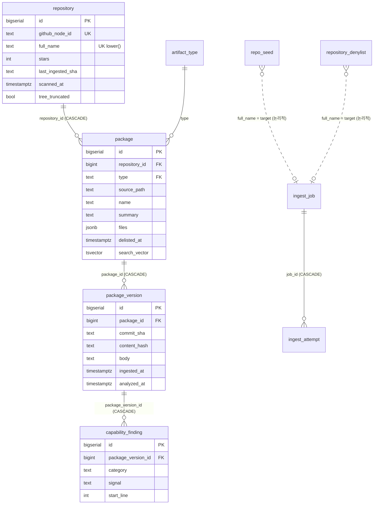
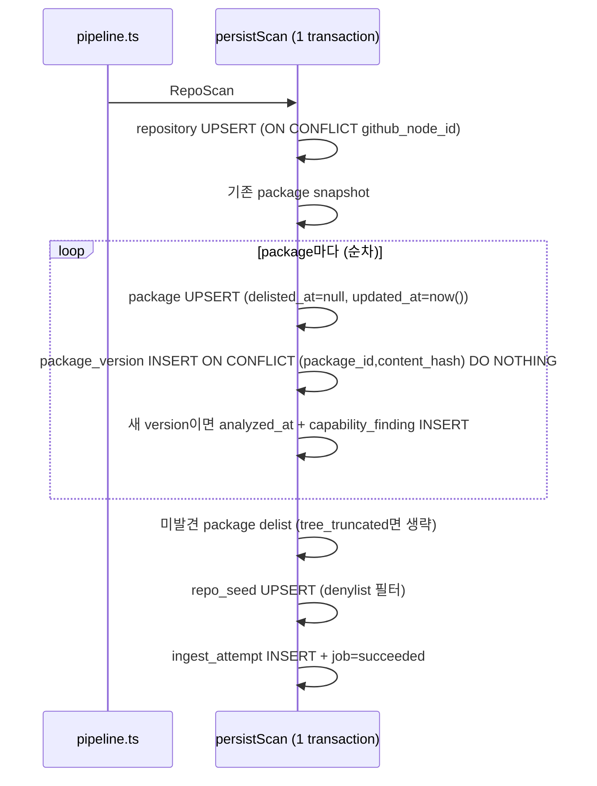
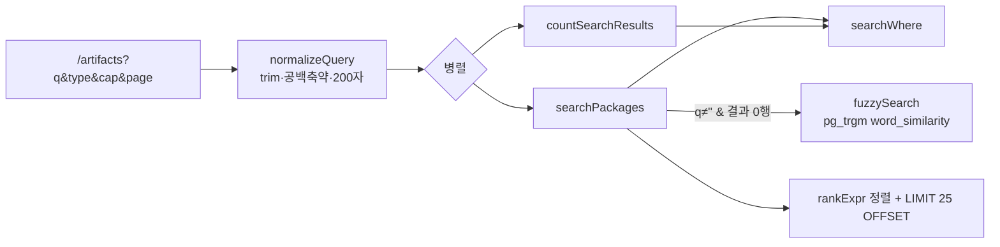

# AgentDock 검색 및 데이터 모델 분석

> 기준: `develop` @ `28639ec` (2026-10-20) · 읽기 전용 분석 · DB 접속/EXPLAIN 미실행
> 표기: **[확인]** 소스에서 직접 확인 · **[추정]** PostgreSQL/라이브러리 동작에서 추론(미실행) · **[제안]** 개선안

> **2026-10-20 갱신**: S1(R16), absence 필터(R3), recall 패키지 R17의 SC·SD·SE·SF는 작업 트리에서 수정됐다(미커밋). SG와 R18은 PENDING이다. [Phase 2 개선 기록](agentdock-phase2-improvements.md) 참고. 아래 본문은 `28639ec` 기준 분석이다.

## 목차

1. [스키마 개요](#1-스키마-개요)
2. [데이터 수명주기](#2-데이터-수명주기)
3. [검색 파이프라인 (SQL 수준)](#3-검색-파이프라인-sql-수준)
4. [질의 유형별 예상 동작](#4-질의-유형별-예상-동작)
5. [인덱스와 확장성](#5-인덱스와-확장성)
6. [DB 연결 계층 (Neon / Serverless)](#6-db-연결-계층-neon--serverless)
7. [Migration 과 Boundary Scanner](#7-migration-과-boundary-scanner)
8. [발견된 결함과 위험](#8-발견된-결함과-위험)
9. [개선 후보](#9-개선-후보)
10. [의미 검색/Vector 검색 필요성 판단](#10-의미-검색vector-검색-필요성-판단)

---

## 1. 스키마 개요

모든 테이블은 `src/db/schema.ts` 의 `agentdock = pgSchema(AGENTDOCK_SCHEMA)`(l.43) 아래에 선언된다. 스키마 이름은 `agentdock` / `agentdock_test` 만 허용(l.19-29). **[확인]**

| 테이블 | 핵심 컬럼 | 키 / 인덱스 |
|---|---|---|
| `schema_meta` | key, value | PK key. `last_boot`(instrumentation), `corpus_sweep:<source>`(syncState) |
| `artifact_type` | id, label | PK. `skill, plugin, catalog, mcp_server, command, hook` — migrate 시 재-seed (`scripts/migrate.mjs:111-121`) |
| `repository` | github_node_id, full_name, stars, is_fork, is_archived, topics, pushed_at, scanned_at, etag, last_ingested_sha, tree_truncated | UNIQUE node_id, UNIQUE `lower(full_name)`, `stars DESC` |
| `package` | repository_id, type, source_path, name, summary, meta(jsonb), parent_path, delisted_at, files(jsonb), **search_vector (GENERATED STORED)** | UNIQUE `(repository_id,type,source_path)`, `(type, updated_at DESC)`, GIN(search_vector), GIN trigram(name‖summary) |
| `package_version` | package_id, commit_sha, blob_sha, content_hash, body(≤32KB), frontmatter, parse_status, analyzed_at | UNIQUE `(package_id, content_hash)`, `(package_id, ingested_at DESC)` — **content_hash 단독 인덱스 없음** |
| `capability_finding` | package_version_id, detector_id/version, category, signal, source_path, start_line, commit_sha, evidence_text | UNIQUE 6컬럼 identity(start_line nullable), `(package_version_id)` |
| `repository_denylist` | full_name(lower), reason | PK |
| `repo_seed` | full_name(lower), source_kind, discovered_from, hint(jsonb) | UNIQUE full_name |
| `ingest_job` | target, status, attempts, next_attempt_at, started_at | partial UNIQUE `target WHERE status IN (queued,running)`, claim/running partial idx — **target 일반 인덱스 없음** |
| `ingest_attempt` | job_id, attempt_no, outcome, counters, rate_* | `(job_id, attempt_no DESC)` |

CHECK 제약/enum 은 의도적으로 없다 — 채워진 테이블에서 CHECK 를 넓히려면 DROP 이 필요하고, boundary scanner 가 이를 파괴적 변경으로 취급하기 때문(`schema.ts:62-69, 374-377`). **[확인]**

### ER 다이어그램



### 생성 컬럼 `search_vector` (`schema.ts:167-173`, `drizzle/0006_silly_black_tom.sql`)

```sql
setweight(to_tsvector('english', coalesce(name,'')), 'A') ||
setweight(to_tsvector('english', coalesce(summary,'')), 'B') ||
setweight(to_tsvector('english', replace(replace(coalesce(source_path,''),'/',' '),'.',' ')), 'C') ||
setweight(to_tsvector('english', replace(coalesce(type,''),'_',' ')), 'D')
```

- `english` 설정(Snowball stemming + 영어 불용어).
- **repository.description, topics, body, frontmatter 는 색인되지 않는다.** **[확인]**

---

## 2. 데이터 수명주기

### 2.1 쓰기 경로 **[확인]**

모든 corpus 쓰기는 `src/ingest/persist.ts` 를 통한다.



- `touchRepository`(persist.ts:383-466): 같은 commit sha 이면 repository 메타만 갱신하고 job 을 종료.
- `analyzePackageVersion`(reanalyze.ts:40-132): 해당 version 의 finding 을 DELETE 후 재삽입.

### 2.2 보존/삭제 정책 **[확인]**

| 대상 | 정책 |
|---|---|
| package | 삭제하지 않음. `delisted_at` soft delete, 다시 나타나면 자동 복귀(persist.ts:153) |
| package_version | 영구 보존. content_hash 별 1행 |
| capability_finding | 영구. reanalyze 시에만 해당 version 분 교체 |
| ingest_job / ingest_attempt | **무한 누적**. refresh 가 매 run 마다 job 을 추가, 정리 경로 없음 |
| repo_seed | 영구 |
| 전체 corpus | `corpus:reset`(2단 gate, DELETE 만) 으로만 삭제 |

### 2.3 수명주기 상의 공백 **[확인]**

| # | 현상 | 근거 |
|---|---|---|
| L1 | 저장소가 artifact 를 모두 제거(`no_artifacts`) 해도 기존 package 가 delist 되지 않고 계속 검색됨 | `pipeline.ts:397-408` 가 persistScan 전에 return |
| L2 | 삭제/비공개 저장소(`unreadable`)의 package 가 영구 노출 | 종료 경로가 repository 행을 쓰지 않음 |
| L3 | 인덱싱 후 archived 된 저장소는 refresh 대상에서 빠져 동결되지만 목록에는 계속 노출. `/artifacts` 의 `SCOPE_SENTENCE` 는 "non-archived" 라고 말함 | `refresh.ts:64-68`, `artifacts/page.tsx:72-75` |
| L4 | **denylist 는 이미 인덱싱된 행을 숨기지 않는다** — enqueue/pipeline/seed 단계에서만 검사. `NOT_LISTED_BECAUSE`, `searchWhere`, `listPackages` 는 denylist 를 읽지 않음. 이름 기준이라 rename 시 우회 | `jobs.ts:49-54`, `pipeline.ts:161-169`, `packages.ts:128-150` |
| L5 | 저장소 HEAD 가 바뀌면 내용이 그대로인 package 까지 `updated_at` 갱신 → "최근" 정렬이 "저장소에 커밋이 있었던 artifact" 를 의미하게 됨. 대형 monorepo 가 홈 rail 을 점유 | `persist.ts:154`, `packages.ts:211` |
| L6 | 내용 A→B→A 로 되돌아가면 A 는 `ON CONFLICT DO NOTHING` → "최신" 이 `ingested_at DESC` 라 **B 가 계속 최신으로 표시** (잘못된 body·permalink) | `persist.ts:174-176`, `packages.ts:38` |

---

## 3. 검색 파이프라인 (SQL 수준)

### 3.1 흐름



### 3.2 WHERE (`searchWhere`, `src/db/queries/search.ts:205-221`) **[확인]**

```sql
package.delisted_at IS NULL
AND ( package.search_vector @@ websearch_to_tsquery('english', $q)
      OR repository.full_name ILIKE '%' || escape($q) || '%' )   -- q가 있을 때만
AND (NOT_LISTED_BECAUSE) IS NULL      -- fork / unparsed / duplicate
AND package.type IN (...)             -- type 필터
AND <capability NOT EXISTS ...>       -- cap 필터
```

### 3.3 Ranking (`rankExpr`, l.237-249) **[확인]**

```
  (lower(name) = lower(q))           ? 2.0
+ (lower(name) LIKE lower(q)||'%')   ? 1.0
+ ts_rank(search_vector, tsquery)            -- 기본 가중치 A1.0 B0.4 C0.2 D0.1
+ (repository.full_name ILIKE %q%)   ? 0.1
ORDER BY rank DESC, updated_at DESC, id
```

- name-prefix 보너스는 **매칭 조건이 아니라 가산점**이다. full-text 또는 repo ILIKE 로 이미 매칭된 행만 올라간다.
- 별(stars)은 ranking 에 쓰이지 않는다 — AGENTS.md invariant, `policy.test.ts` 가 강제. **[확인]**

### 3.4 Fuzzy fallback (`fuzzySearch`, l.306-383) **[확인]**

- 조건: `q !== '' && results.length === 0` (l.460). **offset 을 보지 않는다** → §8 S1.
- 술어: `$q <% (name || ' ' || coalesce(summary,''))`, `word_similarity` 정렬.
- 임계값: 세션 GUC 기본값 0.6. `SEARCH_CAPS.fuzzyThreshold = 0.6` 은 문서용 상수이며 DB 로 전송되지 않는다. 코드 주석상 실제 corpus 로 **측정되지 않았다**.
- pg_trgm 이 없으면(SQLSTATE 42883) `[]` + 로그.

### 3.5 Capability 필터 (l.145-179) **[확인]**

| 필터 | 술어 | 문제 |
|---|---|---|
| `no_network` | 최신 version 에 `category='network_request'` finding 없음 | `analyzed_at IS NULL`(분석 안 됨)도 통과. JSON artifact(plugin/mcp/hook)는 body 가 `''` 이라 항상 통과 |
| `no_shell` | `category='declared' AND signal ILIKE 'Bash%'` 없음 | hook `command`, MCP `command` 로 셸을 실행해도 통과 |
| `no_scripts` | `package.files` 에 스크립트 확장자 없음 | 비-skill 타입의 inventory 범위 결함(ingestion 문서 §5 B1)과 결합 |

→ AGENTS.md 의 "Null and empty are different facts" invariant 와 충돌. **[확인]**

### 3.6 페이지네이션/URL 상태 **[확인]**

- OFFSET 기반, 페이지당 25, `page ≤ 10,000`(zod).
- `type` 은 단일값만 수용(`artifacts/page.tsx:83-88`) — `SearchFilters.types` 는 배열을 지원하지만 라우트가 첫 값만 사용.
- `cap` 은 복수, allowlist 검증. `hrefFor`(l.108-116) 하나로 URL 재구성.
- 모든 페이지 `force-dynamic`, 캐시 없음.

---

## 4. 질의 유형별 예상 동작

> SQL 을 읽고 추론한 결과다. 실행하지 않았다 — 실측은 Baseline 단계에서 수행해야 한다.

| 질의 | 예상 동작 | 평가 |
|---|---|---|
| `mcp` | lexeme `mcp` + type 가중치 D(`mcp server`) → 모든 MCP server 매칭 + repo 이름에 mcp 포함된 저장소의 전 artifact | 넓지만 의도와 부합 |
| `skill` / `hook` / `plugin` | type 이 weight D 라 해당 타입 전체 매칭 | 키워드가 사실상 type 필터 |
| `pla` (prefix) | full-text 무매칭(prefix `:*` 미지원). 그러나 repo ILIKE `%pla%` 가 playwright/template/platform… 저장소의 **전 artifact** 반환 → fuzzy 미실행 | 노이즈 |
| `playwrit` (오타) | repo 이름에 `playwrit` 이 포함된 저장소가 있으면 그 저장소 전체만 반환, fuzzy 미실행. 없으면 fuzzy | 결과가 우연에 좌우 |
| `a`, `m`, `ai` | repo ILIKE 가 거의 전 저장소 매칭 → corpus 대부분 반환 | **flooding** |
| `the`, `how to` | 불용어로 tsquery 가 비어 full-text 0 → fuzzy 가 흔한 단어로 노이즈 "Close matches" | 부정확 |
| `browser automation testing` | 모든 term AND. 실패 시 3단어 전체로 trigram → 흩어진 단어는 실패 | 다단어 recall 낮음 |
| `canvas-design` | path 가중치 C 에 존재 → 매칭 | 양호(테스트 있음) |
| `SKILL.md`, `skills/x/SKILL.md` | 질의 측 파서가 file/path 토큰을 만들지만 문서 측은 `/` `.` 를 공백으로 바꿔 저장 → 미스. fuzzy 는 name+summary 만 | placeholder 가 "path" 를 약속하나 실패 |
| `anthropics/skills` | repo ILIKE 로 매칭 | 동작 |
| `anthropics skills` | AND, repo ILIKE 공백 포함 실패 → 대개 0 | 저장소 검색은 slash 형태만 |
| 한국어 `브라우저 자동화` | english 파서는 한글 토큰을 그대로 통과 — 공백 단위 정확 일치만. 조사 결합형 실패. corpus 가 영어 위주라 사실상 0. trigram 은 DB ctype 에 따라 한글 trigram 미생성 가능 | 미지원(테스트는 "예외 없음"만 확인) |

배포 사이트 확인(2026-10-20, GET 1회): `?q=playwrit` → 0건, close matches 없음. **[확인]** (fuzzy 미동작 원인이 pg_trgm 미설치인지 임계값인지는 **미확인**)

---

## 5. 인덱스와 확장성

| 질의 | 인덱스 사용 (추정) | 위험 |
|---|---|---|
| full-text 검색 | `vector @@ q OR repository.full_name ILIKE` — **조인된 두 테이블에 걸친 OR** 라 GIN 사용 불가 → package seq scan | O(N) per search |
| fuzzy | `package_fuzzy_trgm_idx` 사용 가능(식이 문자 단위로 일치) | 0007 적용 여부 운영 미확인 |
| `NOT_LISTED_BECAUSE` | 모든 목록/카운트/검색에서 **행마다** 평가. duplicate 판정 EXISTS 가 `content_hash` 로 구동되지만 단독 인덱스 없음 | **첫 번째 확장성 벽** — 971행에서 25.5ms, 인덱스 시 7.1ms 로 측정된 기록이 코드 주석(ponytail marker `packages.ts:123-126`)에 있음 |
| 홈/browse `ORDER BY updated_at DESC` | `(type, updated_at)` 인덱스는 type 조건 없는 정렬에 못 씀 | seq scan + top-N sort |
| `count(*)` | 요청마다 전체 count + NOT_LISTED | 캐시 없음 |
| `latestJobForTarget` | `lower(target)=` 에 인덱스 없음, target 은 이미 소문자 저장 | ingest_job 무한 증가와 결합 |

추가 관찰 **[확인]**:

- 캐시가 전혀 없다. corpus 는 sync(하루 2회) 때만 바뀌지만 모든 요청이 O(N) 질의를 다시 수행한다. Neon 무료 compute 의 자동 suspend 를 막고 cold start 비용을 늘린다.
- 저장소 페이지는 순차 round trip 5회(`getRepositoryPackages` 2 + `latestJobForTarget` 1 + `getJobView` 2).

---

## 6. DB 연결 계층 (Neon / Serverless)

`src/db/client.ts` **[확인]**

- postgres.js 3.4.9 + drizzle-orm 0.45.2, `max: 10`, `idle_timeout: 20`, prepared statement 기본 on.
- `connection: { search_path }` startup parameter, `onnotice` no-op.
- `assertSchemaIsolation`(l.43-62): `current_user = agentdock_app` 및 search_path 검증 → `register()` 에서 cold start 마다 실행 + `schema_meta.last_boot` UPSERT(쓰기 1회).

Neon 함의:

| 항목 | 상태 |
|---|---|
| pooled endpoint 가 `search_path` startup parameter 를 수용하는지 | `VERCEL_DEPLOY.md` 상 PENDING — 사이트가 동작하므로 pooled/direct 중 어느 것이 쓰이는지 **미확인** |
| direct endpoint 사용 시 | 인스턴스당 `max: 10` × 동시 인스턴스 수 → 소형 compute 의 `max_connections` 위험 **[추정]** |
| `idle_timeout: 20` | suspend 를 허용하지만 20초 유휴 후 첫 질의마다 재연결 |
| role 기본 search_path | bootstrap 의 `ALTER ROLE ... SET search_path` 가 백스톱 |

---

## 7. Migration 과 Boundary Scanner

| # | 내용 |
|---|---|
| 0000 | schema_meta |
| 0001 | 핵심 테이블 + artifact_type(skill) |
| 0002 | ingest_job / ingest_attempt |
| 0003 | repo_seed + 5개 타입 |
| 0004 | parent_path |
| 0005 | capability_finding, files, analyzed_at |
| 0006 | search_vector GENERATED + GIN |
| 0007 | pg_trgm DO-guard + trigram GIN |

- 전부 additive. `scripts/migrate.mjs` 는 pending 전체를 단일 트랜잭션으로 적용, `folderMillis` 비교(해시 미검증)로 skip. **[확인]**
- `search_vector` 식을 바꾸면 DROP+ADD(검토 marker 필요) 또는 PG17 `SET EXPRESSION`(테이블 재작성). **[추정]**
- `db:test:setup` 은 `schema.ts` 에서 DDL 을 재생성하므로 0007 의 수작업 DO-guard 와 0003 의 INSERT 가 test 스키마에 전달되지 않는다(INSERT 는 migrate.mjs 재-seed 가 보완). **[확인]**
- Scanner 규칙: 스키마 한정, 파괴적 동사 marker, `db:push/pull` 금지, `pgSchema` 강제, 소스 경계(child_process/fs write/raw HTML/hostname 위치), verdict 어휘. 한계: `DELETE/UPDATE/RENAME/ALTER COLUMN TYPE` 미검사, `DO $$ EXECUTE` 내부 동적 SQL 불가시. 실제 경계는 PostgreSQL 권한이다. **[확인]**

---

## 8. 발견된 결함과 위험

| ID | 분류 | 내용 | 근거 | 심각도 |
|---|---|---|---|---|
| S1 | 결함 | fuzzy fallback 이 "결과 0행인 모든 페이지"에서 실행 → 마지막 페이지를 넘긴 `page=N` 에서 full-text total/pager 아래 fuzzy 행이 표시되거나, 불필요한 trigram 질의 실행 | `search.ts:460`, `artifacts/page.tsx:316-426` | Medium |
| S2 | 결함(invariant) | `no_network`/`no_shell` 이 미분석 version 과 JSON artifact 를 "관찰 안 됨"으로 통과시킴 | `search.ts:145-179` | **High** (null≠empty 위반) |
| S3 | 결함 | denylist 가 기존 노출 행을 숨기지 않음 | §2.3 L4 | Medium |
| S4 | 결함 | `no_artifacts`/`unreadable` 이 delist 하지 않음 | §2.3 L1-L2 | **High** (데이터 정합성) |
| S5 | 품질 | 짧은/불용어 질의의 repo ILIKE flooding, prefix 미지원 | `searchWhere` l.212-213 | Medium |
| S6 | 품질 | 경로/확장자 질의 실패, repo description/topics 검색 불가 | 생성 컬럼 | Medium |
| S7 | 성능 | `NOT_LISTED_BECAUSE` content_hash 인덱스 부재 + 매 요청 count(*) + 캐시 없음 | `packages.ts:128-150` | Medium(규모 증가 시) |
| S8 | 성능 | 조인 OR 로 GIN 미사용 | `search.ts:212-213` | Low(현재 규모) |
| S9 | 정합성 | 모든 package `updated_at` bump 로 정렬 왜곡 | `persist.ts:154` | Low-Medium |
| S10 | 정합성 | revert 시 잘못된 최신 version | §2.3 L6 | Medium |
| S11 | 정합성 | rename 후 같은 이름 신규 저장소 → `lower(full_name)` UNIQUE 위반 → storage_failed 반복 | `persist.ts:77-97`, `schema.ts:103` | Low |
| S12 | 정합성 | `capability_finding_identity` 의 nullable `start_line` → NULL 행 dedupe 안 됨 | `schema.ts:298-314` | Low |
| S13 | 운영 | ingest_job/attempt 무한 증가 + target 인덱스 없음 | `jobs.ts:239` | Low |
| S14 | 품질 | LIKE escape 가 `\` 를 처리하지 않음 | `search.ts:120-122` | Low |

---

## 9. 개선 후보

| ID | 개선 | 진입점 | Migration | 위험 | 검증 |
|---|---|---|---|---|---|
| SA | fuzzy 는 `offset === 0` 일 때만 | `search.ts:460` | 없음 | 매우 낮음 | `q`=결과 있음 + page 초과 → fuzzy 미호출, "no page N" 렌더 |
| SB | absence 필터에 `analyzed_at IS NOT NULL` 요구 + 본문 없는 타입 처리 + hook/mcp command 를 `no_shell` 에 포함(또는 라벨 정정) | `search.ts:145-179` | 없음 | 검색 의미 변경 → 결정 기록 필요 | DB 테스트: 미분석 version 은 `no_network` 에서 제외 |
| SC | repo ILIKE 를 `q` 에 `/` 가 있거나 길이 ≥3 일 때만, 또는 owner/repo 세그먼트 경계 일치 | `searchWhere` | 없음 | 낮음(의미 변경 기록) | `a`,`m`,`pla`,`anthropics/skills` 테스트 |
| SD | prefix 검색: 마지막 토큰 `:*` 추가 또는 name prefix 를 WHERE 로 승격 | `searchWhere`/`rankExpr` | 선택적(lower(name) text_pattern_ops) | 낮음-중 | `pla` → playwright |
| SE | 질의 측 경로 정규화(`/`, `.` → 공백) 후 `websearch_to_tsquery` | `searchWhere`/`rankExpr` | 없음 | 낮음 | `SKILL.md`, `skills/canvas-design` |
| SF | 다단어 0건 시 OR 완화 재시도 → 그다음 trigram | `searchPackages` | 없음 | 낮음 | 3단어 테스트 |
| SG | 실제 corpus 로 trigram 임계값 측정, `SET LOCAL` 로 고정 또는 측정값 기록 | `fuzzySearch` | 없음 | 낮음 | 측정치를 상수 옆에 기록 |
| SH | `package_version(content_hash)`, `ingest_job(target)` 인덱스 + `lower()` 제거 | `schema.ts`, `jobs.ts:239` | additive | 매우 낮음 | EXPLAIN/timing |
| SI | 목록/카운트 캐싱(`revalidate` 또는 Next 16 `'use cache'` + sync 후 무효화 불가 시 짧은 TTL) | `page.tsx`, `artifacts/page.tsx` | 없음 | 중(Next 16 API 확인 필요) | 캐시 hit 시 DB 질의 0 |
| SJ | denylist 를 `NOT_LISTED_BECAUSE` 에 반영 | `packages.ts:128-150` | 없음 | 중(노출 의미 변경 — 결정) | packages.test |
| SK | 저장소 description/topics 검색: `package` 에 persist 가 관리하는 별도 tsvector 컬럼 | `schema.ts`, `persist.ts:123-157` | additive | 중 | topic 단어 검색 |
| SL | `updated_at` 은 새 version/복귀 시에만 갱신 | `persist.ts:154` | 없음 | 낮음-중(정렬 변경) | persist.test |
| SM | revert 대응: `last_seen_at` 컬럼 + "최신" 기준 변경 | `persist.ts:161-177`, `packages.ts`, `search.ts` | additive | 중(결정) | A→B→A 테스트 |
| SN | 한국어: `simple` 설정 tsvector 병행 | 생성 컬럼 | additive + GIN | 중 | 한글 fixture recall |

---

## 10. 의미 검색/Vector 검색 필요성 판단

**지금은 필요하지 않다.**

1. corpus 가 약 1천 건 규모이고, 색인 텍스트는 name/summary/path 뿐이다(body 미포함).
2. 관찰된 recall 실패는 모두 **기계적 원인**이다 — prefix 미지원, AND-only, 경로 토큰화, ILIKE flooding, description/topics 미색인, 미측정 trigram 임계값. SA–SG, SK, SN 이 기존 PostgreSQL 기능만으로 해결한다.
3. pgvector 는 공유 DB 에서 superuser 설치가 필요(AGENTS.md 가 migration 내 `CREATE EXTENSION` 을 금지)하고, embedding 제공자·키·외부 호스트가 늘며, "점수를 공표하지 않는다"는 제품 원칙과 설명 가능성이 충돌한다. `.planning/REQUIREMENTS.md` 도 V2-SEM-01 을 "zero-result 질의 로그 증거 + vector 지원 DB" 조건부로 미뤄 두었다.
4. **재검토 조건**: SA–SG 적용 후에도 `log({event:'search'})`(이미 질의·결과 수 기록) 에서 개념형 질의의 zero-result / close-match-only 비율이 의미 있게 남을 때, name+summary+body 발췌에 대한 소규모 pilot 을 full-text → trigram 다음 3번째 fallback 으로 검토한다.
